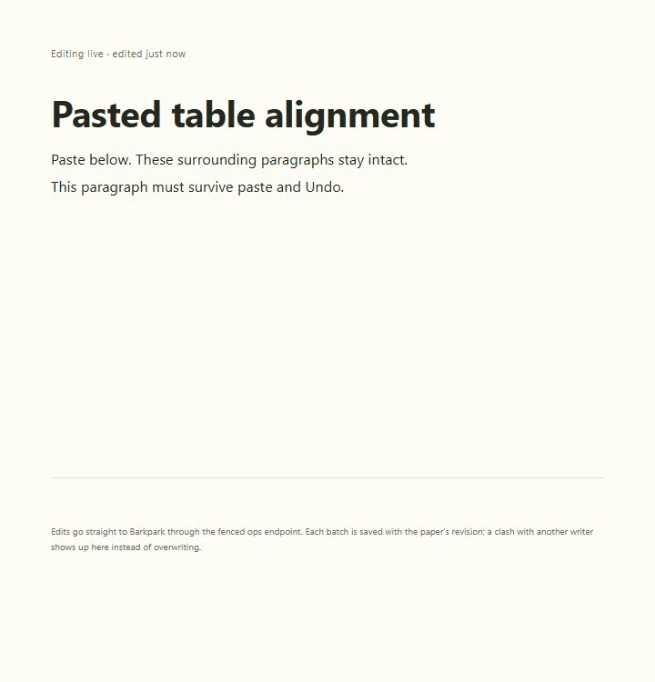

# Markdown table paste

Pasting a GFM table preserves center and right column alignment in header and body cells. Inline marks, links and literal pipes remain intact. Native Undo and redo, a later human edit and reload agree with the real server.

[Real Paper evidence](runs/2026-09-22T01-30-15-608Z/README.md) · [Before-fix Chromium data](before-fix/01df-result.json) · [Matching Chromium comparison](comparison/9803/comparison.json) · [Handoff](../../cycles/E006-markdown-paste.md).

## Changelog

- 2026-09-22: E006 uses upstream `9803bbe5e` and Barkdown harness `c22c0d3`. Real paste/history/human-edit/reload checks passed. Six stills and recorded motion reviewed; narrow cells remain readable. Default upstream pin and merge gates are unchanged. The earlier JSDOM conflict baseline was investigated but not changed or claimed as a product data-loss fix.
