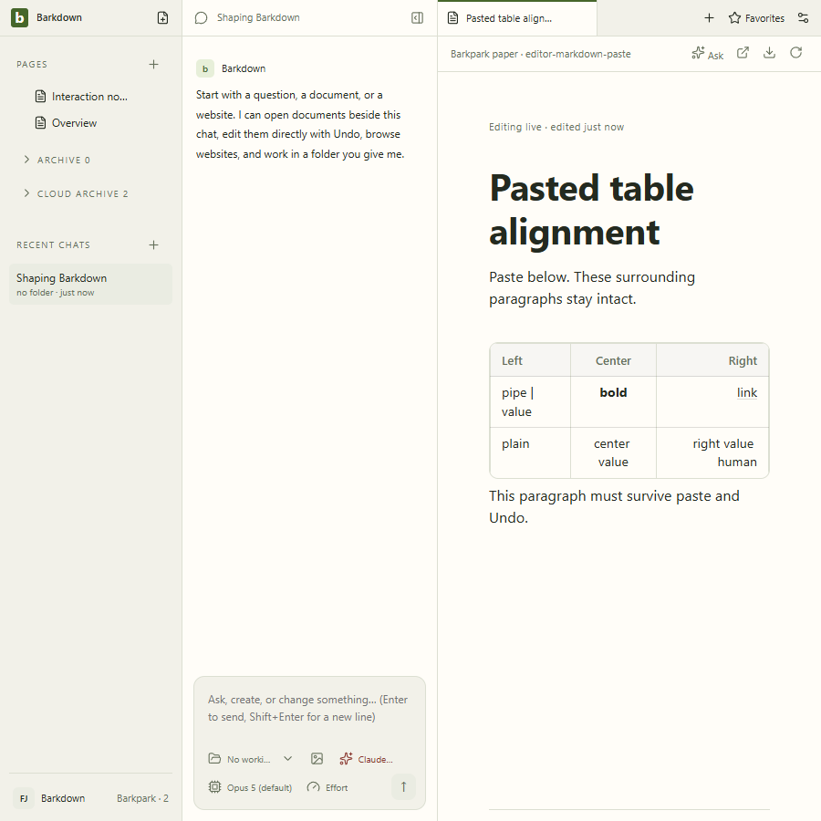

# Aligned paste through real Paper

Clean Barkdown source `c22c0d3`, upstream `9803bbe5e`. Runtime `gbbizV` stopped normally, including its database. The server revisions advance from 1 through paste 2, Undo 3, redo 4 and human edit 5; reload matches the exact saved blocks. No model turn in this dedicated test.

[Continuous 26.96-second video](markdown-paste.webm) · [Server result](server.json) · [Manifest](manifest.json) · [Visual review](review.json).

The GIF is seconds 6–19 at 5 fps, cropped to the editor. All 65 decoded frames were inspected, alongside all six stills and 56 full-video samples at 2 fps. Expected insertion/removal and history-footer changes are visible. The full video retains loading and viewport resize.
