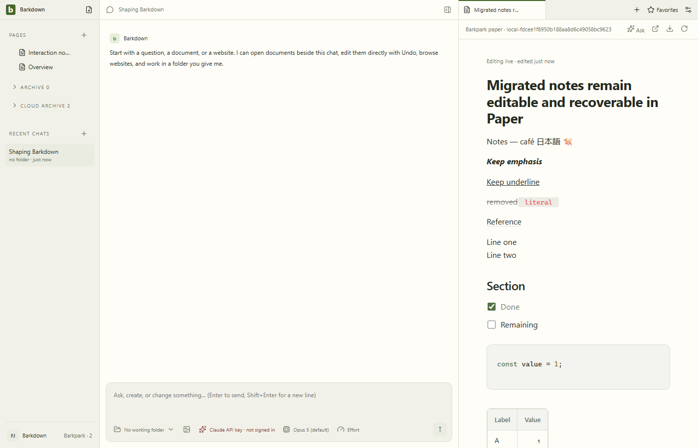
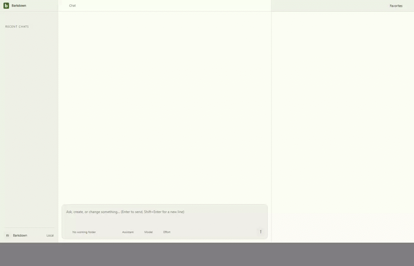

# Migrated Paper: ten cases verified

Source `2f4a1dc` / private Barkpark `dc97bef1b`. [Manifest](runs/2026-09-23T22-35-37-547Z/manifest.json) records the served editor hash, ten native typing/save/Undo pairs, native Shift+Enter and Undo, reload and Electron restart. Source, backup and workspace bytes remain unchanged. The rehearsal checks the served bundle against the selected source artifact.

The GIF derives from the full [Electron recording](runs/2026-09-23T22-35-37-547Z/editing-and-undo.webm) at 2 fps, 840×540, without masking or cropping. [Restart recording](runs/2026-09-23T22-35-37-547Z/restart.webm), [narrow view](runs/2026-09-23T22-35-37-547Z/04-narrow.png), [native inserted break](runs/2026-09-23T22-35-37-547Z/native-break-inserted.png). [Named review](runs/2026-09-23T22-35-37-547Z/motion-review.json) covers 16 stills, 55 video samples, all 55 decoded GIF frames and eight restart samples.

## Retained failures and limits

The [original native-input trace](runs/2026-09-23T21-20-49-208Z/failure-state.json) showed newline text becoming a rejected ProseMirror hardBreak. Upstream now serializes it as LF text, retaining original carriers on Undo. Inline CR carriers remain refused.

The [first corrected-source rehearsal](runs/2026-09-23T22-29-49-100Z/manifest.json) still served stale compiled assets and failed; it is not passing evidence. Refreshing this private worktree's built editor artifact produced the [first ten-case pass](runs/2026-09-23T22-32-55-161Z/manifest.json). The current run adds the hash tripwire and native Shift+Enter proof. Earlier code-language, title-clipping and nine-case runs remain immutable history.

No media/internal-reference migration, navigation authority switch, legacy-history conversion, real-library migration or power-loss durability is established. [C046](../../cycles/C046-migrated-paper.md) tracks remaining closeout; [migration contract](../../migration/README.md) owns wider P2 gates.
