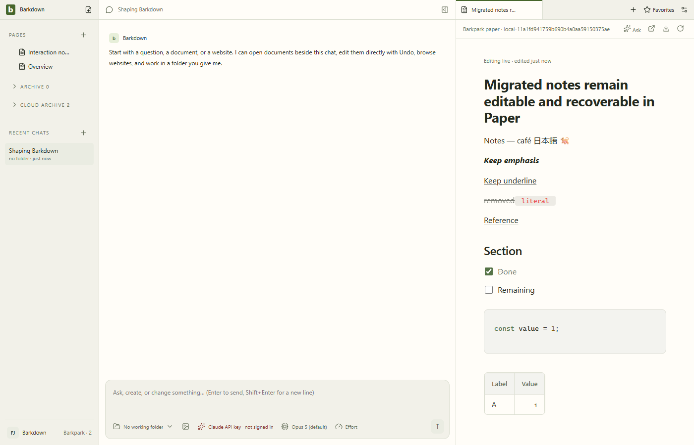
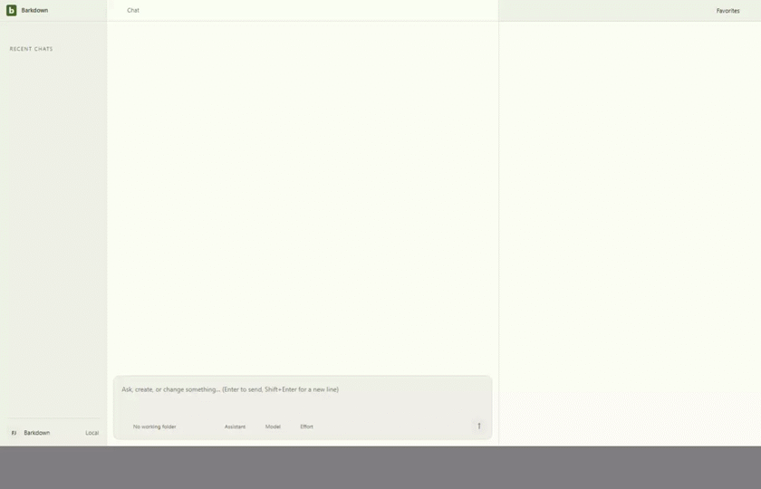

# Migrated Paper: nine cases verified, cutover blocked

Source `fe8696c` / private Barkpark `844ecd321`. [Manifest](runs/2026-09-23T21-26-20-905Z/manifest.json) binds the actual server bundle, screenshots, two Electron videos and nine native edit/Undo revision pairs. [Geometry](runs/2026-09-23T21-26-20-905Z/geometry.json) verifies the wrapped title and narrow page. Source documents, backups and workspace bytes remained unchanged after save, reload and Electron restart. No provider turn or navigation activation was simulated or claimed.

The GIF is a 2 fps, 840×540 derivative of the full [Electron recording](runs/2026-09-23T21-26-20-905Z/editing-and-undo.webm). [Restart video](runs/2026-09-23T21-26-20-905Z/restart.webm). [Narrow view](runs/2026-09-23T21-26-20-905Z/04-narrow.png). Detailed frame review and derivative hashes accompany the final evidence checkpoint.

## What failed and remains blocked

The original ten-case acceptance is not complete. Native typing beside a literal newline makes Chromium emit a PM hardBreak; Paper's serializer safety guard refuses that node. The following valid transaction can dismiss the notice. [Exact native input/filter trace](runs/2026-09-23T21-20-49-208Z/failure-state.json) and [failed view](runs/2026-09-23T21-20-49-208Z/failure.png) retain the diagnosis. Preflight now refuses both hardBreak nodes and literal inline CR/LF, retaining exact source/backup. Code-block newlines remain supported. Do not remove the upstream guard without serializer and native-input proof.

Earlier immutable runs retain the code-language mismatch (20:54), five successful text pairs followed by the newline failure (20:57, 21:07, 21:11), and first-case input traces (21:14, 21:19, 21:20). The 21:23 run first proved all nine permitted cases but exposed title clipping; 21:26 fixes that presentation and repeats all nine. Every run records its own source; failed runs are not promoted to passing evidence.

No media/internal-reference migration, authority switch, legacy-history conversion, real-library migration or power-loss durability is established. See [C046](../../cycles/C046-migrated-paper.md) for the active gate and [migration contract](../../migration/README.md) for the wider P2 boundary.
