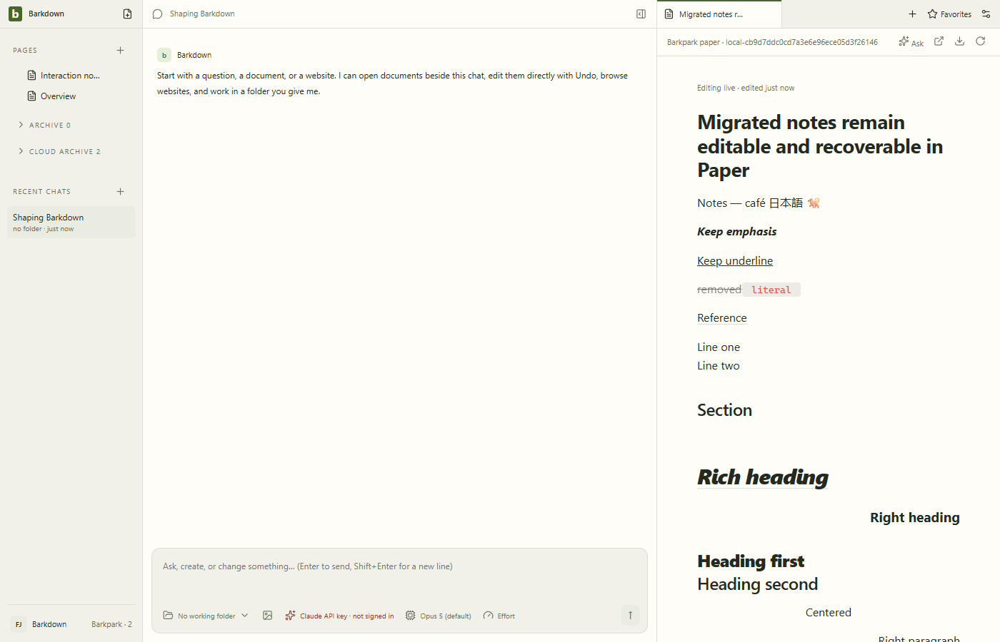
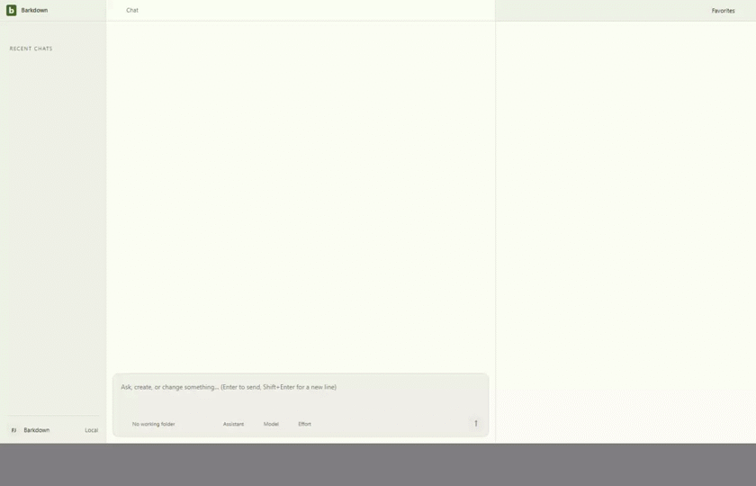
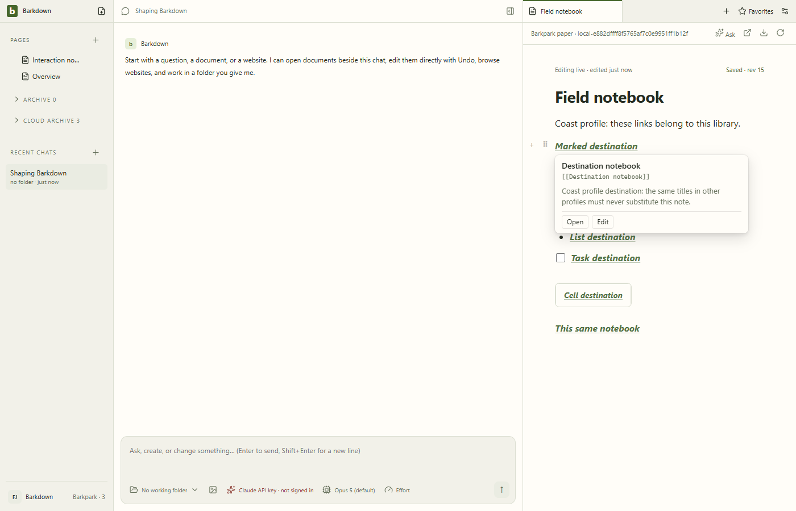
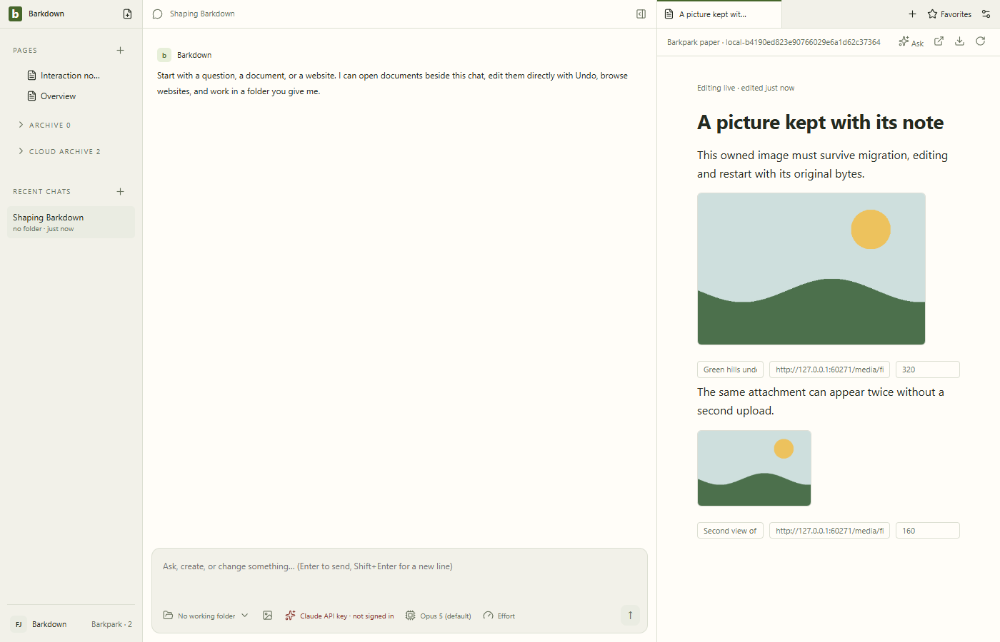
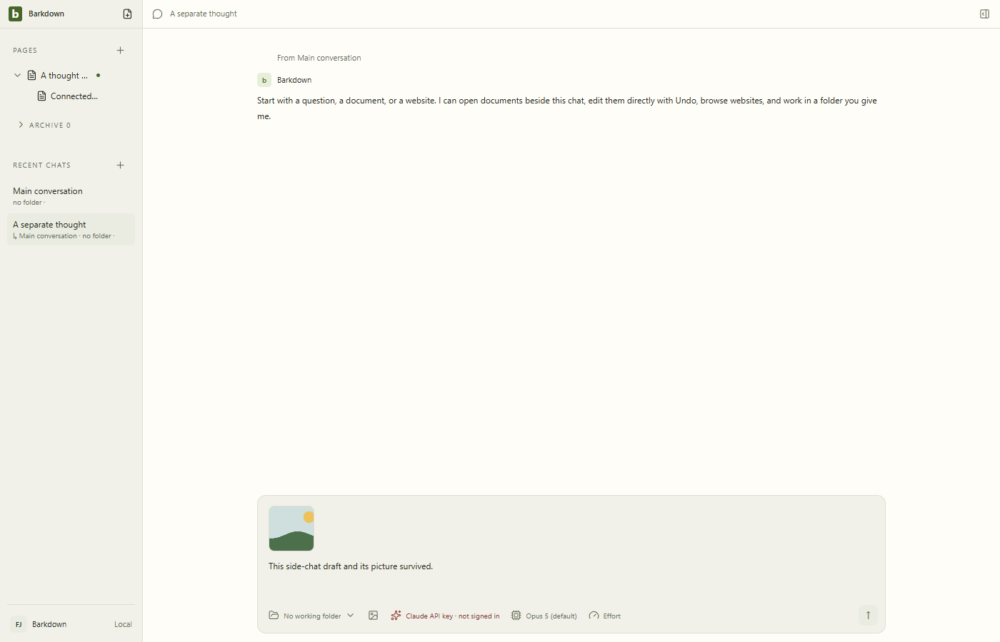
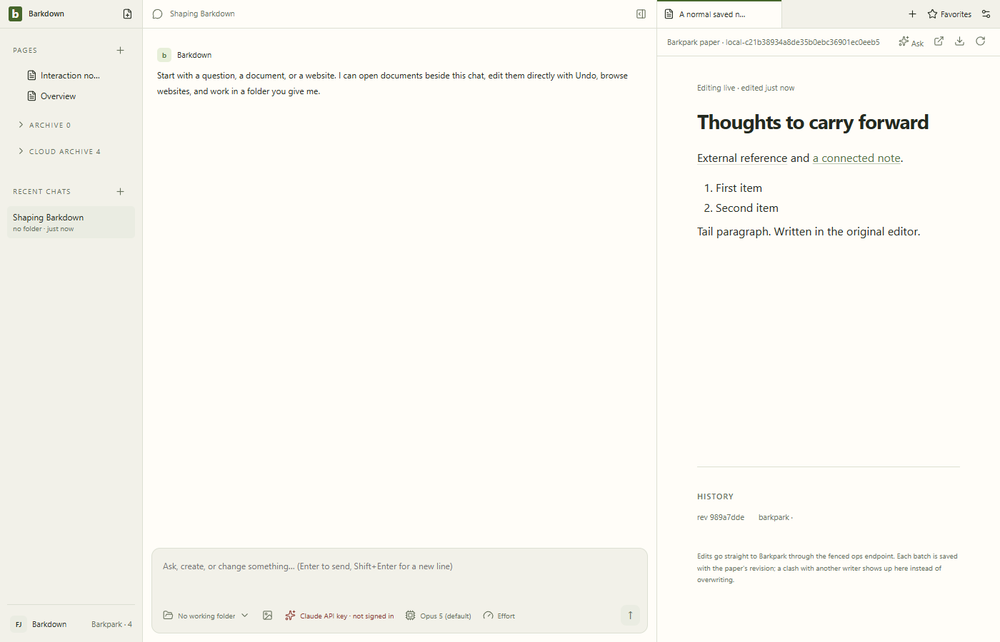
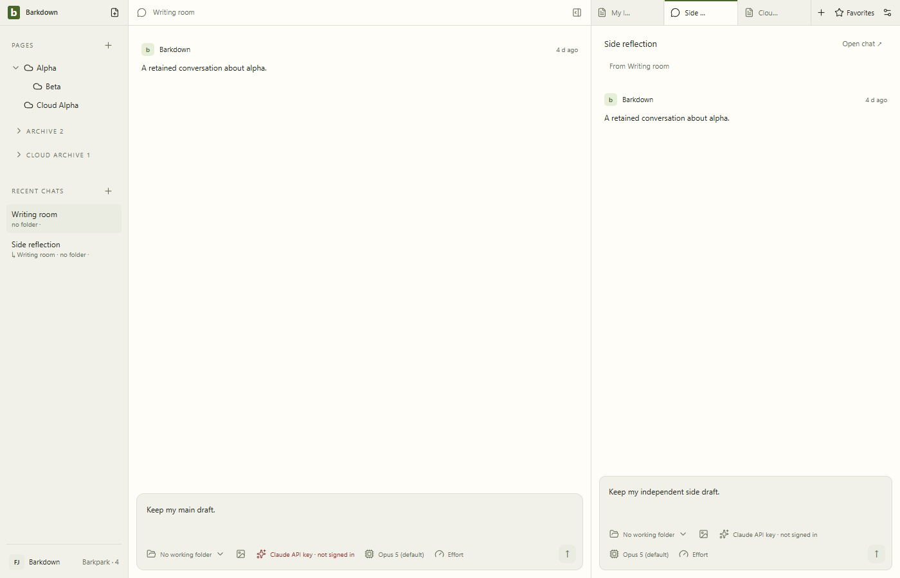
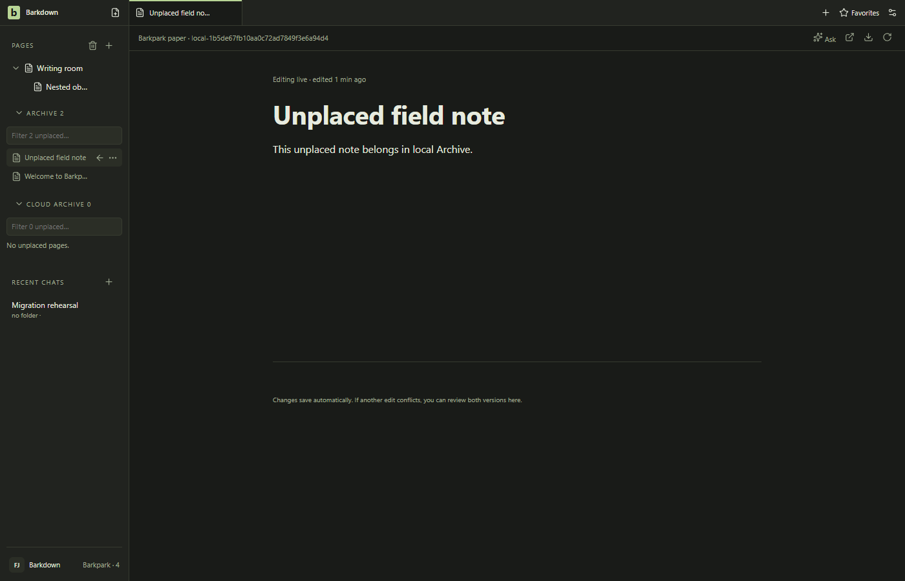
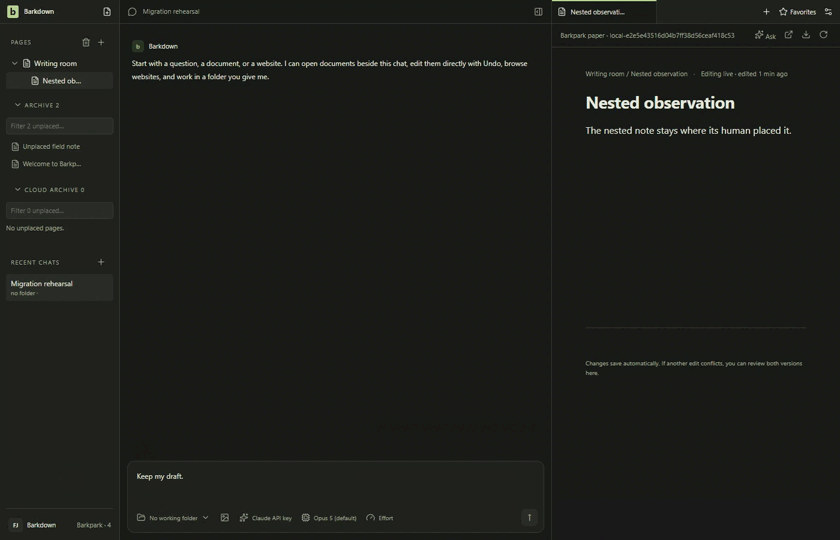

# Migrated Paper: content, references and owned images

Source `d92898f` / private Barkpark `30c007e43`. [Manifest](runs/2026-09-24T00-08-01-504Z/manifest.json) records the served editor hash, 21 native typing/save/Undo pairs and a deep nested child edit, native paragraph, marked-heading and list Shift+Enter and Undo, reload and Electron restart. Source, backup and workspace bytes remain unchanged. The rehearsal checks the served bundle against the selected source artifact.

The GIF derives from the full [Electron recording](runs/2026-09-24T00-08-01-504Z/editing-and-undo.webm) at 2 fps, 840×540, without masking or cropping. [Restart recording](runs/2026-09-24T00-08-01-504Z/restart.webm), [narrow view](runs/2026-09-24T00-08-01-504Z/04-narrow.png), [native inserted break](runs/2026-09-24T00-08-01-504Z/native-break-inserted.png). [Named review](runs/2026-09-24T00-08-01-504Z/motion-review.json) covers 31 stills, 96 video samples, all 96 decoded GIF frames and eight restart samples.

## Retained failures and limits

The [original native-input trace](runs/2026-09-23T21-20-49-208Z/failure-state.json) showed newline text becoming a rejected ProseMirror hardBreak. Upstream now serializes it as LF text, retaining original carriers on Undo. Inline CR carriers remain refused.

The [first corrected-source rehearsal](runs/2026-09-23T22-29-49-100Z/manifest.json) still served stale compiled assets and failed; it is not passing evidence. Refreshing this private worktree's built editor artifact produced the [first ten-case pass](runs/2026-09-23T22-32-55-161Z/manifest.json). The C046 ten-case checkpoint added the hash tripwire and native Shift+Enter proof. C047 adds heading formatting/alignment, literal marked LF and marked-heading line insertion. Earlier code-language, title-clipping and nine-case runs remain immutable history.

The content/reference checkpoints do not establish media migration, navigation authority switch, legacy-history conversion, real-library migration or power-loss durability. The C050 image proof below extends only the bounded media scope; [migration contract](../../migration/README.md) owns wider P2 gates.

C047 retained assertion failures: [literal LF segmentation](runs/2026-09-23T23-07-55-168Z/manifest.json) and [new heading-break marks](runs/2026-09-23T23-14-15-739Z/manifest.json). Both preserved existing text/marks; expectations now reflect native carrier splitting and unmarked new breaks while retaining exact saved Undo requirements. [First sixteen-case pass](runs/2026-09-23T23-10-28-832Z/manifest.json) precedes the final rendered-style and marked-heading Shift+Enter checks.

C048 adds genuine rich quotes, recursive mixed list markers and checked state. [Full list break](runs/2026-09-24T00-08-01-504Z/native-list-break-inserted.png) and [narrow nesting](runs/2026-09-24T00-08-01-504Z/04-narrow-nested-lists.png) close the first pass’s viewport coverage gap. Retained failures: [task-list boundary omission](runs/2026-09-23T23-44-05-666Z/manifest.json) and [multiline DOM locator](runs/2026-09-23T23-52-41-023Z/manifest.json). The [first 21-case pass](runs/2026-09-23T23-55-19-987Z/motion-review.json) remains valid behavioral evidence with its stated visual limits.

## Internal references — C049

Source `1e57023` / private Barkpark `30c007e43`. Two isolated profiles preserve seven marked links across six carriers, cyclic and self navigation, actual backlinks and interrupted staging without touching source/backup/workspace. [Orchard manifest](runs/2026-09-24T00-52-48-801Z/manifest.json), [Coast manifest](runs/2026-09-24T00-54-54-614Z/manifest.json), [paired identity proof](../../cycles/evidence/C049/paired-profiles.json).

The unmasked full-frame GIF is derived at 2 fps and 840×540 from [the native Electron recording](runs/2026-09-24T00-54-54-614Z/links-editing-navigation.webm). Named reviews cover all 19 stills per profile, [51 Orchard video/GIF samples](runs/2026-09-24T00-52-48-801Z/motion-review.json), [52 Coast video/GIF samples](runs/2026-09-24T00-54-54-614Z/motion-review.json), and ten restart samples each. [Narrow view](runs/2026-09-24T00-54-54-614Z/03-narrow.png) retains content and reachable controls. Two-fps sampling is not every raw video frame; dedicated hover stills retain brief preview states. These are disposable native editor rehearsals, with no model turn or real-library activation.

## Owned PNG images — C050

Source `bc1dc82` / private Barkpark `30c007e43`. [Native manifest](runs/2026-09-24T01-32-14-944Z/manifest.json) and [recovery assertions](runs/2026-09-24T01-32-14-944Z/recovery.json) prove an actual child exit after upload, exact scoped reconciliation and one uploaded object shared by two references. Alt/width/deletion save and exact native Undo, reload and restart preserve source/backup/workspace bytes.

[Full Electron recording](runs/2026-09-24T01-32-14-944Z/images-editing-and-undo.webm), [restart recording](runs/2026-09-24T01-32-14-944Z/restart-or-failure.webm), [narrow view](runs/2026-09-24T01-32-14-944Z/07-narrow.png). The [named review](runs/2026-09-24T01-32-14-944Z/motion-review.json) covers ten stills, all35 raw2fps samples, all35 decoded GIF frames and eight restart samples. Full-frame conversion uses840×540 with no masking/cropping. Narrow image ALT/URL fields expose only part of their text; controls remain reachable, but this is not a polished narrow configuration claim.

Scope: owned top-level eight-bit non-interlaced grayscale/RGB PNG with optional alpha, alt and width. Explicit height, captions, animated/paletted/interlaced PNG, other formats and external downloads refuse. [First deletion-test failure](runs/2026-09-24T01-23-25-081Z/manifest.json) retained original content: the harness now uses the existing accessible figure focus + Enter selection before Backspace. [First pass](runs/2026-09-24T01-29-38-039Z/manifest.json) predates final post-Paper media revalidation. These are disposable offline adapter rehearsals, not real-library activation, general media portability or power-loss proof.

## Retained backup restoration

C051 source `02e938b` restores a closed disposable legacy profile at its original path after a mid-file child exit, then opens the real app. The [manifest](runs/2026-09-24T02-09-49-913Z/manifest.json) records exact backup/source preservation, unchanged staged Paper and native revisions3/4/5. Side-chat parent/draft/image, nested Pages, favorite, pending proposal, backlinks and readable history survive; a repeat after human changes refuses.

[Raw recording](runs/2026-09-24T02-09-49-913Z/restored-profile-editing.webm), [restart](runs/2026-09-24T02-09-49-913Z/restored-profile-restarted.webm), [narrow](runs/2026-09-24T02-09-49-913Z/06-narrow.png), [named review](runs/2026-09-24T02-09-49-913Z/motion-review.json). All7stills,15raw samples,15decoded GIF frames and7restart samples were inspected. Existing narrow legacy title clipping/provider truncation remains; this is recovery proof, not editor polish. Credentials/settings/runtime are excluded. No live restore UI, authority switch, later Paper edit rollback, power-loss or portability claim.

Retained first attempts: [unsupported Markdown link target](runs/2026-09-24T02-04-23-049Z/manifest.json) stopped before Paper writes; [missing fixture initialization flag](runs/2026-09-24T02-05-54-275Z/manifest.json) and [transient revision-label wait](runs/2026-09-24T02-07-34-164Z/manifest.json) were harness corrections. Their failure stills were inspected; the original parser/native link-attribute compatibility gap remains a separate migration gate.

## C052 native source compatibility

Actual legacy editor save → strict staging → Paper link/list/parser edits, exact saved Undo, internal reference preview/navigation and restart pass at aa1f1c4/private30c007. Closed source and backup bytes remain exact; no workspace activation. [Manifest](runs/2026-09-24T02-41-48-208Z/manifest.json), [actual motion review](runs/2026-09-24T02-41-48-208Z/motion-review.json). Full desktop/root and standard live/fixture closeout pass; [C052 results](../../cycles/evidence/C052/results.json).

## Human organization preview — C053

Source `af9d982` / private Barkpark `30c007e43` loads an offline projected copy into a separate disposable app. Nested Pages, local/cloud identity, side-chat parent/drafts/paths, direct navigation, favorites and clean restart pass; all original source/backup bytes and staged Paper objects remain unchanged. [Manifest](runs/2026-09-24T03-20-50-258Z/manifest.json).

[Review](runs/2026-09-24T03-20-50-258Z/motion-review.json) covers ten stills,30 native video samples,30 decoded GIF frames and eight restart samples. GIF is full-frame2fps at840×540; [raw recording](runs/2026-09-24T03-20-50-258Z/projected-navigation.webm) retains intermediate loading. [Narrow view](runs/2026-09-24T03-20-50-258Z/09-narrow.png). Target legacy boot seeds two unrelated archive fixtures; this is not source activation.

Retained failures: [wrong fixture directory](runs/2026-09-24T03-07-44-303Z/manifest.json), [object-key-order comparison](runs/2026-09-24T03-10-20-986Z/manifest.json), and [real stale-editor favorite navigation](runs/2026-09-24T03-16-54-898Z/manifest.json). The latter updated the tab path without navigating its mounted editor; corrected through the existing unsaved-work guard, with source-qualified reuse. Unplaced local archives, ambiguous closed targets and malformed navigation explicitly refuse. Original history/receipts remain opaque legacy evidence; no migration authority changes.

## Owned navigation preview (C080)

Source058554fd on private b70214090 preserves nested Pages, local Archive, owned paths/favorites and restart. A foreign-library favorite refuses even with a matching current slug. Source and backup remain byte-identical. [Result](runs/2026-09-25T22-25-10-582Z/result.json), [named image/motion review](runs/2026-09-25T22-25-10-582Z/review.json), [delivery status](../../cycles/C080-owned-navigation.md).

Dark native journey on disposable data. The GIF shows seconds3.5–8.5 of the [navigation recording](runs/2026-09-25T22-25-10-582Z/navigation.webm), at5 fps/840×540 without cropping;25 decoded frames inspected. [Restart recording](runs/2026-09-25T22-25-10-582Z/final.webm), [setup recording](runs/2026-09-25T22-25-10-582Z/setup.webm). Six stills and206 full-recording samples (137 distinct rasters, exact duplicates collapsed) were reviewed. Raw startup retains the unchanged initial light shell and transient loading title. Gray padding after viewport resize is outside the app.

This is a preview copy, not authority activation or rollback proof. The earlier development failures are retained in the cycle evidence.
