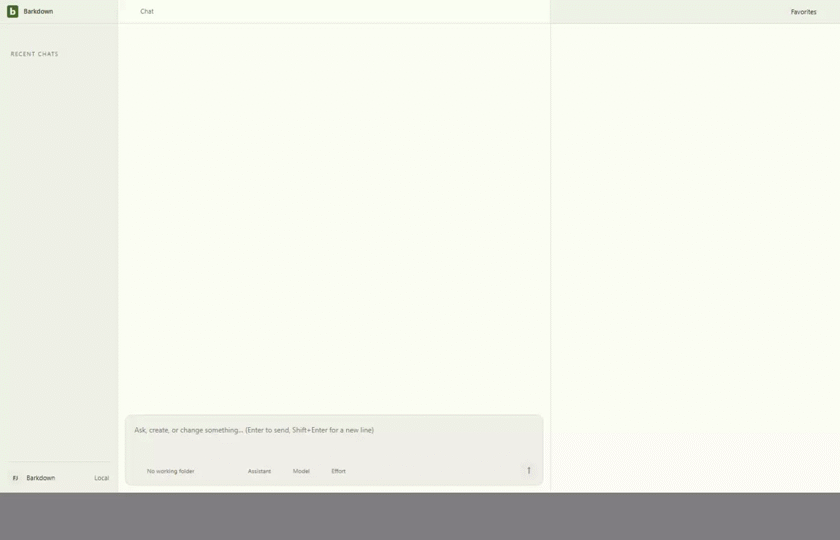

# Migrated Paper: sixteen cases verified

Source `2aee376` / private Barkpark `8d48ae661`. [Manifest](runs/2026-09-23T23-16-54-605Z/manifest.json) records the served editor hash, sixteen native typing/save/Undo pairs, native paragraph and marked-heading Shift+Enter and Undo, reload and Electron restart. Source, backup and workspace bytes remain unchanged. The rehearsal checks the served bundle against the selected source artifact.

The GIF derives from the full [Electron recording](runs/2026-09-23T23-16-54-605Z/editing-and-undo.webm) at 2 fps, 840×540, without masking or cropping. [Restart recording](runs/2026-09-23T23-16-54-605Z/restart.webm), [narrow view](runs/2026-09-23T23-16-54-605Z/04-narrow.png), [native inserted break](runs/2026-09-23T23-16-54-605Z/native-break-inserted.png). [Named review](runs/2026-09-23T23-16-54-605Z/motion-review.json) covers 23 stills, 77 video samples, all 77 decoded GIF frames and eight restart samples.

## Retained failures and limits

The [original native-input trace](runs/2026-09-23T21-20-49-208Z/failure-state.json) showed newline text becoming a rejected ProseMirror hardBreak. Upstream now serializes it as LF text, retaining original carriers on Undo. Inline CR carriers remain refused.

The [first corrected-source rehearsal](runs/2026-09-23T22-29-49-100Z/manifest.json) still served stale compiled assets and failed; it is not passing evidence. Refreshing this private worktree's built editor artifact produced the [first ten-case pass](runs/2026-09-23T22-32-55-161Z/manifest.json). The C046 ten-case checkpoint added the hash tripwire and native Shift+Enter proof. C047 adds heading formatting/alignment, literal marked LF and marked-heading line insertion. Earlier code-language, title-clipping and nine-case runs remain immutable history.

No media/internal-reference migration, navigation authority switch, legacy-history conversion, real-library migration or power-loss durability is established. [C047](../../cycles/C047-heading-alignment.md) tracks current closeout; [migration contract](../../migration/README.md) owns wider P2 gates.

C047 retained assertion failures: [literal LF segmentation](runs/2026-09-23T23-07-55-168Z/manifest.json) and [new heading-break marks](runs/2026-09-23T23-14-15-739Z/manifest.json). Both preserved existing text/marks; expectations now reflect native carrier splitting and unmarked new breaks while retaining exact saved Undo requirements. [First sixteen-case pass](runs/2026-09-23T23-10-28-832Z/manifest.json) precedes the final rendered-style and marked-heading Shift+Enter checks.
