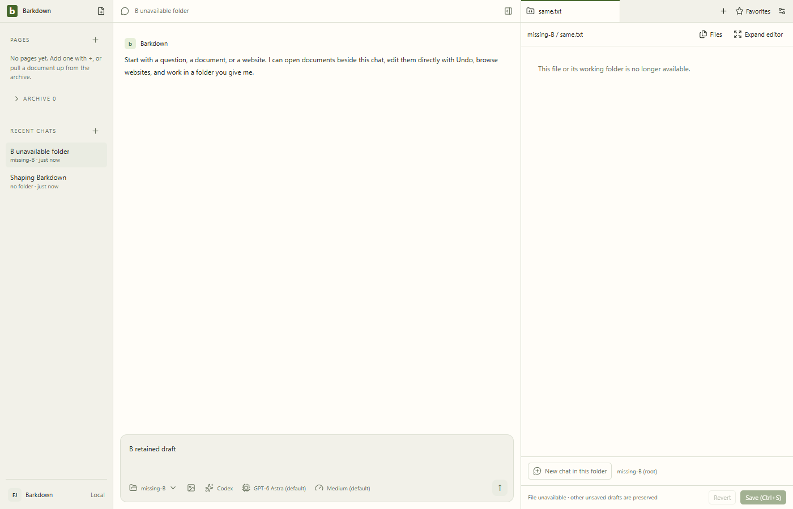
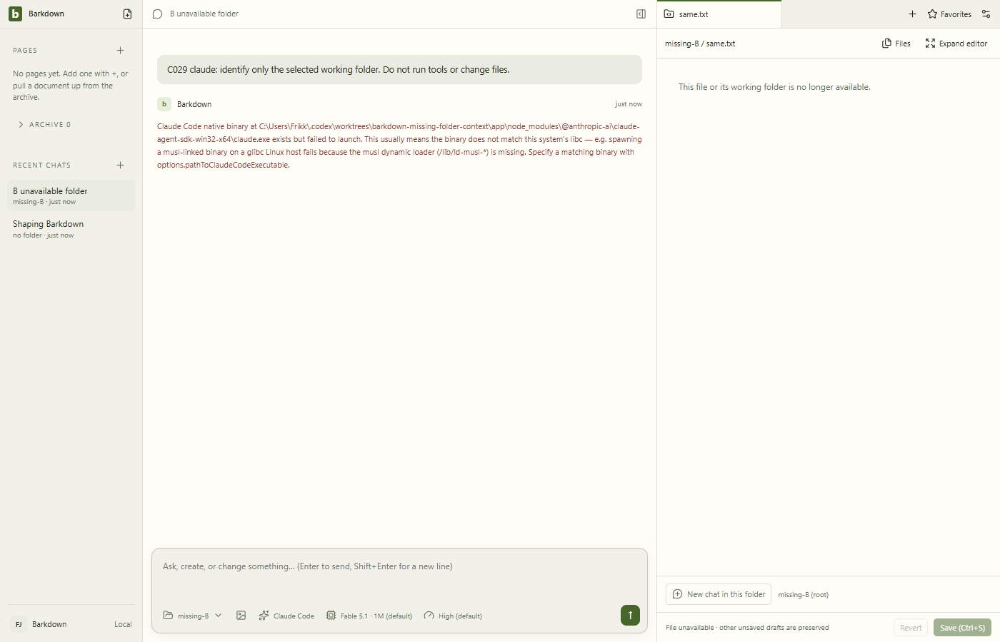
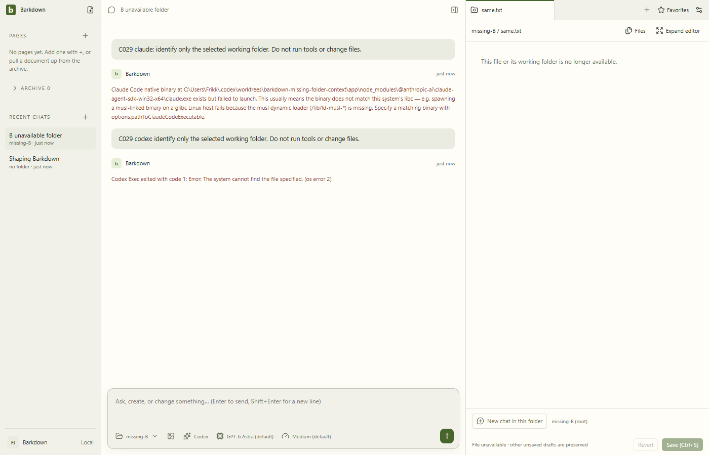

# Missing selected folder: actual native evidence

Source69acbce. Windows disposable GGgmox. No production changes or Paper runtime. Process restart retained selected B chat, missing folder and draft. Opening same.txt showed explicit unavailability rather than A content. Both native CLI dispatches failed; original user text stayed readable, exact missing folder remained captured, and both native Jobs stopped with zero active processes. This does not prove a model answered location correctly.

Claude SDK’s libc/binary-launch diagnostic is misleading on Windows; Codex reports missing-file OS error2. Raw report and original errors retained. Real Windows ACL denial remains untested; controlled API EACCES coverage is separate. [Manifest](manifest.json) and [explicit review](review.json) retain source/hashes.

Full combined desktop/deterministic/status/root gates remain pending. No baseline restamp or implicit visual approval.

Integration import found a manifest-only Git newline normalization. The [original captured CRLF manifest](manifest.captured-crlf.json) matches the original review hash; the original Git LF manifest and review remain unchanged. The [explicit addendum](review-addendum.json) records exact reversible bytes and unchanged JSON content. All six inspected artifact hashes match; no image mismatch or new visual approval is claimed.
