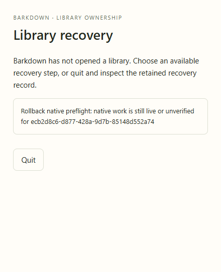
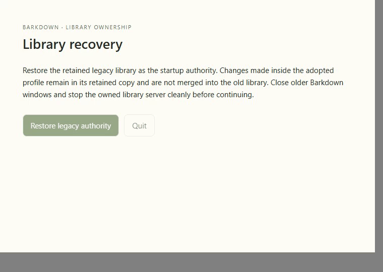
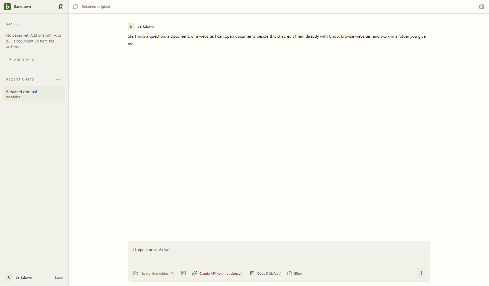

# Native work blocks authority rollback

C021 source f3e92a1 (product cb2a3ef) was tested in actual Electron with a live owned Windows process tree. Rollback refused before changing the active journal. After verified shutdown, a new explicit attempt restored the original workspace and preserved the retained profile. [Cycle](../../cycles/C021-rollback-native-preflight.md) · [Original manifest](../adoption/native-rollback-f3e92a1/manifest.json) · [Hash-bound review](../adoption/native-rollback-f3e92a1/review.json).

The reviewer inspected three full stills and25 video samples. Original source bytes were checked before the legacy writer booted; backup bytes and every original workspace value were also checked. All owned processes stopped. Root independently inspected the three final stills and verified all37 artifact hashes on import.

## Limits and changelog

2026-09-22: original evidence21429c6 imported into the new integration candidate. Windows-only native proof; no provider or Barkpark in this specific journey. Unknown or incomplete native evidence stays refused. Malformed legacy Pages recovery remains a separate gap. The live Paper regression is [separate evidence](../../images/status/history/C021-f3e92a1.json). Combined approval must be recaptured for the new source; this gallery does not transfer lane approval.
