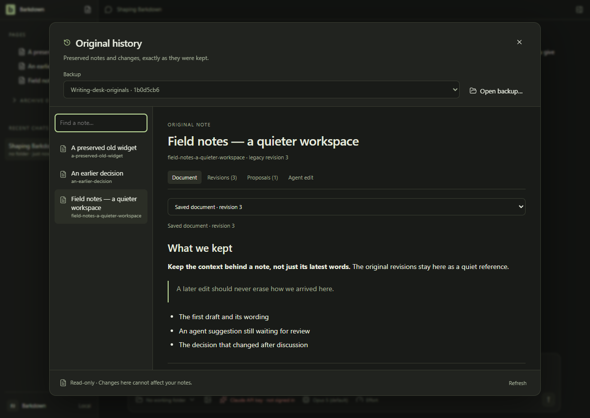
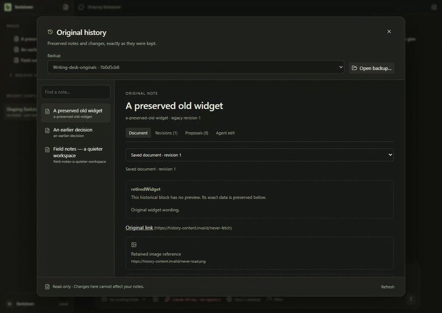

# Original history

Settings → Original history reads an existing migration backup owned by the current profile. Saved notes, retained revisions, pending proposals and stale/undone agent receipts stay inspectable after restart. No restore, accept, Undo or Paper write action is available. Historical links/images remain inert; unsupported data has an exact JSON view. Previously pruned history cannot be reconstructed.

Actual Electron/main IPC and verified disposable backups; only the OS folder-picker result is supplied. The GIF excerpts the first recording at half speed. [Narrow view](runs/2026-09-25T10-25-30-744Z/08-narrow.png), [manifest](runs/2026-09-25T10-25-30-744Z/manifest.json), [named review and encoding](runs/2026-09-25T10-25-30-744Z/review.json), [full first recording](runs/2026-09-25T10-25-30-744Z/page@f2f5ee79b710509b736a58d6d6d05c5a.webm) and [restart/ownership recording](runs/2026-09-25T10-25-30-744Z/page@58544627027246fa287fa65c235508d8.webm). Source a126c7185bda77822ca7e03b79f766028549ac90; Windows. No model or server call is needed. Raw motion and review contact sheets are retained in the run.

## Changelog

- 25 September, C074: profile/hash-bound registration, inert original previews, search, keyboard focus, restart and foreign/tampered/missing-backup refusal. Source documents, receipts and backups remain byte-identical. [Cycle](../../cycles/C074-original-history.md). The first visual candidate was rejected for overlapping capture calls; its raw evidence remains in its run. This does not activate migration or retire legacy editing.
