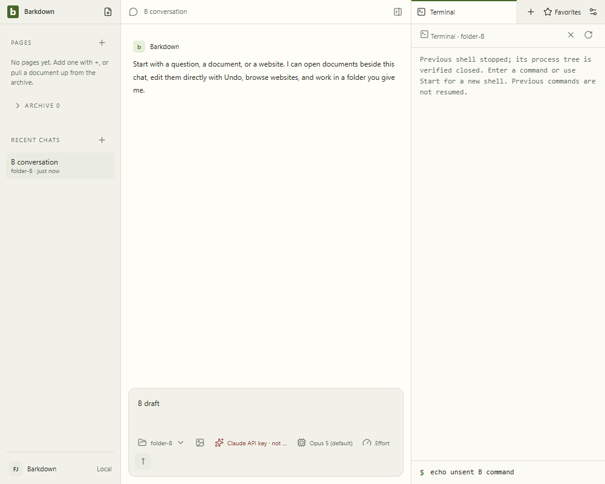

# Packaged Electron38 native ownership

Source89a0fd2, exact Electron38.8.6, real packaged Barkdown.exe. No dependency upgrade was consumed. [Manifest](89a0fd2/manifest.json), [package hashes](89a0fd2/package-provenance.json), [review](89a0fd2/review.json), [cycle](../../cycles/C035-packaging38.md).

Seven full-size stills and30frames sampled at2fps from all three original videos inspected. [Motion map](89a0fd2/video-map.json) links original videos and samples. Source-bound captures prove terminal profile switch/forced main death/restart/no replay and current draft preservation; all4nativeJobs verify stopped. They do not establish clean-machine install, bundled Barkpark or final combined acceptance.
