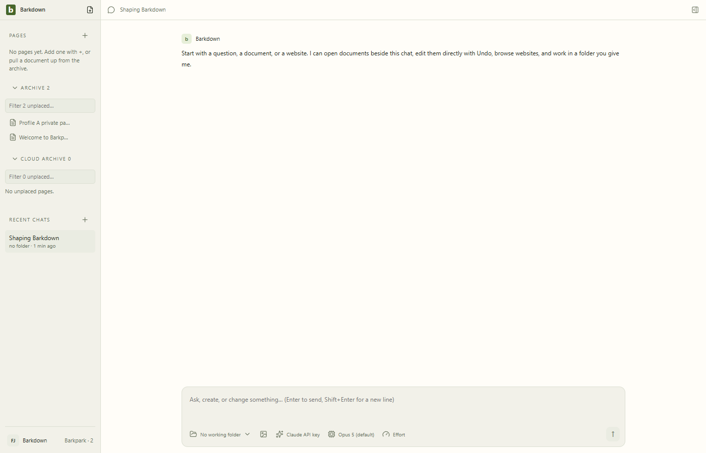
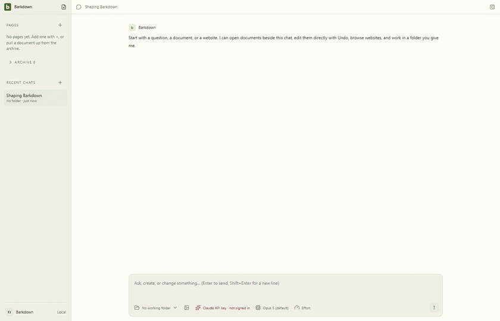

# Paper Archive ownership

Managed profile-owned Papers appear in Archive. Connected libraries remain in Cloud archive, including manually configured localhost servers. Discovery preserves human Pages, nesting, labels and drafts.

C060 source `7e15949`, private Barkpark `30c007e43`. Two actual managed profiles with same-slug papers, restart, a manual loopback recorder and real HTTP503/Retry passed. All eight stills,333 decoded full recording GIF frames and29 excerpt frames were inspected; dark/narrow/failure views were also inspected at full size. [Manifest](runs/2026-09-24T09-25-42-927Z/manifest.json), [review](runs/2026-09-24T09-25-42-927Z/review.json), [full recording GIF](runs/2026-09-24T09-25-42-927Z/derived/journey.gif), [excerpt provenance](runs/2026-09-24T09-25-42-927Z/derived/derivation.json).

Excerpts omit long startup waits and use2fps; brief transitions remain in the original videos. Settings GIF palette banding is retained. Synthetic published Papers do not prove ordinary empty-note creation, migration activation or physical database identity. Legacy unmanaged local mode remains cloud until separately proven.

## Changelog

- 2026-09-24: trusted managed-runtime origin replaces slug/URL assumptions. Human placement survives refresh, profile change and restart; connected catalog failure retains known rows. Four failed fixture attempts are retained in run folders and [cycle evidence](../../cycles/evidence/C060/); they are not accepted motion proof.
