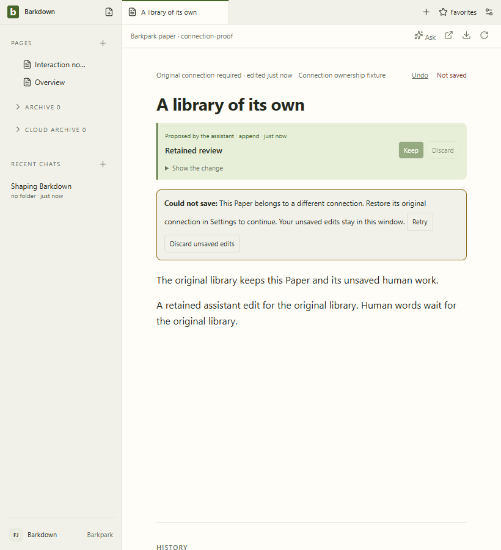
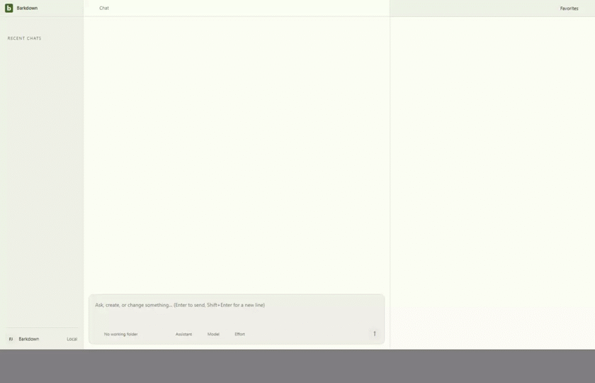

# Reviewed Paper connection recovery

Source `0e4b891`, isolated Barkpark `30c007e43`. [Capture manifest](manifest.json), [actual review](review.json), [derived provenance](derived/manifest.json). All11 original artifact hashes verified;9 stills and47 decoded GIF frames inspected.

The recording uses actual isolated Paper storage and a non-persisting foreign recorder. Thirteen old-binding operations sent zero foreign requests; original content, proposal and receipt were unchanged. Restoring the original connection permits Retry and guarded Undo; explicit CLI native editing and restart also pass. The2fps derivative may omit brief failure/narrow states; the still above and original WebM retain that evidence. Binding is in-session; durable receipt/tab identity and migration authority remain separate work.
