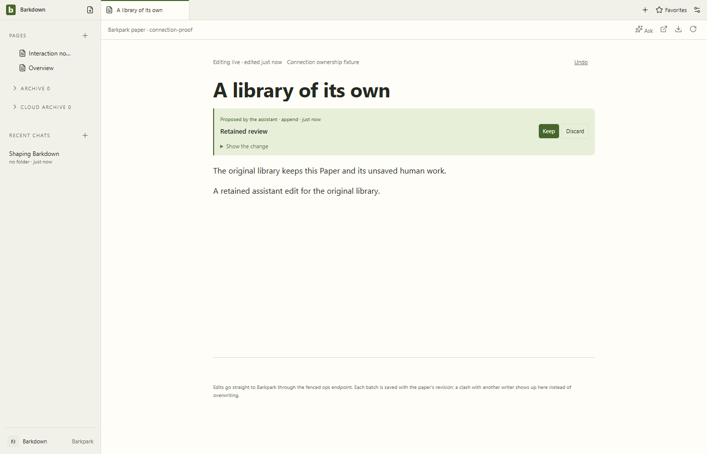
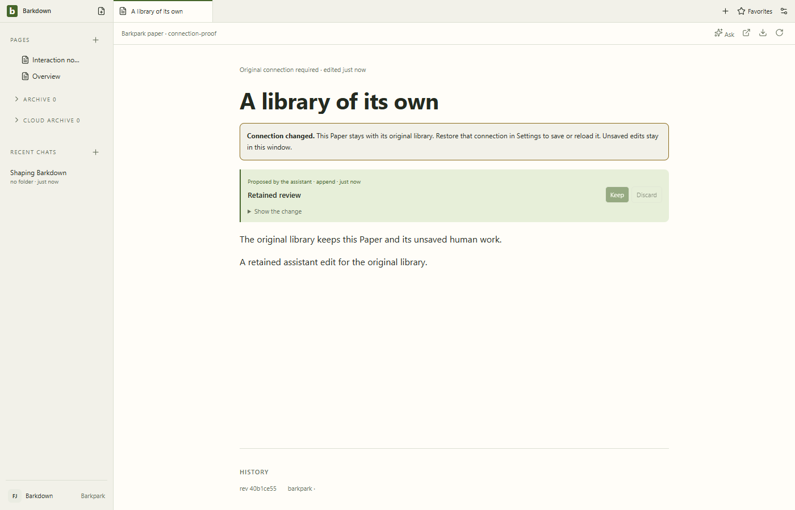
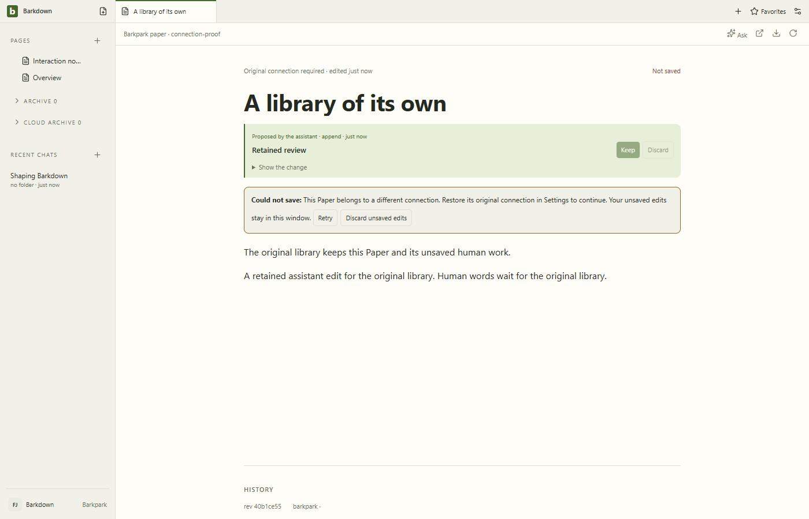
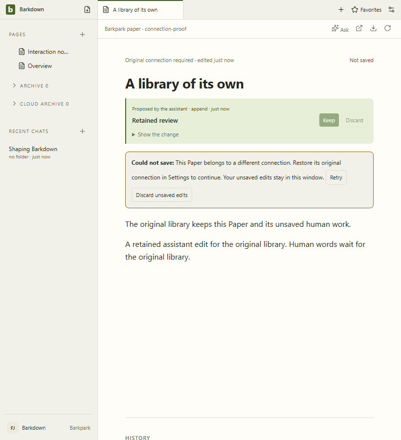
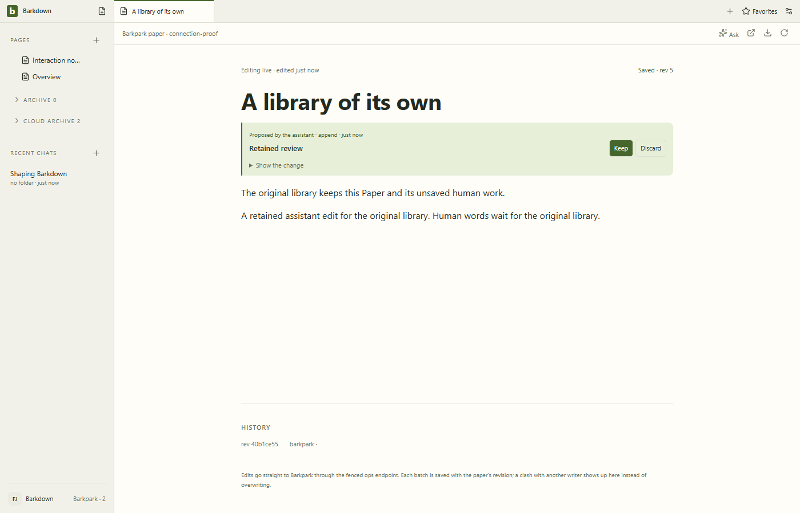
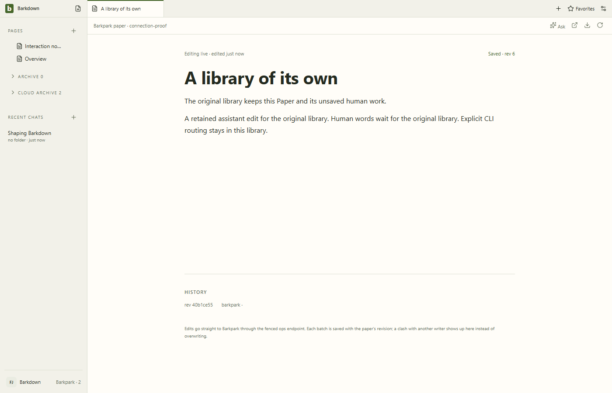
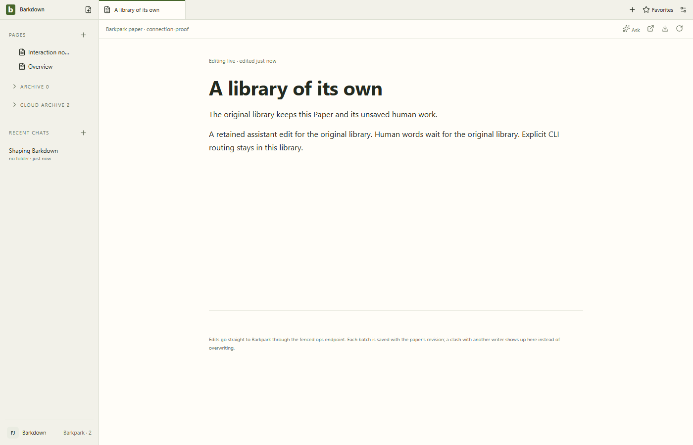

# Connection regression at C058

All9 stills and47 sampled raw-video frames inspected. One warning remains visible when appropriate, pending text stays readable in the narrow pane, and original-connection Retry/Undo/CLI/restart succeed. No new layout regression observed.

[Capture assertions](manifest.json), [review](review.json), [actual recovery recording](connection-recovery.webm), [restart recording](restart-or-failure.webm).

