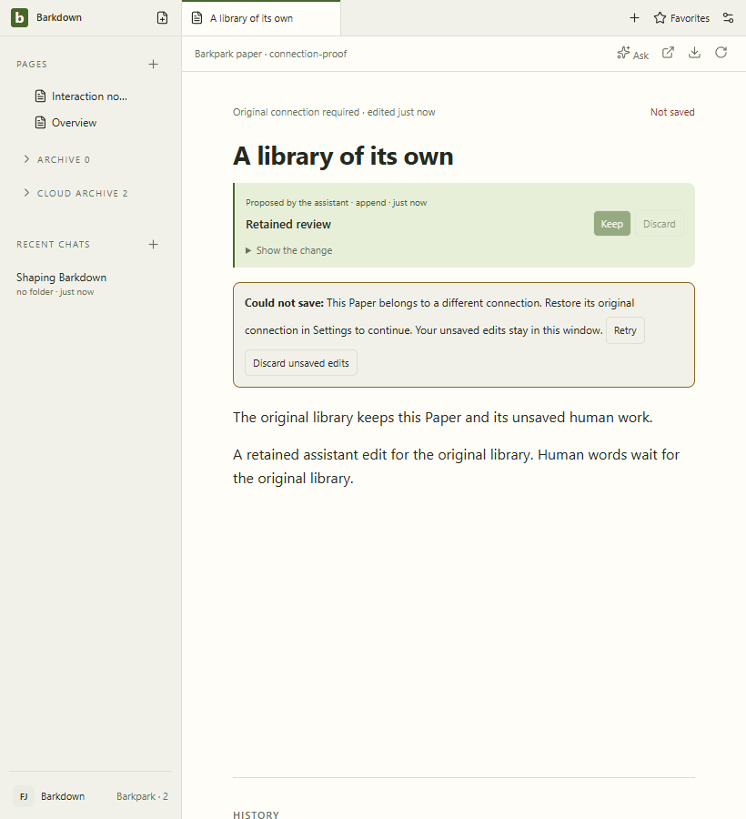
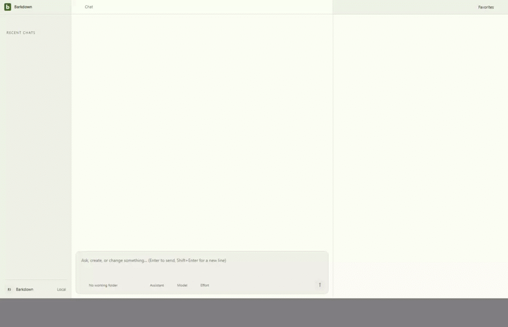

# Open-buffer regression with owned saved navigation

Source `5bc6144d95d456247296ca0f375fcfa01df10346`;13 foreign operations refuse without requests, retained human words save on original Retry, exact Undo and explicit CLI/restart assertions pass. All9 stills/48 decoded GIF frames inspected;11 original hashes verified. [Manifest](manifest.json) · [Review](review.json).

Private fixture only; raw recordings retained.2fps GIF can omit brief states. No real-library or migration activation claim.
