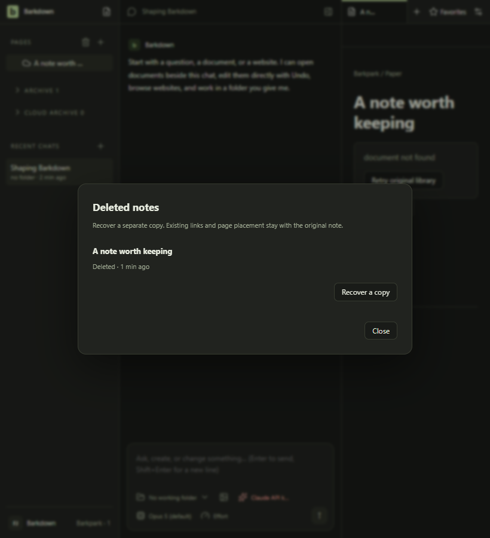
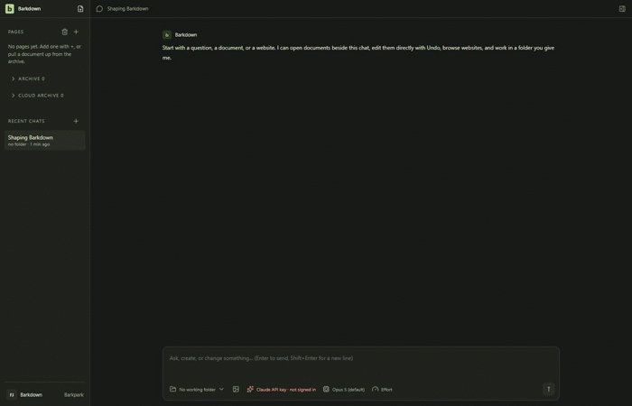

# Local Paper deletion and recovery

C071: an owned local draft can be deleted with a revision fence and recovered as a separate copy. Deleted notes is separate from the unplaced Archive. Original Pages, favorites, links and tabs retain their identity. Recovery does not restore an original ID or roll back later human edits.

Actual Electron against a private local Paper runtime, in dark mode. The original unavailable tab stays behind the recovery dialog; its saved Page and favorite remain unchanged.

This 35-frame excerpt samples the two real sessions at 2 fps, omitting startup/loading. [Exact intervals](runs/2026-09-24T21-48-23-203Z/derived/excerpt.json), [full sampled journey](runs/2026-09-24T21-48-23-203Z/derived/journey.gif), [deletion recording](runs/2026-09-24T21-48-23-203Z/delete-and-retain.webm) and [restart/recovery recording](runs/2026-09-24T21-48-23-203Z/restart-and-recover.webm) retain the complete context.

Source: application c6e3df7 plus native assertion correction d56fac5, captured at aa8c6dc against upstream ae6065545. The [manifest](runs/2026-09-24T21-48-23-203Z/manifest.json) records eight stills, exact block/new-ID/organization/restart assertions and zero renderer errors. [Named review](../../cycles/evidence/C071/review.json) inspected all eight stills and 195 sampled motion frames, alongside fresh standard/live evidence. The [cycle handoff](../../cycles/C071-paper-deletion-recovery.md) owns final checks and limitations.

The backend journal is written before deletion. Lost replies reconcile exact history without replaying deletion. Copy recovery reuses a durable creation identity. An unavailable older server refuses the new operation; it never falls back to generic both-variant deletion.

## Changelog

- 24 September 2026: reviewed native deletion/restart/copy journey. Corrected dialog padding and a premature final-navigation assertion; superseded candidates remain retained and unapproved. Same-identity restore, arbitrary crash recovery, migration activation and cross-device portability remain outside this journey.
