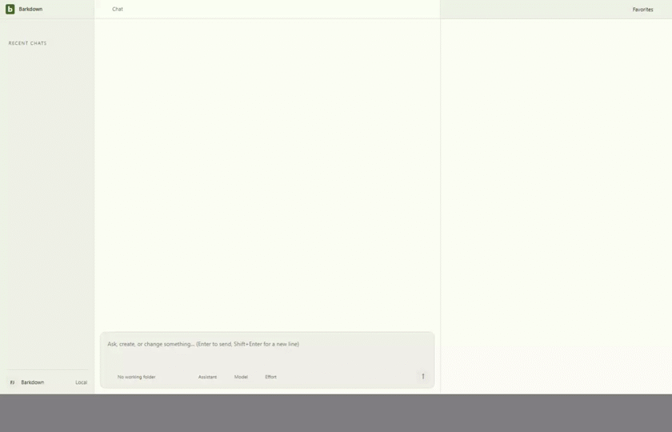
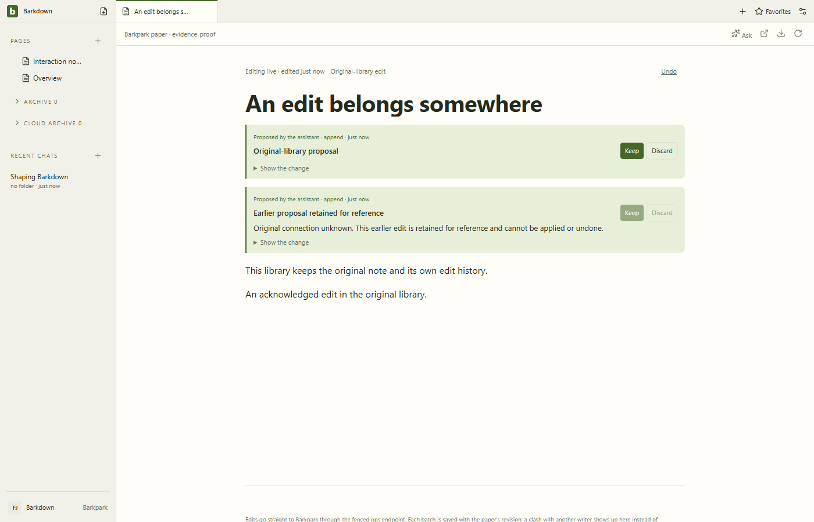
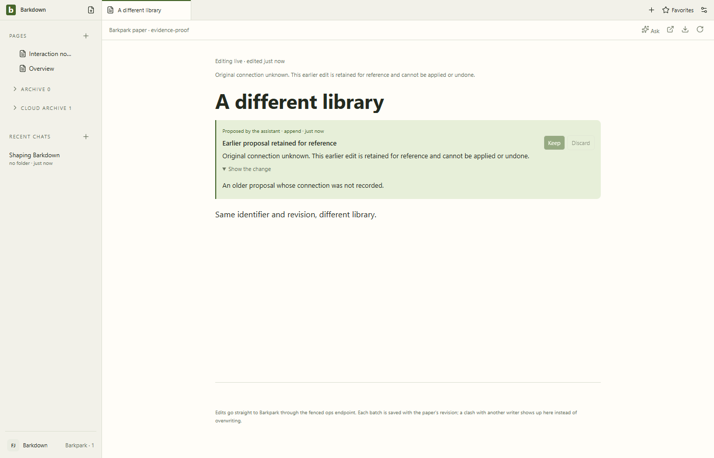
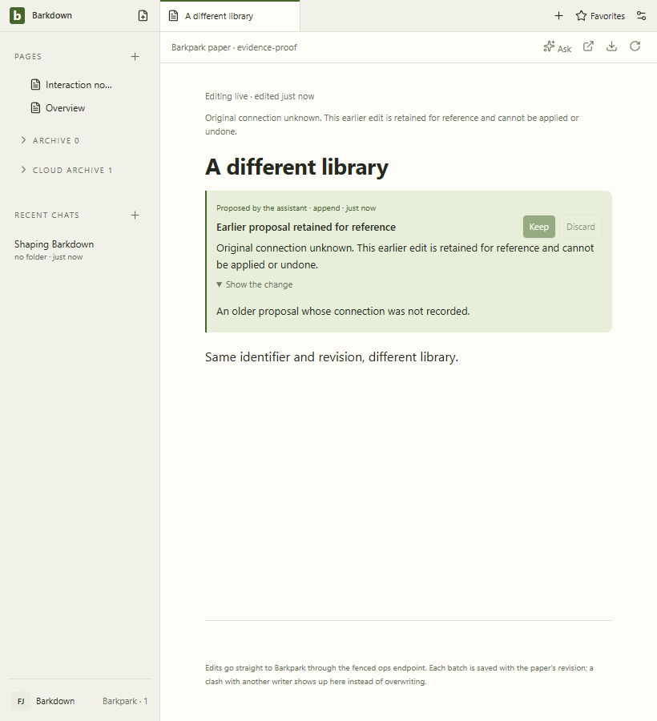
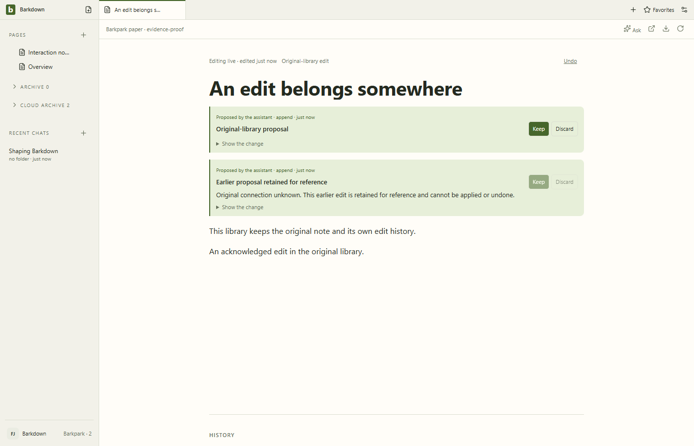
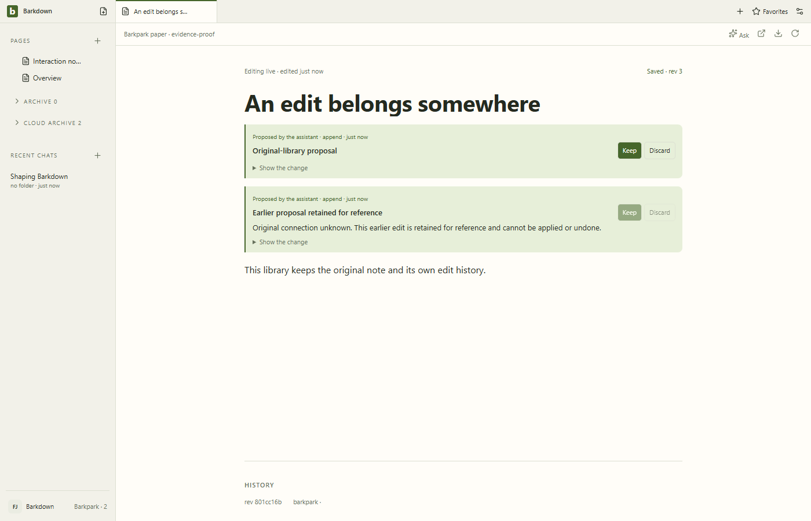
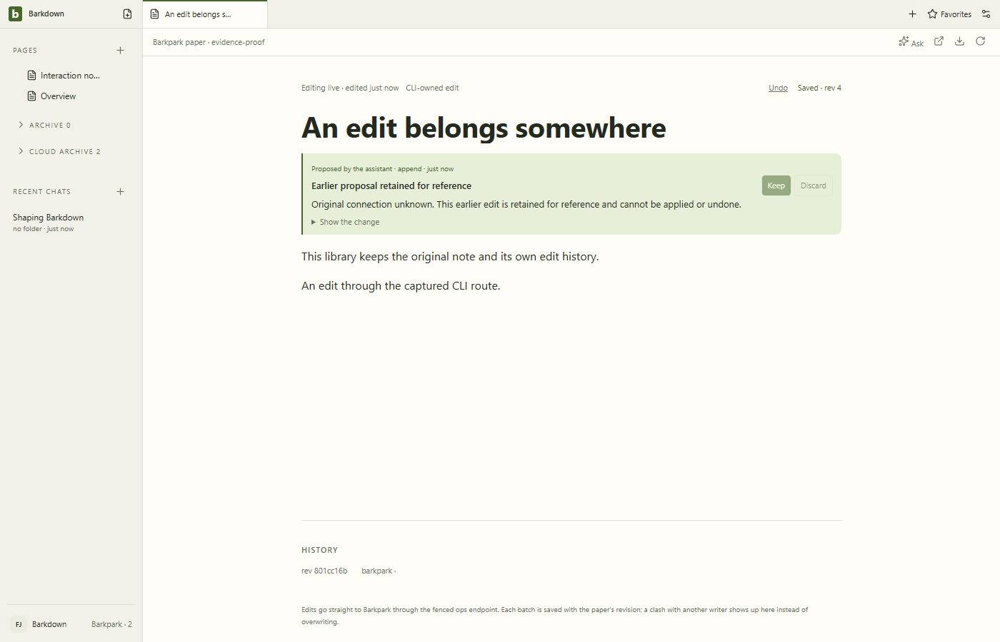
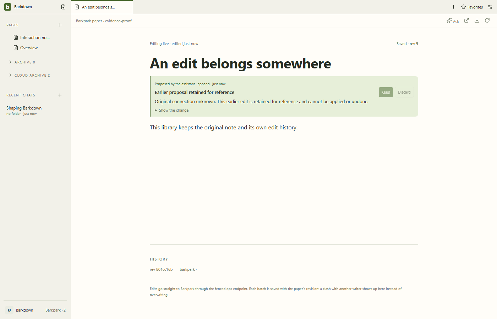

# Retained edit ownership — accepted-native

Eight stills and all56 decoded GIF frames inspected, including full-size820px narrow view. Unknown-owner explanation wraps without clipping; original-owner Undo and foreign reference-only proposals are distinct. Six zero-request refusals and exact HTTP/MCP-CLI restart Undo pass. Startup/loading states and recording letterboxing are visible, not masked.

[Capture manifest](manifest.json), [review and hashes](review.json).

