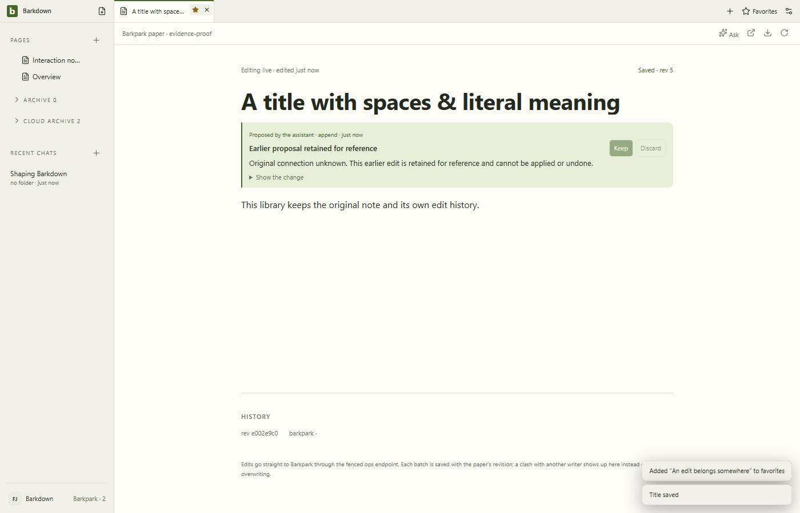

# False title acknowledgement regression

Actual native rename exposed false acknowledgement: UI/favorite changed but raw published Paper retained its old title. Generic document patch creates a draft twin. Source77b3a24 refuses unsupported Paper title writes before invoking the CLI. This run is a regression capture, not accepted behavior.

[Manifest](manifest.json) · [Review](review.json).
