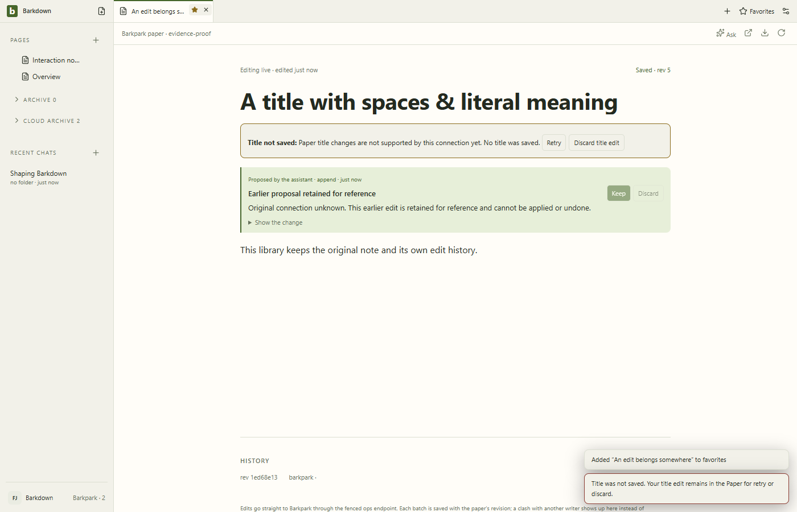
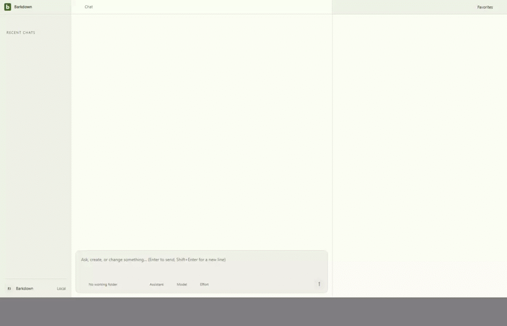

# Original-library edit evidence and guarded title refusal

Source `77b3a24f99a2869ebbc277b29ab757f34a41cf9c`. All11 stills and58 decoded GIF frames reviewed. Six foreign operations make no further request, original records remain exact, and HTTP/MCP-CLI Undo recovers after process restart. Unknown older evidence remains readable.

The title operation is deliberately refused before writing: generic document patch changes a draft twin, not the published Paper. The attempted title stays available until explicit discard; original tab/favorite labels remain. A supported guarded title endpoint is still needed.

[Manifest](manifest.json) · [Review](review.json) · Raw recordings: [foreign](foreign-refusal.webm), [return](original-recovery.webm), [CLI restart and title refusal](restart-or-failure.webm).

The GIF is a2fps840×540 derivative. Brief states may be omitted; full-size stills and raw recordings are retained. No real library, authority activation or portability claim.
