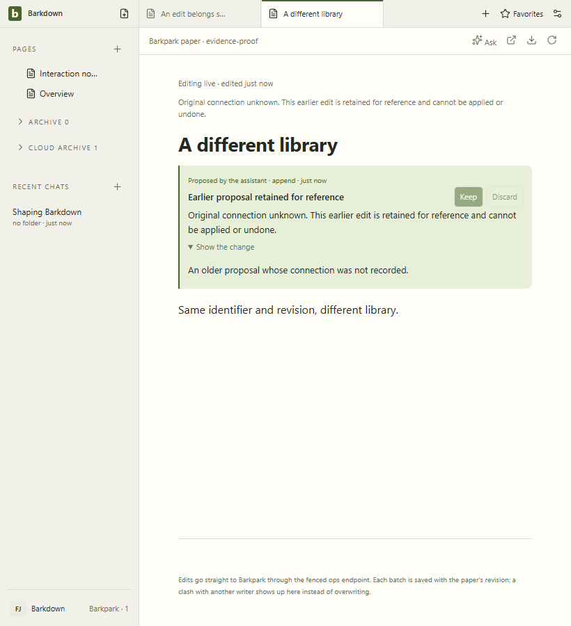
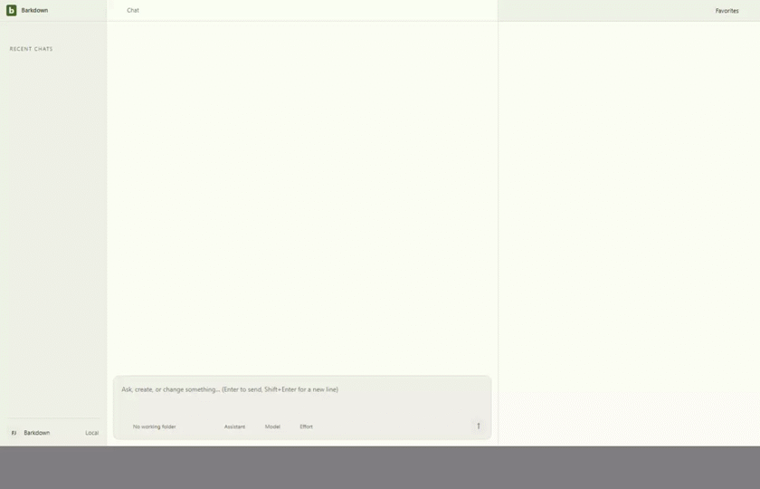

# Retained evidence with saved navigation

Source `5bc6144d95d456247296ca0f375fcfa01df10346`; actual native HTTP and stdio MCP CLI edit/restart/Undo assertions pass. All11 stills and58 decoded GIF frames inspected;14 original hashes verified. [Manifest](manifest.json) · [Review](review.json).

Private fixture only. Original recordings retained;2fps GIF can omit brief states. Titles remain unsupported and refused attempts remain drafts. No real-library migration or portability claim.
