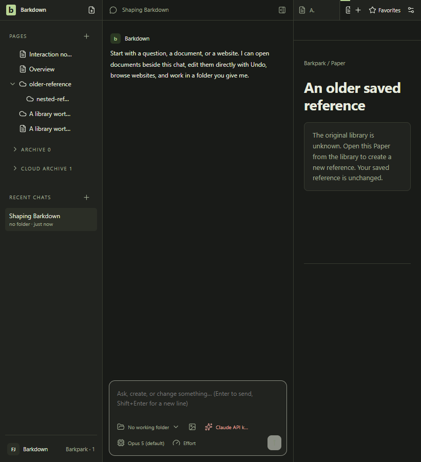
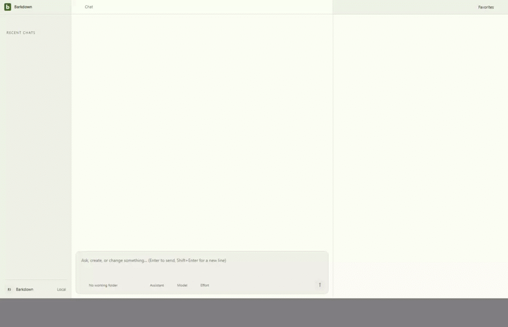

# Saved Paper navigation

New Paper tabs, favorites, human Pages and provider activity carry an opaque durable library owner. Unknown historical references remain preserved; they never attach themselves to a same-slug Paper in the current catalog. Returning to the original library allows explicit Retry.

[Expanded native journey and review](runs/2026-09-24T08-28-41-875Z/README.md) at385d072:9 stills/45 decoded GIF frames inspected,12 original hashes verified. A/B refusal, distinct saved references, parent Page return, separate imported-copy controller and restart pass. [Retained edit regression](../paper-evidence/runs/2026-09-24T08-45-39-569Z/README.md) and [open-buffer regression](../paper-connection/runs/2026-09-24T08-48-06-438Z/README.md) also pass with actual image review.

C059 final standard/live freshness, explicit approval and root verification pass; the closing cycle review records exact sources. No physical database identity, origin classification, migration activation or portability claim. Earlier failed and presentation-refinement runs remain append-only evidence.
