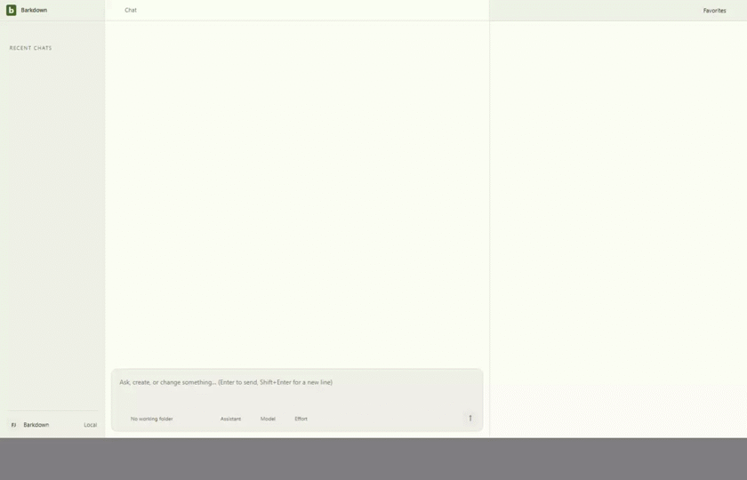
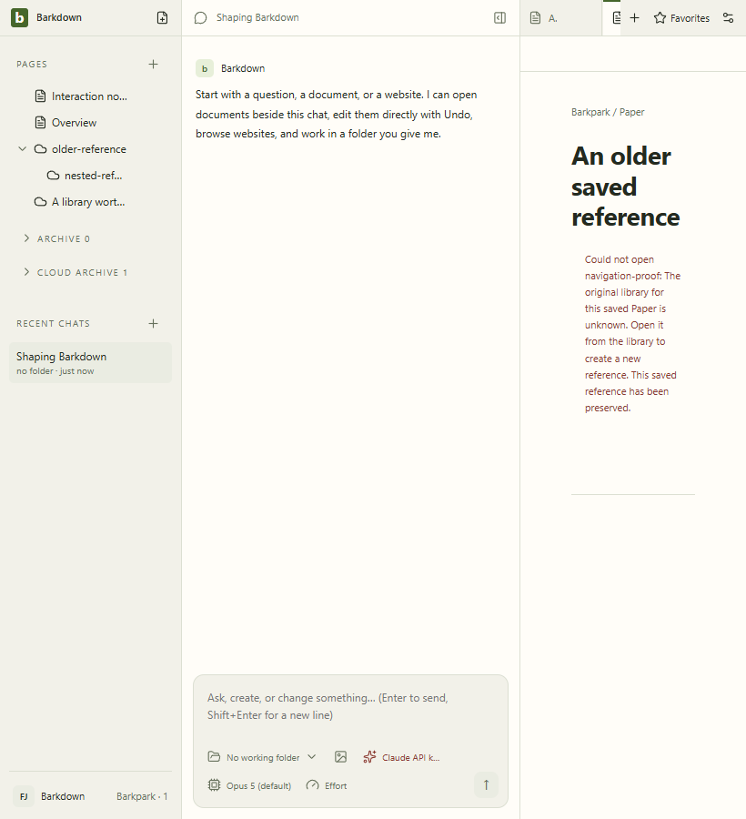

# Saved navigation: behavior passes, presentation refinement

Source1e124ca. Six stills and40 decoded GIF frames were inspected; nine originals hash-verified. Same-slug A/B refusal, preserved Pages/favorites, Retry and restart pass. At820px the non-editing state keeps an unnecessary editor gutter and long red error; a refined capture must supersede presentation acceptance.

Raw recordings and complete review/hash record are retained. The2fps GIF can miss brief states; original full-size stills remain authoritative.
