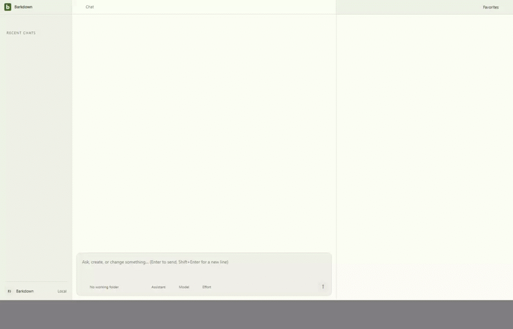
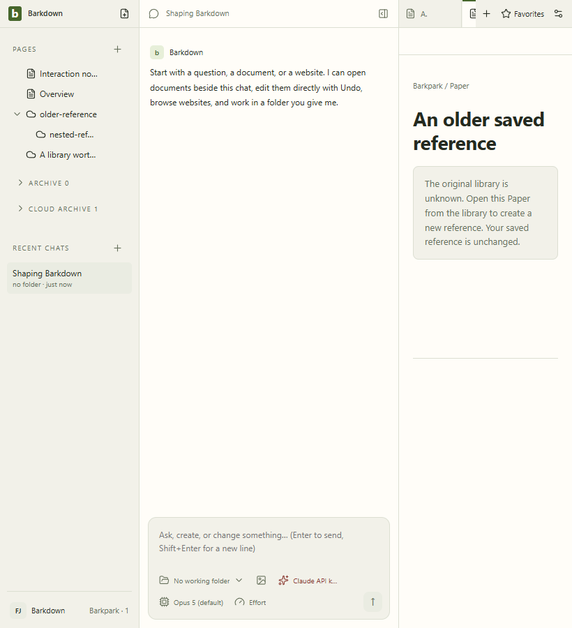

# Saved Paper navigation and recovery

Source513f9c1 / private upstream30c007e43. All six stills and43 decoded GIF frames inspected; nine original artifact hashes verified. Saved A tabs/favorites refuse same-slug B Paper reads, unknown legacy references preserve nesting, and new A/B favorites/Pages stay distinct. Original Retry and another actual Electron restart recover the original content. No library mutation occurs.

The neutral notice fits the narrow pane. Raw recordings and full-size stills remain retained;2fps may omit brief states. No real-library, dark unavailable-state, provider streaming or authority activation claim. Full suite/root/final standard and live gates remain in the current cycle.
