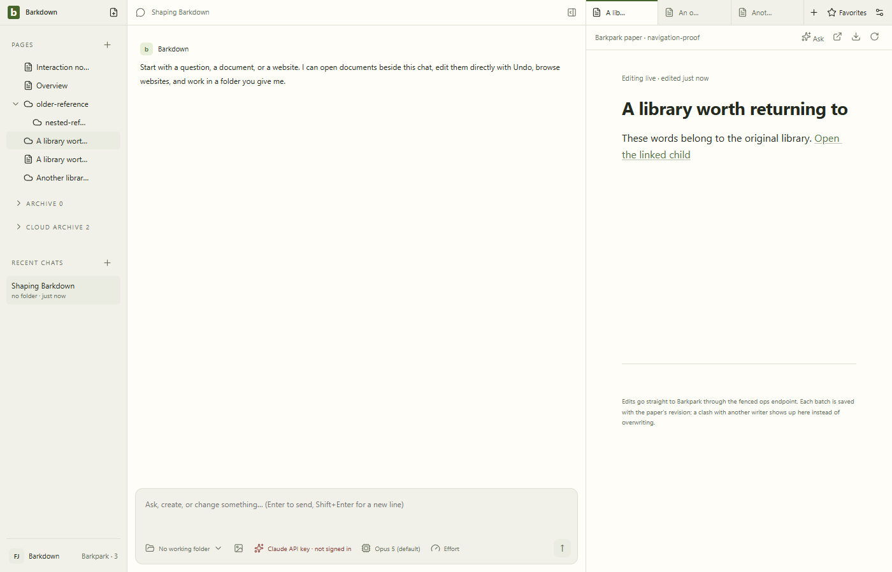

# Saved Paper navigation — expanded native proof

Source `385d072c169084ff974cd4f0e733decaccfc4068`; private Barkpark `30c007e43a74f899bd1b1310e6165eb50fc3eb86`. Behavioral assertions pass. All9 stills and45 decoded GIF frames inspected;12 original artifact hashes verified. [Manifest](manifest.json) · [Review](review.json).

Native wikilink child → parent Page return, separate imported-copy controller, saved A reference refusal on B, unknown legacy preservation, distinct favorites/Pages, original Retry and actual restart. Raw recordings: [original](original-selection.webm), [foreign](foreign-selection.webm), [restart](restart-or-failure.webm). GIF samples at2fps and can omit brief states. No real-library cutover, archive classification or portability claim. Existing Markdown import conversion is not migration acceptance.
