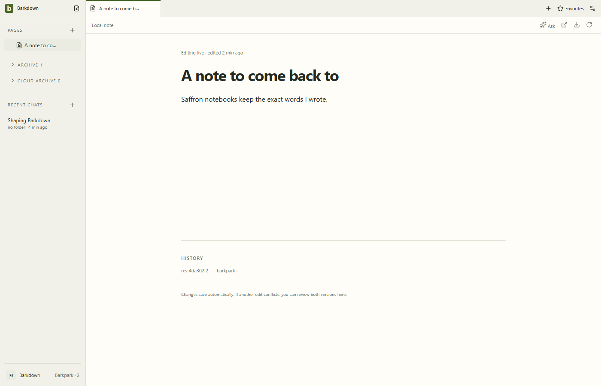
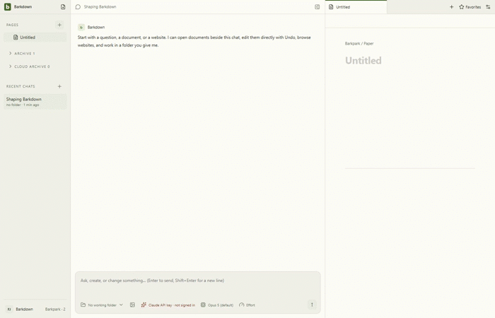

# Ordinary local notes on Paper

Managed local profiles create empty Paper notes through New Page. The exact draft identity stays attached to title/body edits, Pages, body search and saved tabs. An unconfirmed creation retains its request identity; Retry checks the same note. Connected cloud libraries and legacy storage keep their existing creation paths.

The excerpt samples actual native video at2fps and omits runtime startup/waits. [Full sampled journey](runs/2026-09-24T18-55-34-677Z/derived/journey.gif), [original creation/profile video](runs/2026-09-24T18-55-34-677Z/create-edit-and-profile-switch.webm), [restart video](runs/2026-09-24T18-55-34-677Z/restarted.webm) and [exact excerpt provenance](runs/2026-09-24T18-55-34-677Z/derived/derivation.json) retain the whole sequence. This is a private real Paper runtime, not a live-provider ordinary-note test.

## Proof and remaining limits

- [Native manifest](runs/2026-09-24T18-55-34-677Z/manifest.json): public New Page, title/Enter/body typing, actual body-search result, two profiles with identical draft IDs, foreign-owner refusal and exact restart. Eight stills,354 sampled motion frames and22 excerpt frames reviewed by Codex; [review and source details](../../cycles/evidence/C067/review.json).
- [Body-search result](runs/2026-09-24T18-55-34-677Z/02b-body-search.png) explicitly contains the searched body text. Earlier runs selected an open-tab title too early and do not establish this UI search proof.
- [Real API contract](../../cycles/evidence/C067/draft-contract-1790275629640.json): request nonce, guarded title/body changes, stale refusal, service reconstruction, lost-response reconciliation and unchanged published twin.
- [C067 handoff](../../cycles/C067-ordinary-paper-notes.md): exact commands, validation and remaining delivery status.

App source7e1c51c; native run records sourceDirty:true because the only pending app change was the stronger search assertion, subsequently committed unchanged as46854ef. The earlier clean-source capture is retained separately; no manifest is restamped. Standard and live Paper galleries have their own provenance.

[C069](../agent-notes/README.md) separately proves agent creation/body edits/Undo. Deletion/recovery, migration activation and legacy retirement remain unproved. Missing readback after uncertain creation never authorizes another POST. P2/A2 remain open.

## Changelog

- 24 September, C067: accepted human create/edit/search/restart journey and nonce-based creation reconciliation. Native testing exposed hidden empty-body styling and Enter staying in the locked title; both are fixed. All failed/development recordings remain in their original run folders. Final body-search assertion requires the actual text excerpt.
