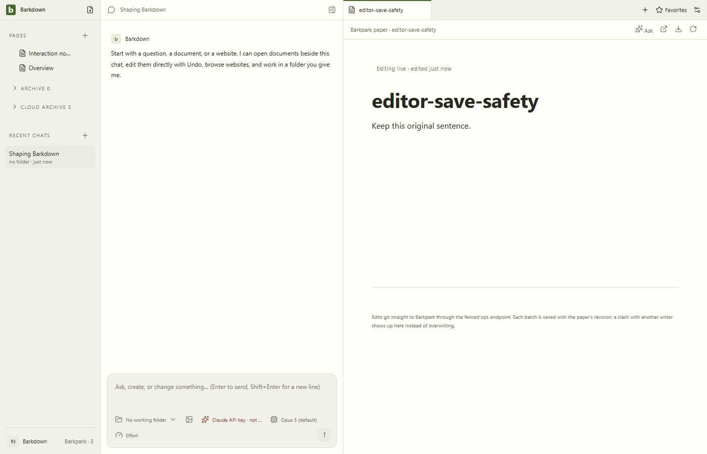
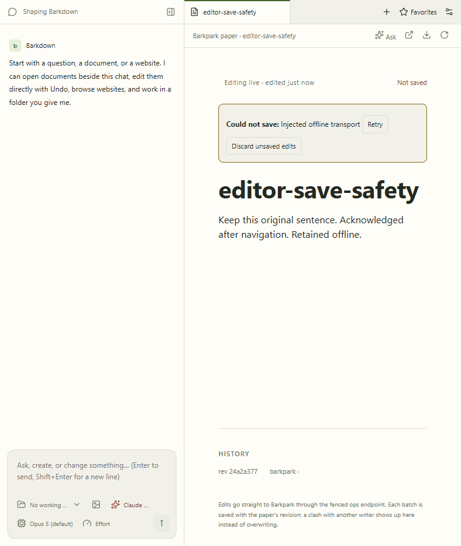

# Paper save safety

Real Paper canvas against a disposable Barkpark. The test delays or refuses the real adapter call to exercise recovery; it does not simulate an editor or invent save acknowledgements. No model turn is involved in this journey.

The GIF shows actual action checkpoints, not continuous video. [All nine stills and provenance](runs/2026-09-21T22-43-32-426Z/manifest.json) include the dedicated narrow view below. The separate [live status gallery](../../images/status/manifest.json) contains the real Codex turn and continuous editing sequence.

Runtime implementation: `228a008`; clean final capture source `e19edfa`, Barkpark `a5440345c`, Windows/Electron 38.8.6. [Named review and artifact hashes](runs/2026-09-21T22-43-32-426Z/review.json) bind this evidence. The independent live status manifest records clean runtime source, actual server version and a real Codex turn.

The [earlier capture](runs/2026-09-21T22-31-47-690Z/manifest.json) is preserved: its confirmation still caught the entrance animation, and its dirty flag reflects only a README link edit. The new capture waits actual animation completion and records clean source; the old frame was not overwritten or restamped.

## Behavior evidence

- Delayed writes retain their original paper when reload, navigation, keyboard close or middle-click close is attempted; the other paper remains unchanged.
- Undo and redo agree with the server, not just the canvas.
- A refused write stays visible. Retry persists it. Explicit discard is cancelable and reads the saved copy before replacing the draft; failure or intervening input preserves the draft.
- [Controlled host regressions](../../cycles/E001-host-results.json) cover cold bundle/load races, chained saves, stale echoes, late failures and title drafts. These prove orchestration, not specialized block fidelity.

Run `npm --prefix app run test:paper-host`. For the real-server cases, set `BARKDOWN_TEST_BP_SOURCE` to a built checkout and run `npm --prefix app run test:paper-host:isolated`; coordinate the shared source build directory with other captures. Add `BARKDOWN_EDITOR_CAPTURE=1` for a new append-only evidence folder after committing app source.

## Changelog

- 2026-09-22, E001: reviewed all nine stills and every action-GIF frame. Retained content, save status and confirmation remain readable; no clipping in the 760px recovery view. Nineteen controlled races and four real-server journeys passed. Native shutdown/crash durability, every specialized block's Undo and profile switching remain separate gates. See [handoff](../../cycles/E001-paper-save-ownership.md).
