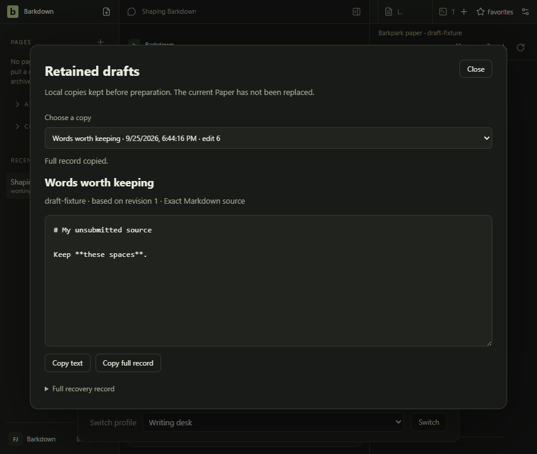
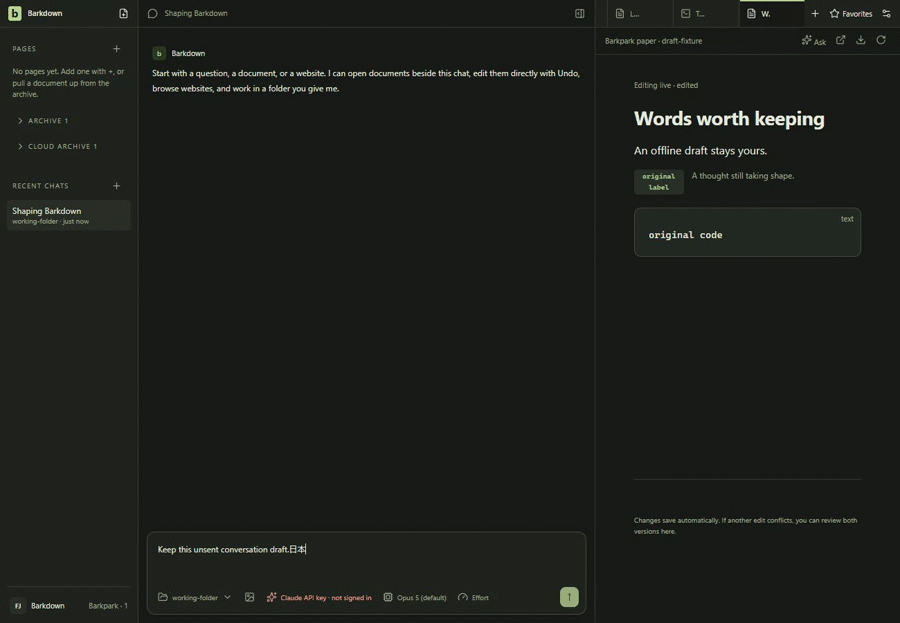

# Profile preparation and retained drafts

Delivered through PR40; evidence in [C076](../../cycles/C076-profile-preparation.md). Preparation is an internal action, not a public migration button. It pauses one profile, retains Paper and chat drafts, refuses dirty project/legacy buffers and composition, and verifies owned process shutdown. Cancel preserves copies and requires restart before that profile can write again. The reader copies text or a complete record; it never overwrites the current Paper.

[Development behavior results](../../cycles/evidence/C076/abort-development/result.json) pass scoped and native checks. Clean-source native screenshots and sampled motion have now been reviewed at4c030a0c; full regression, root verification and standard/live approval passed before merge. Earlier [foreground stills](../../cycles/evidence/C076/README.md) do not establish the new cancellation/reader journey. Native tests use disposable data and deterministic HTTP reads; they do not prove live server saves or migration cutover.

25 September: added cancellation, retained-copy reader, fresh-host reopening and Settings access. The existing root demo remains applicable to ordinary editing; it does not demonstrate preparation.

Disposable native journey, dark mode, deterministic HTTP. The GIF shows8–10.7s of the first recording at half speed. [Manifest](../../cycles/evidence/C076/preparation-native/2026-09-25T16-44-07-825Z/manifest.json) · [Named review and hashes](../../cycles/evidence/C076/preparation-native/2026-09-25T16-44-07-825Z/review.json) · [Full retention recording](../../cycles/evidence/C076/preparation-native/2026-09-25T16-44-07-825Z/page@5291033f1640bb3a09d2a675893fbc51.webm) · [Full cancellation recording](../../cycles/evidence/C076/preparation-native/2026-09-25T16-44-07-825Z/page@c614c987bb913630eddd7a75128c8fa1.webm) · [Full reopen recording](../../cycles/evidence/C076/preparation-native/2026-09-25T16-44-07-825Z/page@438fd1080d4a78b1c70ecf130d2c6357.webm).

Known polish limitation: startup/profile reload briefly displays the light empty shell before dark settings load. The raw recordings retain it. The notice intentionally overlaps the paused composer; copies never silently restore over a Paper.
