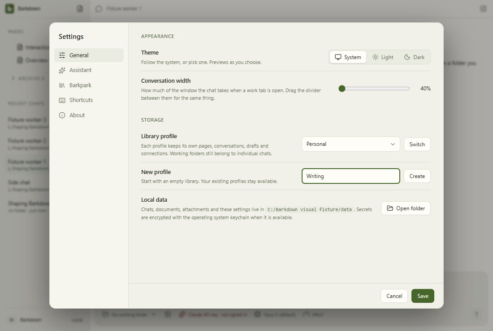

# profiles

Profile Settings controls with injected stable registry names. This tour makes no profile switch; real switching and Paper save protection have separate integration evidence.

[Full comparison](../runs/2026-09-22T00-21-53-476Z/README.md) · [Capture manifest](../runs/2026-09-22T00-21-53-476Z/manifest.json)

## Changelog

- 2026-09-22T00:24:23.670Z: Inspected31 candidate action frames including narrow settings/goals; zero pixel or geometry changes. Seven GIFs use same step frames. Actual credential save/restart and pending-save ownership checks pass separately; dedicated Saving/configured images inspected, busy contrast corrected before this source. Structural tagged-key gate is distinct from actual decrypt roundtrip proof; no cross-platform/power-loss claim. Source f7d91e654; [review](../runs/2026-09-22T00-21-53-476Z/comparison.json).
- 2026-09-22T00:02:29.029Z: Inspected all31 candidate action frames including narrow goals/settings. All pixels and geometry unchanged from reviewed baseline; seven GIFs use these same step frames. Separate actual Electron crash/reopen/reconcile/retry test passes with local deterministic SDK transport and synthetic environment credentials; its dedicated recovery views cover changed wording. No authenticated recovery or encrypted-key restart claim. Source e9be0194d; [review](../runs/2026-09-22T00-00-37-127Z/comparison.json).
- 2026-09-21T23:46:03.564Z: Inspected all31 raw action frames and seven step GIF frame sets, including full-size narrow profile Settings and prior goal narrow layout. Existing26 frames have zero changed pixels/geometry; Settings General reflow is the imported profile-settings structure, with legible local-data controls. Four new labelled fixture profile frames show selector, new-name input, narrow stacked controls and restore. Environment unchanged; no overlap or clipped controls observed, content scroll stays available.46 goal tests pass, including real owned process crash/recovery and large-image/history protocol; default-owned Electron SDK flow separately passed with local deterministic HTTP and inspected live-worker/result frames. Clean beefded authenticated3Codex proof is separate; this gallery does not claim actual profile switch or native crash execution. Full desktop and isolated Paper capture still running. Source 043e4727b; [review](../runs/2026-09-21T23-44-00-349Z/comparison.json).
