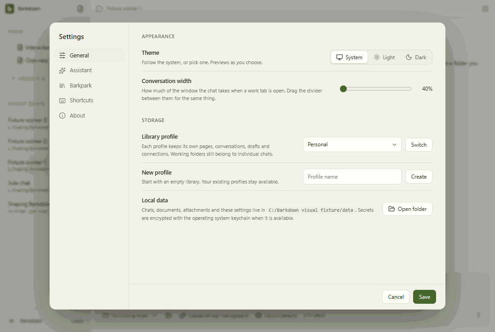

# profiles

Profile Settings controls with injected stable registry names. This tour makes no profile switch; real switching and Paper save protection have separate integration evidence.

[Full comparison](../runs/2026-09-21T23-39-00-392Z/README.md) · [Capture manifest](../runs/2026-09-21T23-39-00-392Z/manifest.json)

## Changelog

- 2026-09-21T23:41:01.692Z: Inspected all31 actual frames in seven area contact sheets, including profile Settings and goal planned/running/paused/narrow/worker navigation. Existing21 reference frames have zero above-tolerance pixel or geometry differences; new10 frames readable with menus and footer/scroll regions intact. No new clipping or overlap observed. Deterministic providers remain blocked; this does not prove native worker execution or live Paper behavior. Inherited40percent default mismatch is tracked separately. Full pre-native desktop passed;46 native goal tests and23 Paper host tests pass, current native Electron fixture adaptation pending. Source ae49f97b9; [review](../runs/2026-09-21T23-39-00-392Z/comparison.json).
- 2026-09-21T23:35:02.650Z: Inspected all 31 PNG frames including narrow geometry and all seven GIF step sequences. Existing 21 frames have zero changed pixels with unchanged environment; ten goal/profile frames are explicit new fixture baselines. Controls remain reachable without clipping. Separately inspected six real Paper profile frames and all 37 live status GIF frames. Real restart, cookie isolation, late worker output, and pending-save switch guard passed; deterministic goals do not claim live model execution. Source 168e31b71; [review](../runs/2026-09-21T23-29-02-248Z/comparison.json).

Live runtime evidence is reviewed separately in [live profile review](live-README.md).
