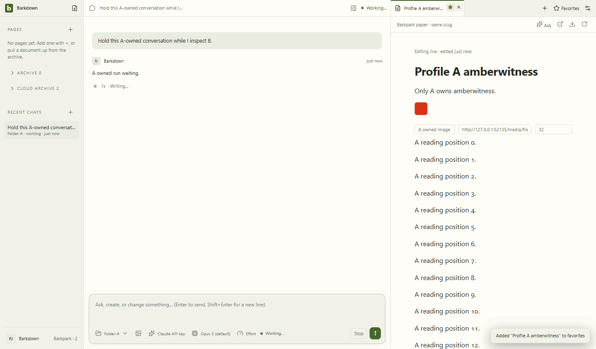

# Two-profile regression at C058

All6 full-journey stills and6 decoded GIF frames inspected. B reading position and draft remain stable across A completion and restart. A-only receipt/Undo and actual MCP isolation assertions pass. The GIF is a step tour, not continuous video.

[Actual assertions and process cleanup](manifest.json), [review and hashes](review.json).

