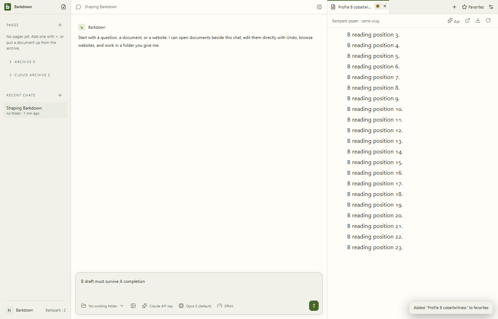
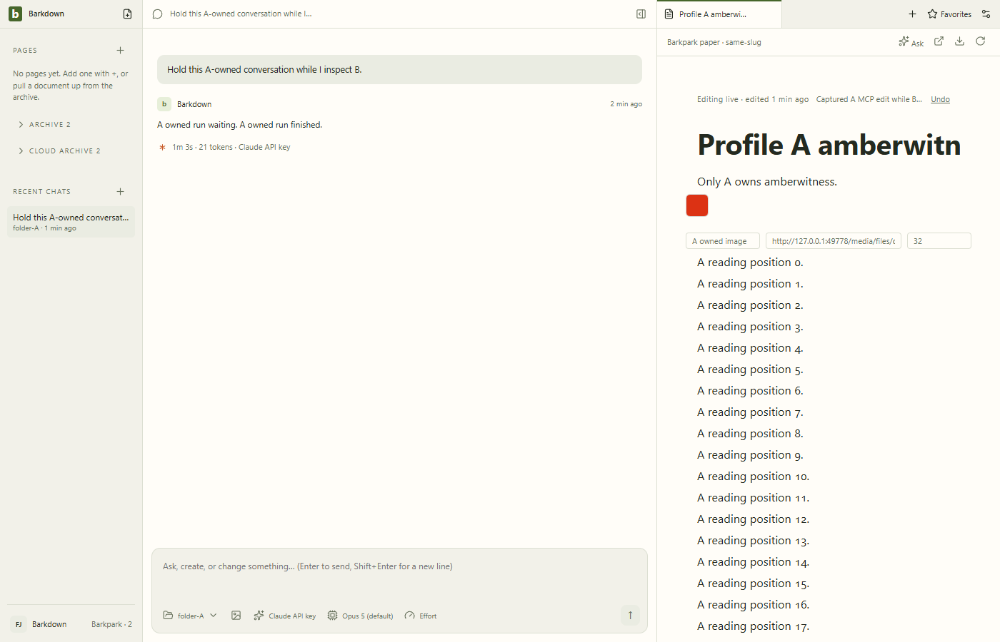
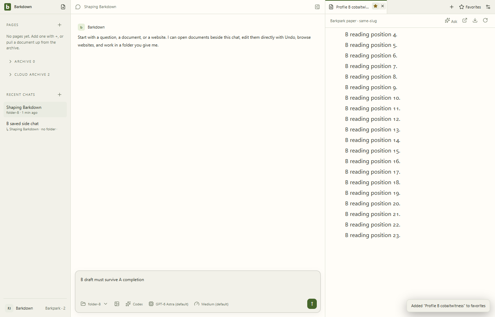

# Actual two-profile Paper journey

C016 remains **in progress**. These are disposable actual Electron/managed PostgreSQL journeys, distinct from the deterministic UI tour. No real library was used. Each folder retains its source commit, runtime identity and cleanup outcome in `manifest.json`.

| Run | What passed | Why it stopped |
| --- | --- | --- |
| [00:40](2026-09-22T00-40-57-913Z/manifest.json) | Real A Paper loaded | Fixture clicked a favorite action before hovering its tab; normal cleanup |
| [00:45](2026-09-22T00-45-41-998Z/manifest.json) | Concurrent A/B, same-slug media/favorites, late A edit and transcript, B draft/context/scroll, rejected A Undo in B | Fixture incorrectly expected no fuzzy search result; the returned result belonged to B; normal cleanup |
| [00:49](2026-09-22T00-49-13-146Z/manifest.json) | Above plus credential denial, scoped search, valid A Undo, restarted B draft/side parent/path | Actual restart scroll was **390**, saved value **360**; unresolved geometry/scroll issue; normal cleanup |
| [00:54](2026-09-22T00-54-58-699Z/manifest.json) | Concurrent A/B and initial ownership assertions | MCP edit returned `fetch failed`; cancellation did not reach driver finalization; explicit owned cleanup required |
| [01:54](2026-09-22T01-54-53-499Z/manifest.json) | Concurrent A/B, actual A MCP edit acknowledged at revision 2, owned API worker stopped with zero active processes | B scrollTop changed 360→390 before restart; visible paragraph positions appear stable, so anchor/image geometry needs measurement; normal cleanup |

| [02:22](2026-09-22T02-22-51-651Z/manifest.json) | Exact B scroll/anchor preserved after decoded-image baseline | Total height grew67px from asynchronous revision footer; normal cleanup |
| [02:57](2026-09-22T02-57-20-871Z/manifest.json) | Full late-A ownership, exact settled B position, scoped search/Undo and A valid Undo | Selected-B process restart position0 versus360; draft/side-parent/path/content intact; normal cleanup |

The 00:54 run's `stopped: true` means the final resources were stopped, **not** that application shutdown succeeded. [Forced cleanup evidence](2026-09-22T00-54-58-699Z/forced-cleanup.json) records both positively identified private PostgreSQL clusters stopped cleanly before the disposable Electron tree was terminated. No owned process or postmaster marker remained.

The HTTP provider uses scripted text through the real SDK to hold A's runtime lease. A **separate actual stdio MCP client** reads and edits with captured A storage/connection. This does not prove API-provider remote tool parity or model decision quality. Unmatched search can return B-owned fuzzy hits; exact-match relevance is not claimed.

All retained live frames were inspected. Controlled actual Electron held-stream cancellation, disconnect/cancellation, and quit checks passed both before and after C014's owned-worker import; they did not reproduce or explain the historical cancellation hang. The next retry uses unchanged native window bounds and records MCP fetch causes before cleanup. P1/A1 is not complete.
