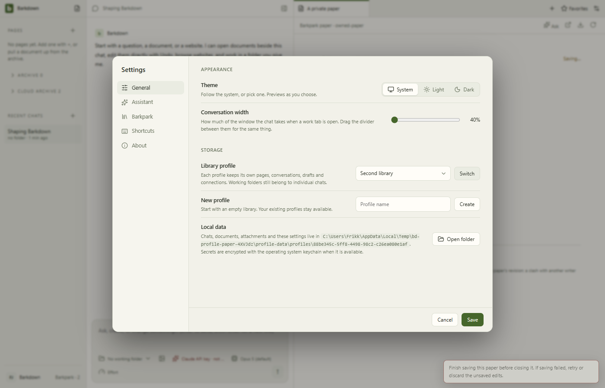
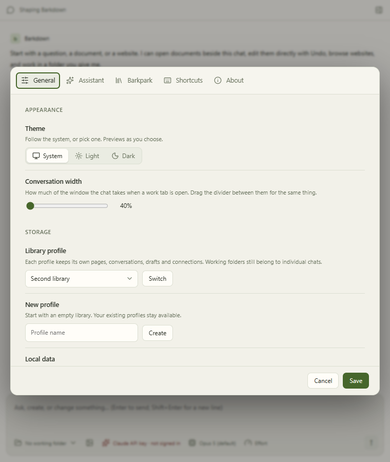

# Live profile and Paper review

The [six-frame run](runs/2026-09-21T23-25-53-025Z/manifest.json) captured clean source `b58a4e4` against a disposable app-owned Barkpark runtime. Actual HTTP applyOps acknowledgement was deliberately delayed: Settings refused switching while the human edit was pending, retained A's canvas, then allowed B after A's revision acknowledgement. The narrow Settings frame keeps controls readable and scrollable. All six stills were inspected; the GIF records actual UI checkpoints, not continuous video. Owned runtime shutdown passed.

The subsequent `168e31b` change only guards asynchronous workspace refreshes. Its fresh [deterministic comparison](../runs/2026-09-21T23-29-02-248Z/comparison.json) and [live status manifest](../../images/status/history/C006-168e31b.json) are separate evidence. Deterministic goal fixtures do not prove three live model sessions. This cycle does not adopt a real legacy library or complete P1.

Review follow-up: inherited default/reset conversation width is 40%, whereas D07 specifies 60%. This is recorded for a separate correction and recapture; the current evidence accurately shows the implemented layout.
