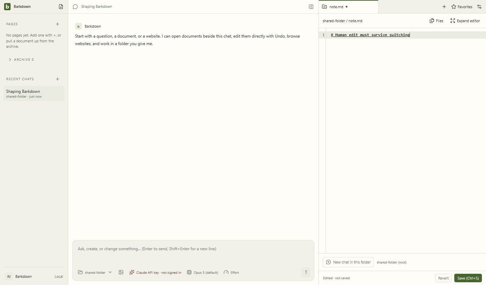

# Project-buffer preservation

Actual Electron/CodeMirror journey at `e68a72e`, with a disposable folder shared by two profiles. The global guard previously counted zero because no root was supplied; the failing Node regression records expected three versus actual zero.

The actual test passed: Settings refuses the profile switch and shows the save-first message, keeps profile A and its unsaved text, and leaves disk bytes unchanged. Only explicit Save writes the file; switching to B then succeeds and opens those saved bytes. All three frames were inspected: the dirty marker and unsaved footer persist before refusal, the toast is visible, and the final saved view has no dirty marker. [Assertions and process cleanup](runs/C019-e68a72e/manifest.json).

This is switch preservation, not automatic saving or durable recovery of unsaved file buffers after app death. Deterministic visual comparison and standard live status closeout remain pending; C019 is not yet closed.
