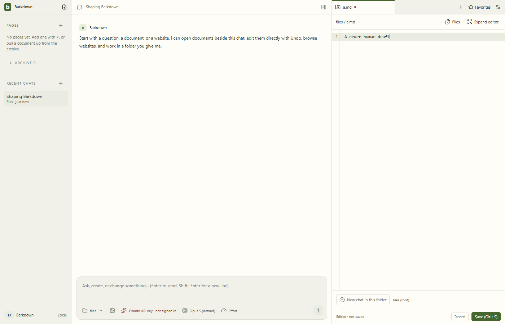
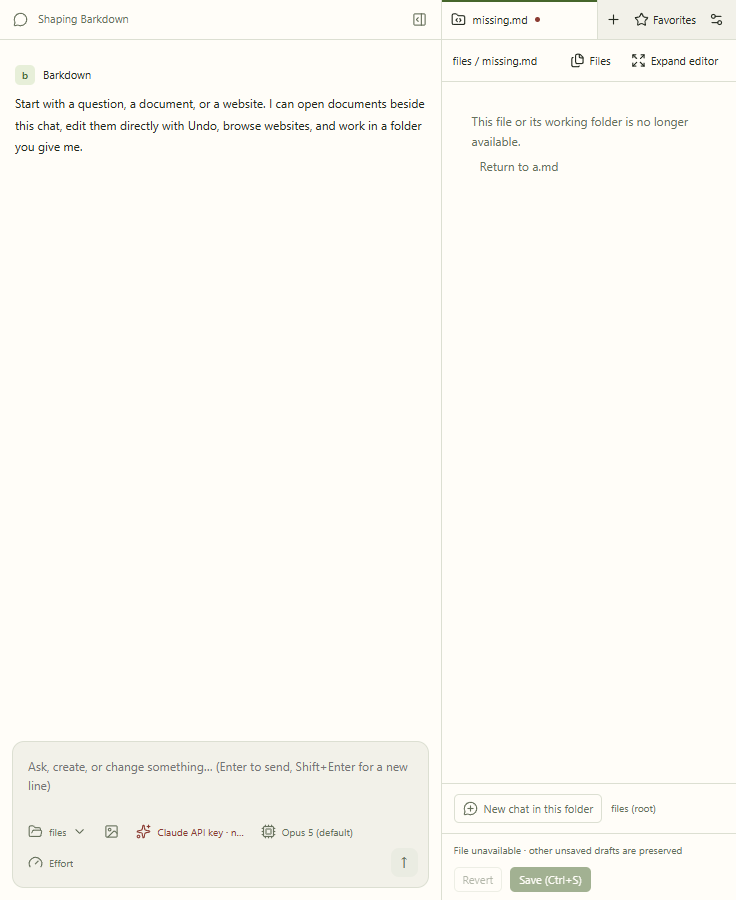
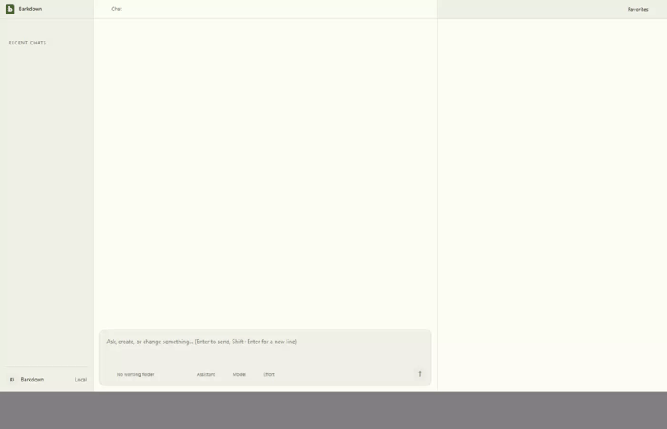

# Project files: draft and save ownership

C024 preserves the previous file draft when navigation fails. Save acknowledges its captured file and text; newer typing remains dirty. Deleted files require explicit recreation, and Cancel preserves the draft.

[Original manifest](runs/2026-09-22T03-49-16-379Z/manifest.json) · [Hashed review](runs/2026-09-22T03-49-16-379Z/review.json) · [Cycle handoff](../../cycles/C024-project-file-authority.md).

Source268d5df, actual Electron CodeMirror and real files IPC. The save-delay fixture blocks acknowledgement after a real disk write. All seven stills and22 video samples reviewed; the app stopped normally. GIF is5fps from8fps samples; resizing leaves original video letterboxing.

Unsaved buffers remain session-only. Physical junction confinement and cross-process editing are outside this slice. This evidence does not approve the combined integration branch.

## Changelog

- 22 September: final wide/narrow copy and recovery approved at268d5df. Full desktop passed0fe916c before final display-only fix; final actual assertions cover that fix.
- Earlier captures03-36-13 and03-37-59 are retained. Their functional checks passed, but raw filesystem error wording was not visually approved; contextBridge stripped custom Error.code.
