# Provider sign-in assistance

Source `1c94f8d`, Windows Electron, 23 September 2026. Actual main/preload, shared main/side composers, Settings and login lifecycle; the process transport and Codex SDK are controlled. This is not evidence of completing a real browser account login. [Manifest and hashes](1c94f8d/manifest.json), [full recorded video](1c94f8d/journey.webm), [desktop regression log](1c94f8d/desktop.log), [focused checks](1c94f8d/focused.log), [four-role goal preflight checks](1c94f8d/goal-provider.log).

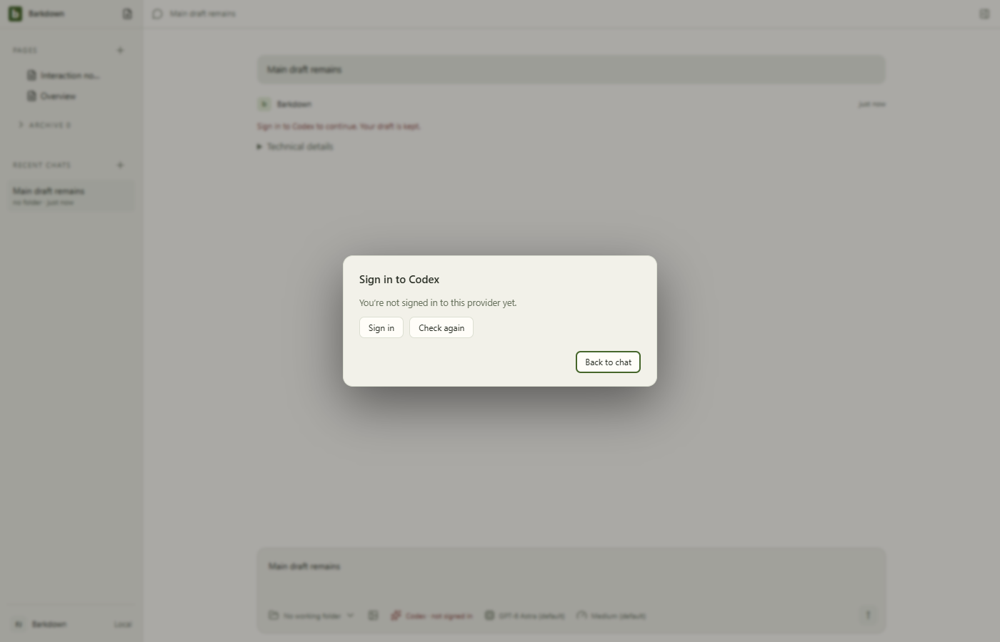

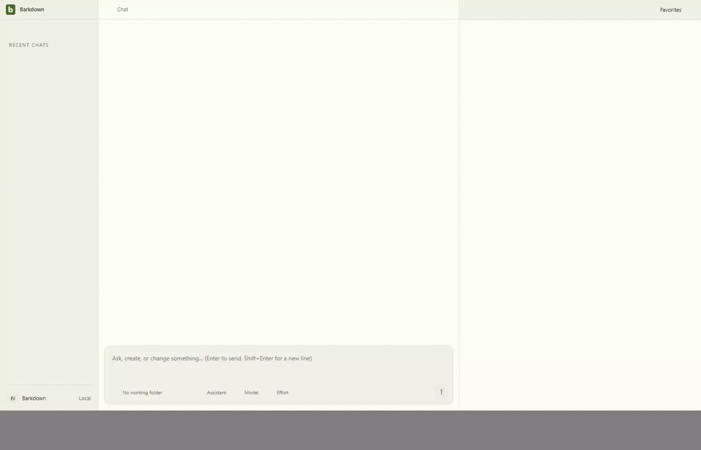

## Observed behavior

The missing-auth send retains the main draft. Cancelling sign-in keeps it intact. A side-chat text/image submission survives refusal and successful sign-in; only an explicit retry invokes the controlled provider, exactly once. Settings rechecks leave both drafts unchanged. Goal sign-in help opens the same controls without resuming the scheduler. Dark Settings and the 390px dialog remain reachable without horizontal overflow.

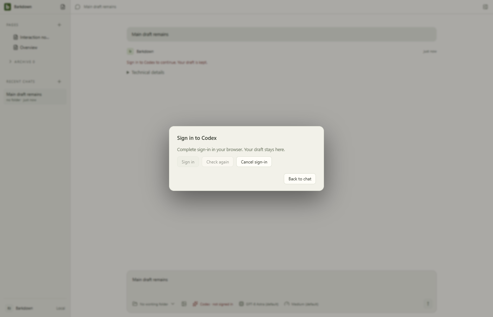
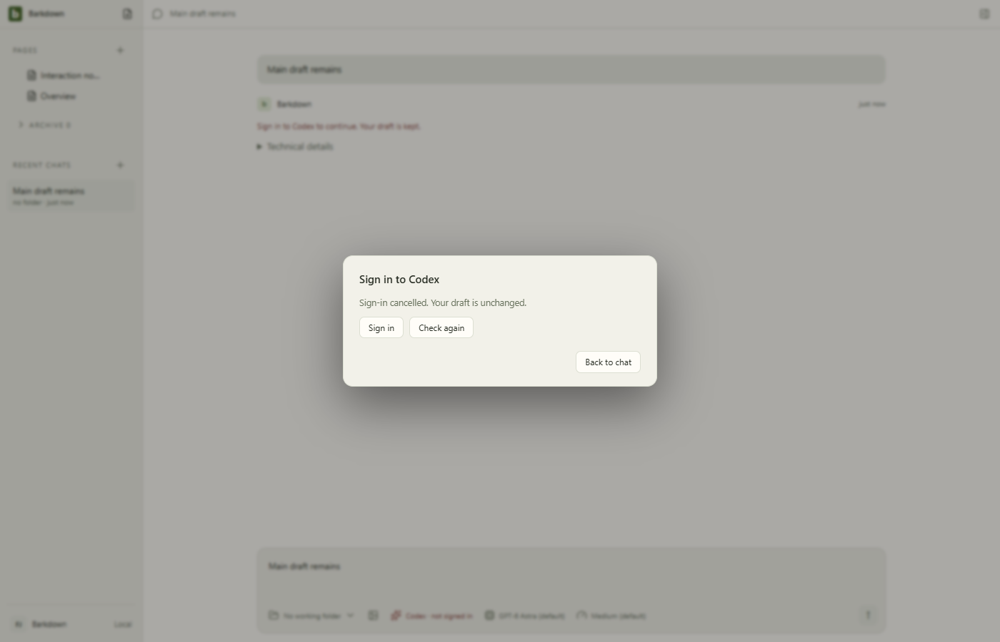
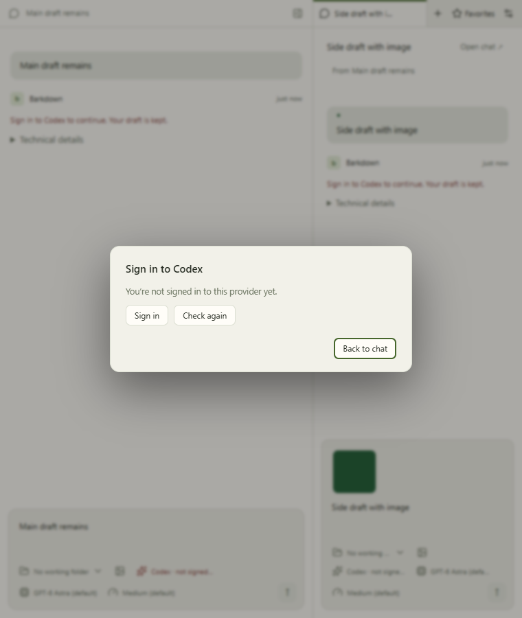
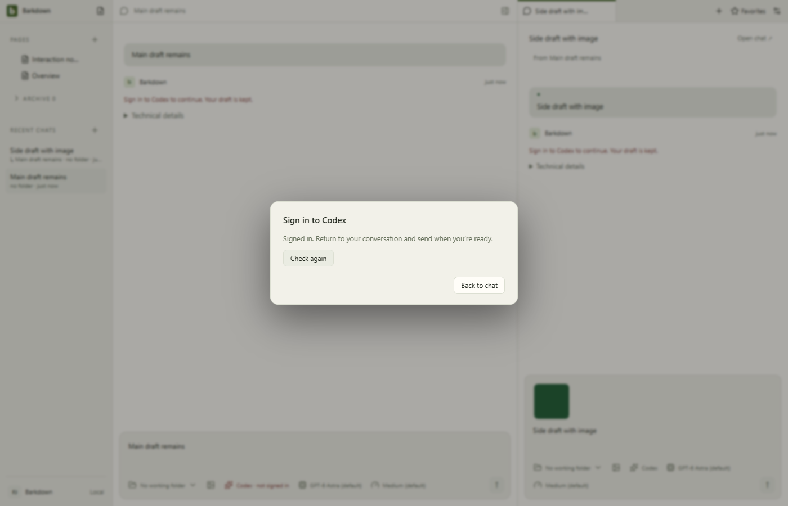
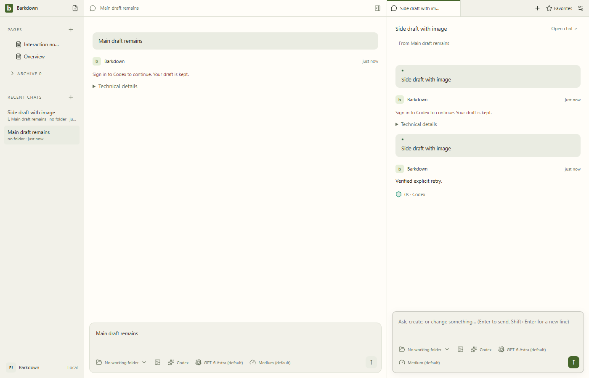
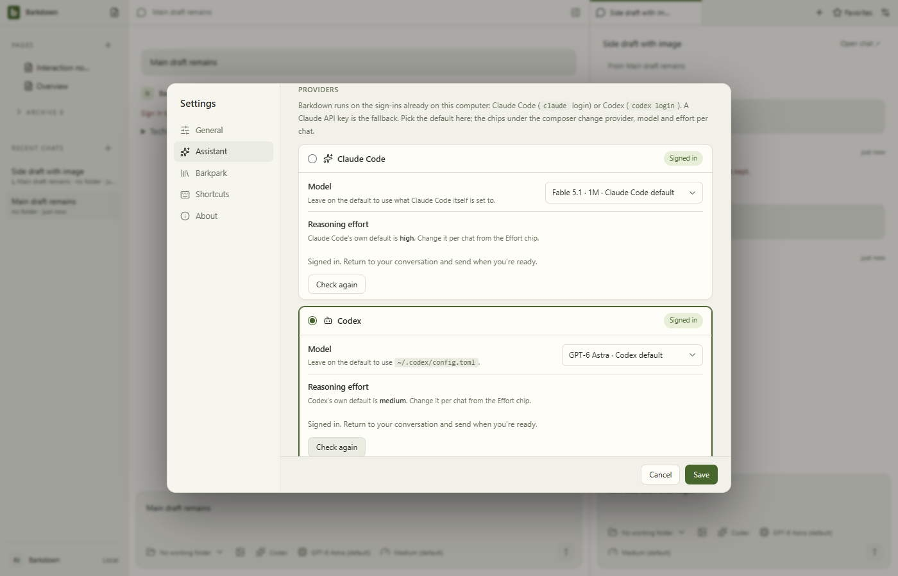
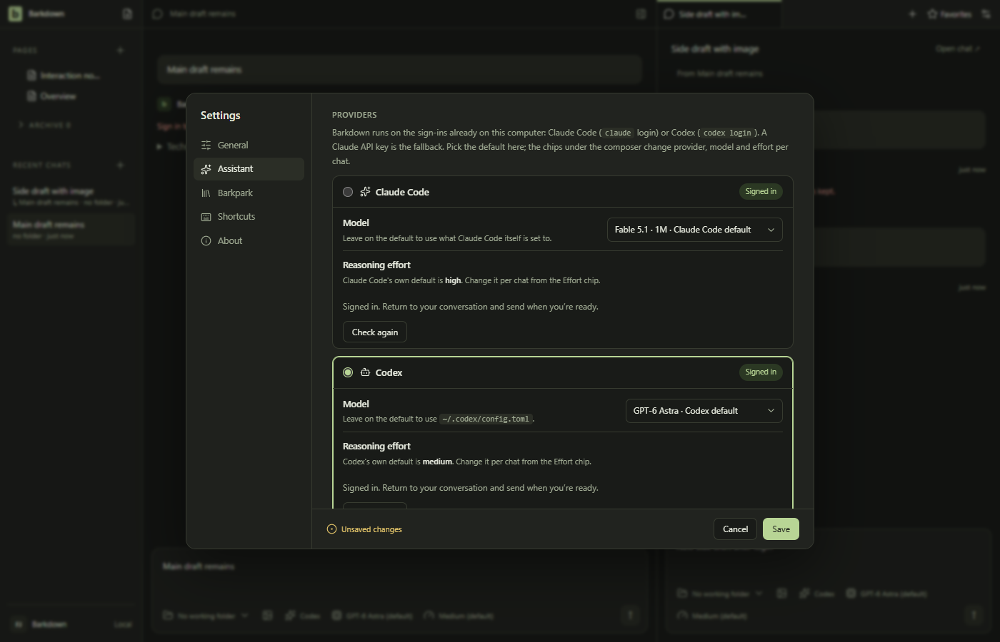
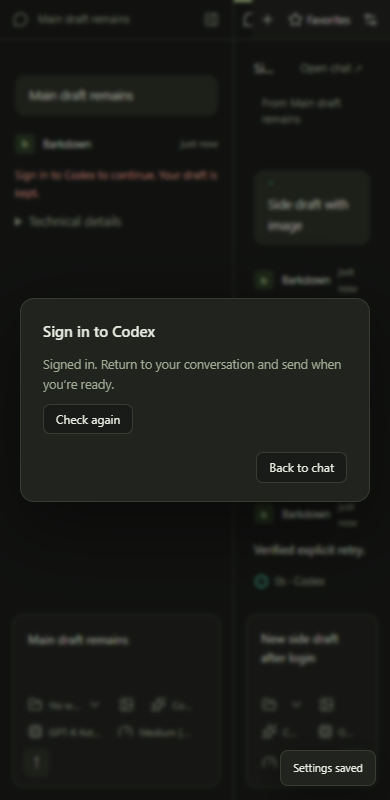
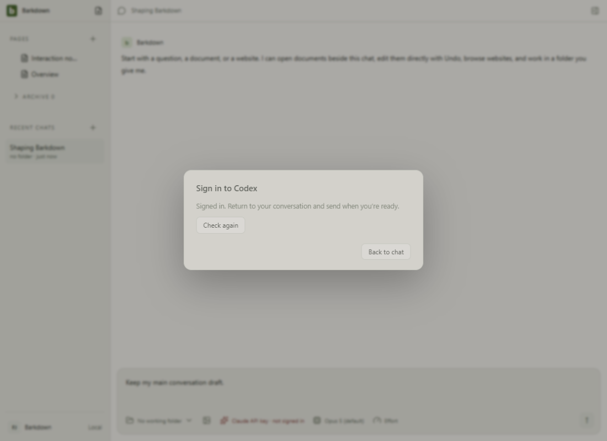

## Review and limits

Codex inspected all nine stills, the goal assistance still and 17 intermediate video samples. Hidden-button styling and provider-menu dismissal were corrected before this source checkpoint. The full original video remains available above. Settings scrolls to reach lower provider cards; no control was removed to fit the still. Startup, resizing and the normal Settings-saved toast remain visible in motion.

Behavior tests additionally exercise native Windows worker Jobs with synthetic credentials for A/B across API, Claude and Codex. No real device credentials were changed. Real read-only login-status probes were successful, but are distinct from the controlled sign-in journey. POSIX native containment and packaged-app execution remain unverified here. Initial provider badges/default selection still rely on file detection until a fresh status check, so keyring-only detection is a remaining limitation.

The first isolated Paper attempt [refused a dirty evidence pointer and stopped its runtime](1c94f8d/live-capture-refusal.log). Live Paper freshness and root verification are still required; this gallery does not close C039/P1. The [cycle handoff](../../cycles/C039-provider-authentication.md) owns current status.

## Changelog

- 23 September: source `1c94f8d` adds explicit sign-in assistance, status verification, cancellation, preserved drafts and shared goal assistance. Full desktop and targeted checks passed; this gallery records the bounded native UI proof.
