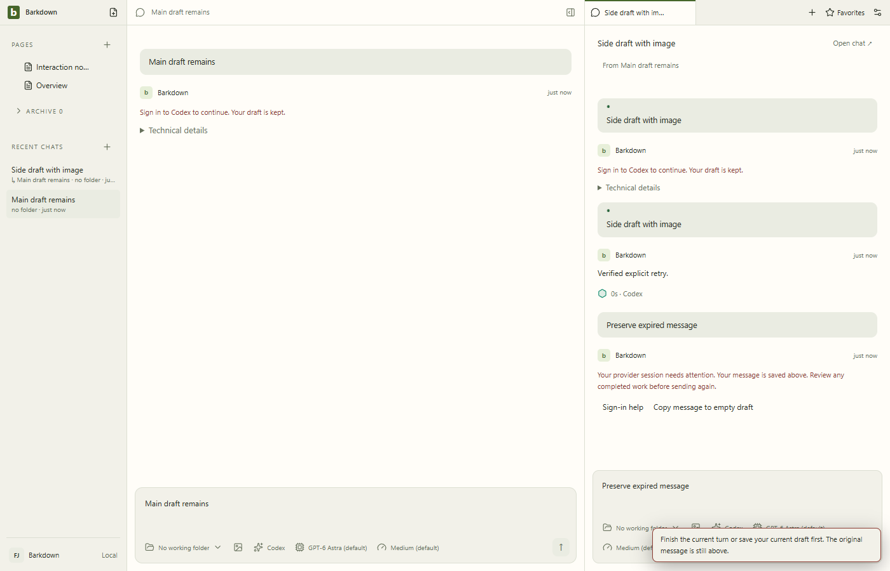
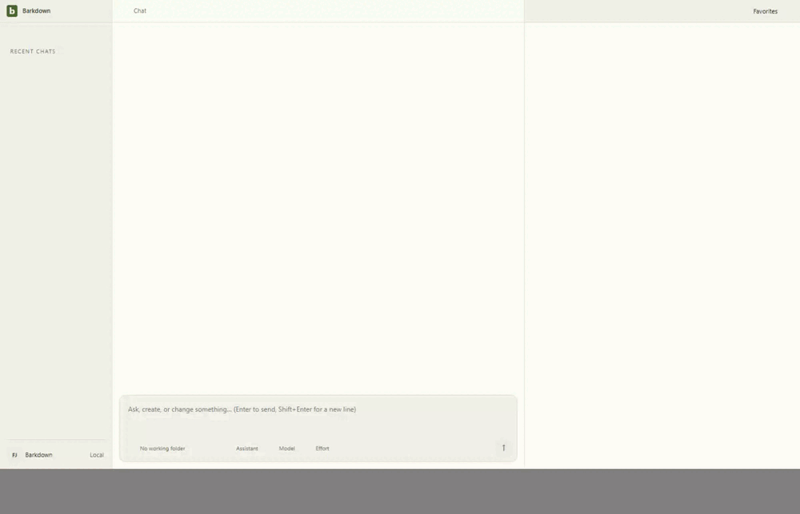

# Provider sign-in assistance

## Current recovery checkpoint — 27ea120

The [clean-source journey](27ea120/manifest.json) now includes expired-session assistance and explicit recovery into an empty draft. Initial supported CLI status discovery replaces file-existence detection, including keyring-only sessions; native bootstrap tests prove existing explicit provider choices survive. Controlled failures distinguish authentication from quota/network/tool-permission errors. Goal assistance also routes API-key failures to the captured profile's Settings without resuming work.

Ten source-bound stills were inspected (the unchanged first still was hash-compared with the prior reviewed image), along with 19 video samples. Cancellation, retained images, explicit retry, newer-draft refusal and light/dark/narrow controls remain visible. Normal startup and draft-protection toasts are retained, including their short-lived overlap with underlying composer controls. Original video is named in the manifest. All 19 decoded GIF frames were also inspected and the global deterministic candidate is explicitly approved. Final desktop and root verification pass; see [the acceptance audit](../../cycles/C039-completion-audit.md) for C039/P1 scope and limits. The following earlier checkpoint retains its original limits and evidence.

## Earlier login checkpoint — 1c94f8d

Source `1c94f8d`, Windows Electron, 23 September 2026. Actual main/preload, shared main/side composers, Settings and login lifecycle; the process transport and Codex SDK are controlled. This is not evidence of completing a real browser account login. [Manifest and hashes](1c94f8d/manifest.json), [full recorded video](1c94f8d/journey.webm), [desktop regression log](1c94f8d/desktop.log), [focused checks](1c94f8d/focused.log), [four-role goal preflight checks](1c94f8d/goal-provider.log).

## Observed behavior

The missing-auth send retains the main draft. Cancelling sign-in keeps it intact. A side-chat text/image submission survives refusal and successful sign-in; only an explicit retry invokes the controlled provider, exactly once. Settings rechecks leave both drafts unchanged. Goal sign-in help opens the same controls without resuming the scheduler. Dark Settings and the 390px dialog remain reachable without horizontal overflow.

## Review and limits

Codex inspected all nine stills, the goal assistance still and 17 intermediate video samples. Hidden-button styling and provider-menu dismissal were corrected before this source checkpoint. The full original video remains available above. Settings scrolls to reach lower provider cards; no control was removed to fit the still. Startup, resizing and the normal Settings-saved toast remain visible in motion.

Behavior tests additionally exercise native Windows worker Jobs with synthetic credentials for A/B across API, Claude and Codex. No real device credentials were changed. Real read-only login-status probes were successful, but are distinct from the controlled sign-in journey. POSIX native containment and packaged-app execution remain unverified here. Initial provider badges/default selection still rely on file detection until a fresh status check, so keyring-only detection is a remaining limitation.

The first isolated Paper attempt [refused a dirty evidence pointer and stopped its runtime](1c94f8d/live-capture-refusal.log). The [clean retry passed](1c94f8d/live-capture-success.txt), with a real Codex turn after Claude quota refusal; five Paper stills and all 37 GIF frames were reviewed. [Read-only device status](1c94f8d/device-status.json) verified both providers and owned-process cleanup. [Root verification passed](1c94f8d/root-verify.txt). This gallery does not close C039/P1: initial keyring-only selection and expired-session draft handling still need explicit acceptance. The [cycle handoff](../../cycles/C039-provider-authentication.md) owns current status.

## Changelog

- 23 September: source `1c94f8d` adds explicit sign-in assistance, status verification, cancellation, preserved drafts and shared goal assistance. Full desktop and targeted checks passed; this gallery records the bounded native UI proof.
