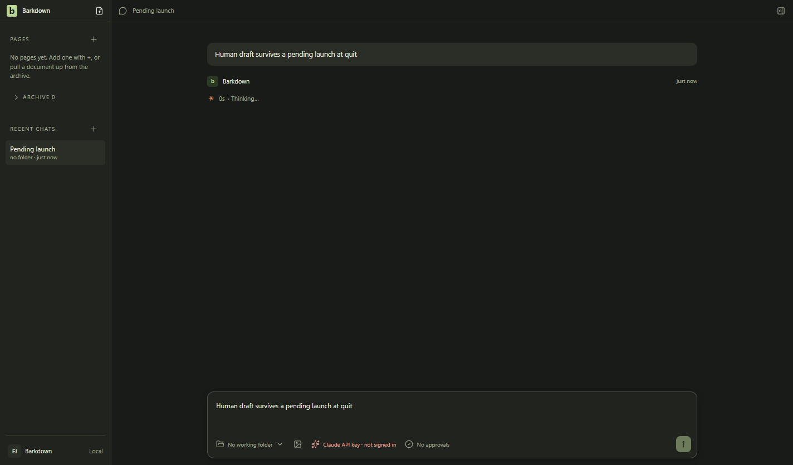
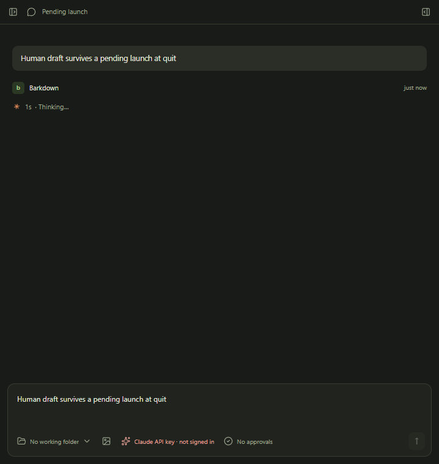
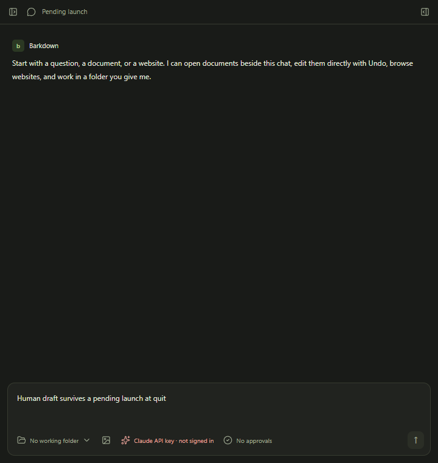

# Quit with a pending Send

C097,7 October2026. Actual dark Electron, renderer Send/IPC, quit and fresh-host restart against a disposable profile. A controlled environment wait holds launch before reservation; quit waits for it, then refuses late dispatch and preserves the human draft. This is not a real provider/worker or Paper-save journey.

[Behavior and limitations](../../cycles/evidence/C097/quit-admission-repair.md) · [Final native receipt](../../cycles/evidence/C097/quit-admission-native-01/result.json)

All three images inspected full size. Standard fixture/private Paper capture is a separate regression gate. Existing root editing demo remains applicable because this repair changes shutdown admission, not note editing.
