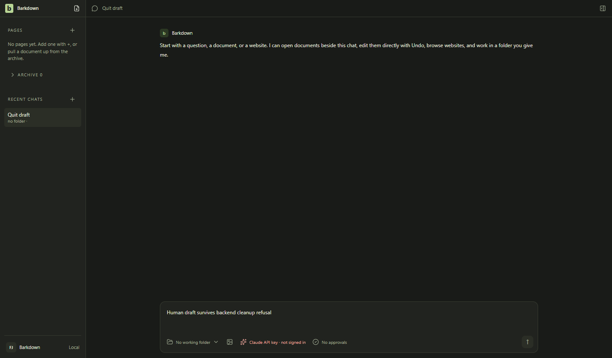
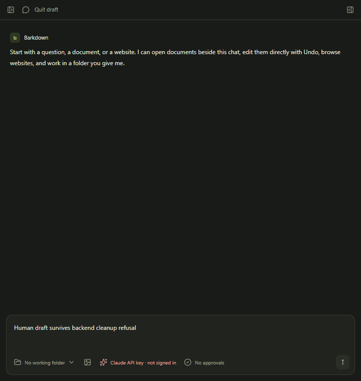

# Quit after failed driver cleanup

C097,7 October2026. Actual Electron and disposable profile disk state, with a controlled cleanup-failed receipt in the real run registry. Two quit attempts keep the same host open even after the failed run leaves the live map. Saved human words remain; a test-only host exit and fresh launch restore them. No real provider, child process or Paper server was launched. Native dialog requests are intercepted and asserted, so the images show the retained app rather than dialog layout. Backend services may remain closed; automatic recovery and descendant death are not proven.

[Behavior, source and limits](../../cycles/evidence/C097/quit-backend-review.md) · [Final native receipt](../../cycles/evidence/C097/quit-backend-final-01/result.json)

All three images inspected full size by Codex Windows C097. Normal fixture/live Paper regression capture is recorded separately; these stills do not establish Paper-save or real-provider success.
