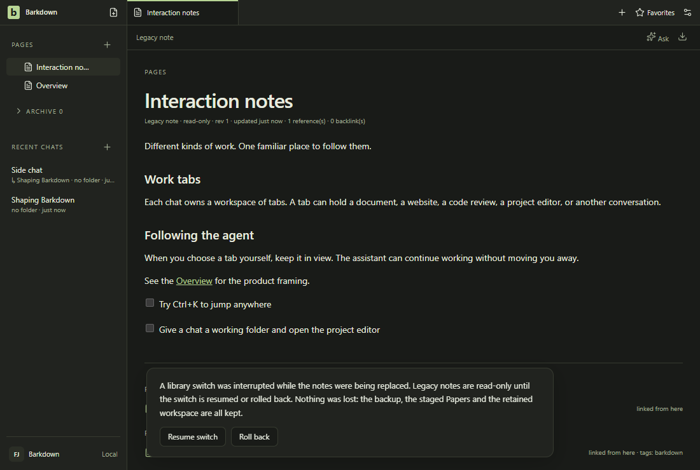

# retained

After the library switch the legacy notes are retained read-only. Dark by default; the light frame compares theme contrast. Fixture journal; no Paper server.

[Full comparison](../runs/2026-10-09T04-30-29-731Z/README.md) · [Capture manifest](../runs/2026-10-09T04-30-29-731Z/manifest.json)

## Changelog

- 2026-10-09T04:32:19.882Z: Reviewed all44fixture stills,44difference images and44encoded GIF frames through contact sheets, plus original narrow workspace/goals/profiles/adoption and Settings. Only measured pixel change is the disposable CLI path; geometry unchanged. Seventeen new browser/agent-browser images reviewed. Dark default; required light frames review theme contrast. Full Windows Desktop1163196ms/88commands passes; actual packaged Paper/reader six native images and native lifecycle remain separate. Fixed80column reader overflow remains open; no installer, live provider, Studio, Mac or A2/A3/A5 acceptance. Source 7634348c0; [review](../reviews/approval-a350d16e9fee56bea7cf552e8f663ca774f2e1183313730586688357d4aea3d7.json) - [comparison](../runs/2026-10-09T04-30-29-731Z/comparison.json).
- 2026-10-08T12:59:14.021Z: Reviewed all44 fixture frames, all37 lossless and37 encoded live editing frames, five live stills, Settings before/after/diff, narrow profiles and Score selection; dark default, light contrast comparison. Sole fixture difference is random temporary CLI path (0.00021499), geometry/environment unchanged. Separate packaged terminal wide/narrow images and real restart/zero-active quit passed; native OS-only PATH fallback and ownership regression passed. Live source capture serves0.2.26.5027; it is distinct from the carried production package. Full Desktop and root checks remain pending. No installer, Mac transfer or A2/A3/A5 acceptance. Source 78a885f67; [review](../reviews/approval-8f45c8b8deb528a4778000ca3847a2ffe46b18e62f393008076ec64cc55c4eec.json) - [comparison](../runs/2026-10-08T12-55-29-276Z/comparison.json).
- 2026-10-08T11:52:58.137Z: C098 retention fix e0426211: all44 fixture frames inspected in contact sheets; Settings before/after/diff and narrow profiles/goals inspected full-size. Sole pixel difference is random temporary CLI path; geometry/environment unchanged. Five live stills plus all37 lossless and37 encoded editing frames inspected separately; table Score selection/edit preserved. Retention/lifecycle20 checks pass22.094s; actual capture preserves1304 earlier runtime directories and prior1917files byte-identically. Carried package lifecycle/reader evidence remains separate; optional upstream80-column TUI overflow, installer and A2/A3/A5 are not accepted. Source e04262114; [review](../reviews/approval-2de372e492a3dc28a226f5b5c6d85a65e308f289c35577d18fa79200ed7ad916.json) - [comparison](../runs/2026-10-08T11-51-09-225Z/comparison.json).
- 2026-10-08T08:34:56.717Z: Capturefa6775a0 after preserving-tool repair:43 of44 standard PNGs are byte-identical to capture02, whose entire gallery and full-size narrow goals/profiles/adoption were inspected. Opened the sole changed Settings assistant frame; only the random owned CLI path differs, changedRatio0.000242, all geometry/environment unchanged. Opened five fresh live Paper stills and inspected all37 lossless editing frames through seven contact sheets, including slash/quote typing, table selection/Tab and quick-open transitions. Dark default; light stills explicitly compare contrast. Actual Claude read/edit turn against isolated carried release, no real library. Full Windows Desktop02 passes814.562s, five existing skips; native06/Electron03 independently prove owned restart/crash recovery. No installer, clean-machine, Mac transfer or A2/A3 acceptance claimed. All earlier captures/failures remain retained; preserving inventories never approve media. Source fa6775a05; [review](../reviews/approval-2e4f478c7c8259fe4c48952f4c9c6220b87f67716bb60c7a0f1b8ce51e72acac.json) - [comparison](../runs/2026-10-08T08-32-40-709Z/comparison.json).
- 2026-10-08T08:18:24.311Z: Inspected all44 standard candidate frames across nine areas, full-size narrow goals/profiles/adoption, all37 lossless live Paper editing frames and five live stills, plus decoded GIF overview/palette frames. Candidate230e5d76 corrects capture default to dark; document/retained light frames explicitly compare theme contrast. Environment and all control geometry unchanged; large pixel changes follow theme selection, with readable menus, dialog actions and no overlap. Live isolated capture records actual Claude turn. Actual Windows driver-native-06 and Electron03 prove restart/forced host recovery separately; fixture tours do not establish live scheduler, migration, installer or A2/A3 acceptance. First capture remains retained/unapproved. Full Desktop rerun is pending after documented skip-ratchet repair. Source 230e5d769; [review](../reviews/approval-118c9e2ea5017a5fc8e6afbf58f11f535977ef00caf0cd5b1c018485ceccc3d6.json) - [comparison](../runs/2026-10-08T08-15-25-190Z/comparison.json).
- 2026-10-08T02:16:06.708Z: Capture36 at d3c1705b: inspected 44 standard stills, 44 differences and 44 motion frames, five Paper stills and 37 GIF frames. Enlarged Settings, both 390px Goals states and Paper frames29/36. Only temporary Settings command path differs (ratio0.00015970515970515972), no geometry regression. Light fixtures retain theme/contrast purpose; dark root demo remains applicable. Three final dark native import-journal frames reviewed: full unfinished-import explanation is readable before/after restart. Six malformed journals refuse actual IPC selection; valid imported/ordinary controls pass.39 adjacent tests pass; final native8.958s. Original native bypass and all harness failures retained; capture35 superseded before approval for CI artifact output. Paper uses real isolated server and labeled sample transcript, no provider turn. No actual interrupted database restore, Mac transfer or A2 acceptance. Source d3c1705b2; [review](../reviews/approval-73b2ebec60ed10c7bc42ec50c24dd6af5f5fd7425a70cfda06750f6f3f1868f2.json) - [comparison](../runs/2026-10-08T02-14-29-183Z/comparison.json).
- 2026-10-08T01:55:07.681Z: Capture34 at 8873261f: inspected 44 standard stills, 44 differences, 44 motion frames, five private Paper stills and 37 GIF frames; enlarged Settings, both 390px Goals states and Paper frames 29/36. Only temporary Settings command path differs (ratio 0.00019287469287469287), no geometry regression. Light fixtures retain theme/contrast comparison purpose; existing dark root demo remains applicable. Four dark two-installation native images and 17 hosted coordinator images reviewed. Native portability passes in 326807ms and exits 17.159ms after final result; original 90-second rejection deadline preserved. This test harness is outside hosted Desktop. Hosted31 passes at 8863e703; prior intermittent startup delay remains unexplained. Paper uses a real isolated private server with explicitly labeled sample transcript and no provider attempt. No Mac transfer or A2 acceptance. Source 8873261fa; [review](../reviews/approval-bd49b810baa5c9dcb4c7c58f45a1ed1ba38c046041c9a12a892e04dc315e5630.json) - comparison (`docs/visual/runs/2026-10-08T01-51-57-455Z/comparison.json`, kept in git history).
- 2026-10-08T01:08:32.871Z: Capture33 at b05d39bf startup diagnostics. Inspected44 standard stills,44 differences,44 motion frames, five private Paper stills and37 GIF frames; enlarged Settings, both390px Goals states and Paper frames29/36. Only temporary Settings command path differs (ratio0.00019656019656019656), no geometry regression. Existing light fixtures preserve theme/contrast comparisons. Also reviewed17 native coordinator and18 applicable terminal/original-history images; hosted failure30 nine images retained. Five diagnostics/five ownership checks, ordinary/recovery phase assertions and20 remaining Desktop commands pass locally. Hosted startup delay remains unresolved; no deadlines or receipt semantics changed. Paper uses real private server with explicitly labeled sample transcript and no provider attempt. No Mac transfer or A2 acceptance. Source b05d39bf3; [review](../reviews/approval-027f29b41e9ef8b733824c710d273318e4757e6def8920b56555dab8bec1867a.json) - comparison (`docs/visual/runs/2026-10-08T01-07-05-447Z/comparison.json`, kept in git history).
- 2026-10-08T00:21:40.386Z: Capture32 at22594902 after import-count implementation84d1a56f. Inspected44 standard stills,44 differences,44 motion frames and five private Paper stills plus37 GIF frames; enlarged Settings, both390px Goals states and Paper frames29/36. Only temporary Settings command path differs (ratio0.00021744471744471745), no geometry regression. Light fixtures preserve existing theme/contrast coverage. Four dark native refusal/valid-transfer images and roadmap also reviewed. Native420.850s and77 adjacent tests pass. Paper uses real private server with explicitly labeled sample transcript; no provider attempt here. Capture31 remains rejected for tracked documentation changes during capture. No Mac transfer or A2 acceptance. Source 22594902d; [review](../reviews/approval-a536ae99d9cb523346aa6c7bf7c43e8d08443c91ab2b968aa047a64b2461517c.json) - comparison (`docs/visual/runs/2026-10-08T00-20-16-897Z/comparison.json`, kept in git history).
- 2026-10-07T23:47:09.331Z: Corrected capture30 attestation, same0802b65b candidate: all44 stills/differences/motion frames and five Paper stills/37 GIF frames inspected; Settings,390px Goals and Paper29/36 enlarged. Only temporary command path differs; geometry unchanged. Prior attestation incorrectly carried forward sample-transcript wording. Actual manifest chat.real=true/provider=claude and inspected transcript show one completed read/edit turn; no sample fallback. Capture omitted the earlier blocker environment setting. This proves one disposable-profile Claude turn, not broader provider continuity, Codex success or Mac transfer.40 export units,109 adjacent checks and Windows two-installation journey pass; first native launch failure retained. Light fixtures retain theme/contrast coverage; native dark frames and roadmap separately inspected. Source 0802b65b8; [review](../reviews/approval-816bb797407f5549d1583d8ed57d139dbf16af2c7553b5cc92f64169f5d72940.json) - comparison (`docs/visual/runs/2026-10-07T23-42-58-824Z/comparison.json`, kept in git history).
- 2026-10-07T23:45:01.707Z: Export-count repair at 0802b65b. Inspected all 44 standard stills, 44 differences and 44 motion frames, plus five private Paper stills and all 37 GIF frames. Enlarged changed Settings, both 390px Goals states and Paper frames29/36. Only temporary command path differs (0.01855 percent); no geometry change or new clipping. Existing light fixtures retain theme/contrast coverage; dark native transfer frames and roadmap reviewed separately. Paper uses a sample transcript with a real isolated editor; no provider success or Mac transfer claimed.40 export units,109 adjacent checks and actual two-installation journey pass; separate native launch failure retained. Source 0802b65b8; [review](../reviews/approval-208d92a9f91d4d5724785afa0fc6a673f8f93afd325c7a6efc401fcff5e3bce4.json) - comparison (`docs/visual/runs/2026-10-07T23-42-58-824Z/comparison.json`, kept in git history).
- 2026-10-07T22:03:36.903Z: C097 at39c06b94: inspected all44 standard stills/differences and44 motion frames, five private Paper stills and37 GIF frames in16 sheets; enlarged Settings path,390px Goals and Paper29/36. Only temporary Settings command path differs (0.0002162162), geometry unchanged. Planning/retry, drafts, retained originals, menus and narrow layouts remain readable. Native start-action evidence:50 inspected images, ordinary/recovery and22 resumed commands pass; synthetic delayed success and no-dispatch refusal retained alongside an unexplained earlier synthetic dismissal. Private real Paper uses labeled sample transcript; light variants preserve theme/contrast and original-failure comparison. No native latency-rootcause, real-provider, Mac-transfer or A2 claim. See docs/cycles/evidence/C097/coordinator-click-review.md. Source 39c06b943; [review](../reviews/approval-bc24f3e45d3d9f813f13034437598f4556d211e85d9eae573e04b6e990c3ac02.json) - comparison (`docs/visual/runs/2026-10-07T22-02-07-072Z/comparison.json`, kept in git history).
- 2026-10-07T20:39:10.685Z: C097 source9a74a3af: inspected all44 standard stills,44 differences,44 motion frames, five Paper stills and37 GIF frames; enlarged Settings assistant,390px Goals and Paper29/36. Only temporary Settings command path differs (ratio0.00020761670761670762); no geometry change. Controlled original30s failure and delayed repaired pass retained; ordinary recovery and all21 resumed Desktop commands pass. Segmented validation, not an uninterrupted Desktop pass. Private live Paper uses a labeled sample transcript. Existing light fixtures retain theme/contrast comparison; dark Paper and Original history also reviewed. No Mac transfer or real-provider claim. Source 9a74a3af2; [review](../reviews/approval-b5a18e4e93c34e74070ccdd52087b4e5edd7d387227cda9c08804592ccd16510.json) - comparison (`docs/visual/runs/2026-10-07T20-35-47-119Z/comparison.json`, kept in git history).
- 2026-10-07T19:43:11.187Z: C097 final source d7bf87e8: inspected all44 standard stills,44 differences and44 motion frames; five Paper stills and37 GIF frames in16 sheets, with enlarged Settings assistant,390px Goals and Paper29/36. Only temporary command path differs (0.00022604422604422604); geometry unchanged.32 focused tests and native ownership/CLI/Full YOLO/in-flight checks pass. Full Desktop failed at terminal Settings navigation; addressed terminal shortcut and all17 resumed steps pass, not an uninterrupted suite pass. Original cause unconfirmed; failure retained. Native dark evidence separately reviewed; existing light fixtures cover theme/contrast. Private Paper uses labeled sample transcript; no real-provider,real-library or Mac-transfer claim. Source d7bf87e8b; [review](../reviews/approval-d749e10c538bb30207066a3c0df5044fca4ac5a13174ffa504922bc7df4a9673.json) - comparison (`docs/visual/runs/2026-10-07T19-36-08-034Z/comparison.json`, kept in git history).
- 2026-10-07T19:12:25.022Z: C097 assistant ownership at 92292586: inspected all44 stills,44 differences and44 decoded standard motion frames plus five private Paper stills and37 GIF frames in16 sheets. Enlarged Settings assistant,390px Goals and Paper frames29/36. Only temporary command path differs (0.0002199017199017199); geometry unchanged.32 focused tests and native A/B,CLI,Full YOLO,in-flight selection checks pass; dark native screenshots separately inspected. Existing light fixtures preserve theme/contrast coverage; private Paper uses labeled sample transcript without provider attempts. Full Desktop running; no real-library,real-provider or Mac-transfer claim. Source 922925865; [review](../reviews/approval-f50ae4f9aab4fe9a21b736d4f7a0054622e9c6a7fbb7132982032e230ac6a358.json) - comparison (`docs/visual/runs/2026-10-07T19-09-35-907Z/comparison.json`, kept in git history).
- 2026-10-07T18:44:43.911Z: Capture25 reviewed: all44 standard stills,44 difference images,44 decoded motion frames, five private Paper stills and37 GIF frames in16 sheets. Enlarged Settings assistant,390px Goals and Paper frames29/36. Only the temporary command path differs (0.0002063882063882064); control geometry unchanged. Existing light fixtures retain theme/contrast comparison; native catalog evidence is dark. Private Paper uses a labeled sample transcript without provider attempts. Sixty targeted cases and actual CLI refusal/retry pass; controlled focus loss plus28 resumed Desktop commands pass, with original full-suite failure retained. No uninterrupted suite, real-library, real-provider or Mac-transfer claim. Root demo remains applicable because layout/editor behavior is unchanged. Source 759c6c4f8; [review](../reviews/approval-1c4878f36d54d10ddbd08798f7efa2233f69175089b0d4a62b839671bb4b6251.json) - comparison (`docs/visual/runs/2026-10-07T18-43-27-355Z/comparison.json`, kept in git history).
- 2026-10-07T18:23:09.148Z: Catalog command repair at3213c2e5, captured6b72a193. Reviewed44 standard stills,44 differences,44 decoded motion frames and five private Paper stills plus37 GIF frames in16 contact sheets; enlarged Settings assistant and Paper frames29/36. Only the temporary Settings launcher path differs (ratio0.0002027027027027027), no geometry change. Reviewed four actual dark CLI catalog journey stills, including720px drawer/Retry: page-2 refusal exits1, cache/Pages preserved, retry returns201 fresh notes, genuine empty success distinct.60 targeted cases and unchanged3-case probe pass. Existing light fixtures retain theme/contrast comparison; Paper uses labeled sample transcript, no provider attempt. Full Desktop running; no hosted repair, real-library or A2 acceptance claim. Root editing demo remains applicable: no layout/editor behavior change. Source 6b72a1932; [review](../reviews/approval-27ee7ae4d9e2fadb10c6f97571c77aacfabc934645e2441547b8b0d2be653bfb.json) - comparison (`docs/visual/runs/2026-10-07T18-21-27-282Z/comparison.json`, kept in git history).
- 2026-10-07T17:55:46.075Z: C097 coordinator startup diagnostics67e6ddf1. Inspected44 standard stills,44 differences,44 decoded motion frames and five private Paper stills plus37 GIF frames in16 contact sheets. Enlarged Settings assistant and Paper edit/restoration frames29/36; ten native coordinator recovery images reviewed, including full-size390px completion. Only the temporary Settings command path differs (ratio0.00019901719901719902), no geometry change. Existing light fixtures preserve theme/comparison coverage; private Paper uses an explicitly labeled sample transcript. Two diagnostic tests pass162ms; actual Windows descendant query passes; native crash/review/retry passes33.002s. Hosted zero-request/zero-receipt startup failure remains unconfirmed; this is diagnostics only. Full Desktop is running, no hosted repair or provider claim. Root editing demo remains applicable because production rendering/editing is unchanged. Source 67e6ddf10; [review](../reviews/approval-356c3732e63ad5d87f9d5c0cc578cb8ccd28a7631e2bec6f89b3b5bebb0e43d7.json) - comparison (`docs/visual/runs/2026-10-07T17-53-00-261Z/comparison.json`, kept in git history).
- 2026-10-07T16:00:23.996Z: Pending-launch quit repair f4d3ae5d. Inspected44 standard stills,44 differences,44 decoded motion frames,five private Paper stills and37 GIF frames in16 contact sheets; enlarged Settings assistant,narrow Goals/profiles and Paper frames28/29/36. Only temporary Settings command path differs (ratio0.0001977886977886978); geometry unchanged. Score selection,edit and restoration preserve adjacent text. Seven final dark native admission/renderer-refusal images inspected,including720px; draft persistence and zero late dispatch are behavior assertions.21 focused tests,64 adjacent(one POSIX skip),native admission6.389s and renderer refusal24.610s pass. Existing light fixtures cover theme/contrast; private Paper uses a labeled sample transcript. No real-provider,backend recovery,Mac,real-library or installer acceptance. Hosted coordinator failure retained; local replay passes but cause unconfirmed. Root editing demo remains applicable. Source f4d3ae5da; [review](../reviews/approval-40a359506131df10bc105aedaf355b1f2305b8112361cd48a07bbb7a6293afde.json) - comparison (`docs/visual/runs/2026-10-07T15-58-16-316Z/comparison.json`, kept in git history).
- 2026-10-07T15:09:37.717Z: Backend quit receipt repair e9af9e7e: inspected44 standard stills,44 differences,44 decoded standard motion frames,five private Paper stills and37 GIF frames in16 contact sheets. Enlarged Settings assistant,narrow profiles/goals and Paper frames28/29/36; score selection/edit/restoration preserves adjacent text. Only temporary Settings command path differs (ratio0.00019533169533169533), no geometry change. Three final dark native backend refusal/retry/reopen images inspected full size, including720px. Actual Electron uses a controlled failed cleanup receipt; native dialog requests are intercepted, so no dialog-layout or process-death proof. Original two failures retained;39 adjacent cases pass with one POSIX skip,8 focused pass and actual native repeated refusal4.778s. Existing light fixtures cover theme/contrast; private Paper uses a labeled sample transcript. No backend-service reopening,real provider/child,Mac,real-library or installer acceptance. README editing demo remains applicable. Source e9af9e7e6; [review](../reviews/approval-9d2c3384e980efca079f2a760a53af3f018b3f6a30401453e5f2b3c3eb6cb805.json) - comparison (`docs/visual/runs/2026-10-07T15-05-55-021Z/comparison.json`, kept in git history).
- 2026-10-07T14:32:56.155Z: Service quit ordering at9e44b9d2: inspected all44 standard stills,44 differences,44 decoded motion frames,five Paper stills and37 Paper GIF frames across16 contact sheets. Full-size Settings assistant,narrow profiles/goals and Paper frames28/29/36 reviewed; score selection/edit/restoration preserves adjacent text. Only temporary Settings command path differs (ratio0.00016953316953316954), geometry unchanged. Four dark native refusal/retry images inspected full size, including720px toast and unobstructed natural expiration. Existing warning temporarily overlaps composer controls. Native before failure17.051s, repaired replay23.101s and normal regression22.916s prove Goals/existing and new terminal continuity;42 adjacent pass,one POSIX skip. Prepared-export quit117.057s passes at committed source. Existing light fixtures cover theme/contrast; private Paper uses labeled sample provider transcript. README demo remains applicable. No backend-drain failure recovery,active real provider/goal,Mac,real-library or installer acceptance claimed. Source 9e44b9d2e; [review](../reviews/approval-46b9f782aeab415f2f7d80c1256403b012edca399692746323832a8085eceb45.json) - comparison (`docs/visual/runs/2026-10-07T14-30-23-180Z/comparison.json`, kept in git history).
- 2026-10-07T14:09:33.231Z: Reviewed source e9563ed4: all 44 standard stills, 44 differences and 44 decoded motion frames; five Paper stills and all 37 Paper GIF frames across 16 contact sheets. Full-size Settings, narrow profiles/goals and Paper frames 28/29/36 inspected. All ten native workspace-quit images inspected. Only standard difference is temporary Settings command path, ratio 0.00019656019656019656, geometry unchanged. Native warning toast temporarily overlays composer controls; natural expiration and unobstructed narrow frame reviewed. Current native quit/refusal/retry/restart 10.537s and clean-frozen export/quit 120.141s pass. Units 6 workspace, 6 handshake, 55 Paper, 5 preparation and 55 adjacent pass. Existing light fixtures cover theme contrast; native captures dark. Private Paper uses labeled sample provider transcript. No real-provider, Mac transfer, real-library or full shutdown acceptance claimed. Source e9563ed4b; [review](../reviews/approval-216da15440bebc8b90f364d15fe9054084574701d6a35ec9a79162750291a44a.json) - comparison (`docs/visual/runs/2026-10-07T13-59-58-497Z/comparison.json`, kept in git history).
- 2026-10-07T13:08:04.734Z: Verified Paper shutdown repair; capture source 500dfb32, app inputs through 41afd5f4. Inspected all 44 standard stills, 44 differences, 44 decoded standard motion frames, five private Paper stills and all 37 Paper GIF frames across 16 contact sheets; targeted full-size Settings, profile form, narrow goals and Paper frames 28/29/36. Only changed pixels are the temporary Settings command path (ratio 0.0002063882063882064); geometry unchanged. Inspected all ten retained native images from runs 02/03/04, including dark refusal and 720px layouts. No new clipping, overlap or missing controls observed; scrollable layouts remain bounded. Behavior proof: 55 host and four handshake cases, 64 adjacent checks; native save/death/refusal/retry/restart 212.541s at eaf2cd31, clean-frozen export/quit 118.167s at 41afd5f4. Rejected dirty-source capture remains unapproved. Existing light fixtures cover theme/contrast; native refusal images and applicable README demo are dark. Private Paper server with visibly labeled sample provider transcript; no real-provider success claimed. Mac, real-library, full shutdown and installer acceptance remain open. Source 500dfb32f; [review](../reviews/approval-036fcb51765d18f763eff952832705a1ec7287fedc7576985940f3e9f72add0e.json) - comparison (`docs/visual/runs/2026-10-07T12-59-48-045Z/comparison.json`, kept in git history).
- 2026-10-07T12:05:30.449Z: Clean frozen Paper quit repair at source 954d0864, implementation f4368062. Inspected all 44 standard stills, 44 differences and 44 decoded motion frames; five private-runtime Paper stills and all 37 GIF frames in 16 contact sheets. Full-size Settings, narrow goals/profiles, and Paper frames 28/29/36 checked. Only temporary Settings command path text changed; geometry, dialogs, focus, intermediate edits and table cells remain correct. Light fixtures cover theme contrast; dark root demo remains applicable to unchanged interaction. Native export-to-quit replay at f4368062 passed 120.774s with actual saved:true, frozen lock intact and no warning; 51 host and 64 adjacent tests passed. Sample provider transcript explicitly labeled; no real-provider or Mac-transfer claim. Dirty frozen shutdown remains outside this bounded fix. Source 954d08648; [review](../reviews/approval-2c29a650565b284aeb4059385b1fd707cdf9bd6f373effcb5b18daa762e058a1.json) - comparison (`docs/visual/runs/2026-10-07T12-00-52-216Z/comparison.json`, kept in git history).
- 2026-10-07T11:41:56.413Z: Inspected44 standard stills/differences and44 decoded motion frames; five Paper stills/37 GIF frames, full-size Settings/narrow Goals/profiles and table frames28/29/36. Only temporary command path characters differ, no geometry change. Paper Tab edits Score and preserves Fixed in. Native import/Undo/recovery and two-installation identity text checks pass, two dark native images inspected. Retained quit warning remains unresolved. Light fixtures serve theme/contrast regression; dark root demo remains applicable. Sample transcript, no new provider attempt; no real-library/Mac-transfer acceptance. Source ebad31b82; [review](../reviews/approval-27fb472cb992e556d0cc66c77b444d1473137417896c5d99beed8d96cedb1afc.json) - comparison (`docs/visual/runs/2026-10-07T11-39-53-163Z/comparison.json`, kept in git history).
- 2026-10-07T10:59:00.870Z: Inspected all44 standard stills/differences and44 decoded motion frames, plus five private Paper stills and37 GIF frames. Full-size changed Settings and narrow Goals/profile views checked. Only temporary command-path characters differ; geometry unchanged. Paper frames28/29/36 now edit Score and preserve Fixed in, paired with selection/content assertions. Capture12 rejected and retained. Light fixture/theme comparison and Paper contrast coverage; dark root hero/demo remain applicable. Sample transcript, no provider retry.34 adjacent export/import checks and headless native logical export53.042s pass; no real-library or Mac transfer claim. Source 009314fd9; [review](../reviews/approval-e9cba441fad86fe7b27d524664f55c4e971d2bbd4997f87c98429e29f6d48984.json) - comparison (`docs/visual/runs/2026-10-07T10-56-47-815Z/comparison.json`, kept in git history).
- 2026-10-07T10:22:16.978Z: Inspected 44 standard stills and differences, all 44 decoded motion frames, five private Paper stills and 37 editing frames. Full-size changed Settings and narrow Goals/profile layouts inspected: only temporary command-path characters change; no geometry change. Light fixtures retain baseline/theme regression coverage; Paper light is contrast comparison. Paper transcript is sample with no provider attempt. Runtime application source b4e85d7f remains unchanged by the subsequent atomic test-clock repair; root dark demo remains applicable. Native logical export is headless, with no new UI claim. Source b4e85d7fc; [review](../reviews/approval-8a62e2ff4acb175ef3061f8851674979543b179a3c69d311f55bd1ef56fc77e4.json) - comparison (`docs/visual/runs/2026-10-07T10-13-40-517Z/comparison.json`, kept in git history).
- 2026-10-07T09:46:36.895Z: Inspected44 standard stills and differences plus44 decoded GIF frames at7d894206.43 stills unchanged; Settings Assistant has a shorter temporary command path on one line instead of two, moving the provider section upward. Full-size before/after inspection found no clipping or control loss; geometry change is disclosed. Narrow, intermediate and recovery states reviewed. Light fixture views retain baseline theme/contrast coverage; dark retained/document and Paper views reviewed. Five private Paper stills and37 decoded motion frames inspected; transcript explicitly sample, no provider attempt. Archive path behavior is proven separately by before/after refusal and adjacent tests; native portability closeout remains separate. Source 7d8942066; [review](../reviews/approval-064474ee55e15b0f2d9e7f8a2dc3de71ca2fc3cab55c2b891c053ce2262dcb69.json) - comparison (`docs/visual/runs/2026-10-07T09-43-25-077Z/comparison.json`, kept in git history).
- 2026-10-07T07:46:23.869Z: Inspected 44 standard stills, 44 differences, 44 decoded standard GIF frames, five Paper stills and 37 decoded Paper GIF frames. Full-size Settings before/after, dark Paper hero and connection Settings inspected. Also inspected 17 native coordinator stills, ten controlled focus-loss stills and two hosted pre-failure images, including interrupted/narrow views. Only temporary Settings path differs; geometry unchanged. No new clipping or overlap. Light scenes cover contrast and preserve failing native theme; sample transcript remains explicit. Source a19a1b762; [review](../reviews/approval-3416e55efdb691721d423754e477a03194260752e3ed5dea45595ebbf9e488a9.json) - comparison (`docs/visual/runs/2026-10-07T07-41-42-615Z/comparison.json`, kept in git history).
- 2026-10-07T07:04:23.575Z: Inspected 44 stills, 44 differences, 44 decoded standard GIF frames, 5 Paper stills and 37 decoded Paper GIF frames; full-size changed Settings before/after, Paper dark hero and connection settings; two native recovery screenshots. Only temporary command-path text changed; geometry unchanged. Light frames retain theme/contrast coverage. No new clipping or overlap; existing GIF shadow bands and narrow canvas padding retained. Source 3cc671171; [review](../reviews/approval-326ad3e3d8429da7c6f7312f3f106bcf9a0ecf3ed7d16f7c96f0f9c702652736.json) - comparison (`docs/visual/runs/2026-10-07T06-59-28-713Z/comparison.json`, kept in git history).
- 2026-10-07T06:20:26.495Z: Inspected all 44 stills, all 44 difference images and all 44 decoded GIF frames; enlarged Settings Assistant before/after. Only temp-path text changed, with stable geometry. Native adoption and real short-path regression pass. Existing light fixtures retain theme/contrast coverage; dark Paper hero remains current. No new visual regression found; existing GIF palette bands/narrow padding remain. Source 7f3f4d197; [review](../reviews/approval-aeadd7244feacaf8443c96705fd78fcc95a936a0a54b31517e7df8e3c9ba913e.json) - comparison (`docs/visual/runs/2026-10-07T06-18-14-648Z/comparison.json`, kept in git history).
- 2026-10-07T05:48:12.897Z: C097 at368108c5: inspected all44 stills,44 difference images and44 decoded GIF frames, including narrow layouts and theme contrast.43 stills are identical; the sole Settings change is the longer disposable command path wrapping to two lines, inspected before/after full size. No environment change; existing fixture GIF palette bands and narrow padding remain. Fresh private Paper:5 stills and37 GIF frames inspected, with an explicitly labeled sample transcript and recorded prior provider blockers; no real-provider attempt claimed. Final keyboard proof:8 native checks,4 dark stills and37 video samples reviewed. Project-file Settings refusal and terminal-focus shortcut pass; interaction78 and resumed Desktop checks pass. Failures remain retained. Source 368108c52; [review](../reviews/approval-6d5d351320821801d2aab9aacaeb384c0bcd94d803a855752ed9b8ad9c38ec6c.json) - comparison (`docs/visual/runs/2026-10-07T05-45-55-273Z/comparison.json`, kept in git history).
- 2026-10-07T05:14:08.744Z: Reviewed all44 stills,44 differences and44 decoded GIF frames at a1470fbe, with Settings before/after inspected full-size.43 stills identical. The temporary command path is shorter, wraps to one line instead of two, and moves the provider area upward; this explains the sole geometry flag. Controls remain reachable. Existing GIF palette bands and narrow padding are unchanged. Light scenes retain theme/contrast coverage. Interaction tour77 passes; Windows editor matrix20/20 and writer proof are retained separately. Matrix review exposed the existing Control+, Settings collision, still open; this gallery does not approve that editor shortcut journey. Live Paper at928f1933 remains applicable without restamping. Source a1470fbe9; [review](../reviews/approval-51d0940f8a2eca70d730cd055e56adfc5de37d5759d42e2b9bd5ebd1f0984544.json) - comparison (`docs/visual/runs/2026-10-07T05-12-13-344Z/comparison.json`, kept in git history).
- 2026-10-07T04:50:21.144Z: C097 CI repair at c75024bc: inspected all 44 stills, 44 difference images and all 44 decoded frames across nine GIFs, including intermediate states, narrow layouts and dark/light contrast coverage. Forty-three stills are pixel-identical; the only pixel change is the disposable command-line path in Settings, inspected before/after full size. Geometry and environment are unchanged. Existing fixture GIF palette bands and narrow padding remain; this test-only change adds no UI regression. Native login six checks, ten stills and eighteen 2-fps video samples reviewed; desktop queue passes in retained resumed receipts ci-desktop-01/02/03, with original failures preserved. Existing live Paper capture remains applicable because production and status-capture inputs did not change; its labeled sample transcript is not real-provider proof. Native POSIX creation-time test collection remains unverified. Source c75024bc9; [review](../reviews/approval-b6233c57ef3b1e84cbb59b942595604ca8189965800f05d7be2aea121d66564f.json) - comparison (`docs/visual/runs/2026-10-07T04-48-18-581Z/comparison.json`, kept in git history).
- 2026-10-06T22:47:24.717Z: C097 Windows return: inspected all 44 stills, 36 difference images and 44 decoded frames across nine fixture GIFs, including narrow dialogs, menus and intermediate states. Intentional changes since C080 reflect the Mac-delivered read-only originals, retained-note coverage, profile export/import, provider controls and Electron 44.5.1. Existing fixture GIF palette bands and narrow-frame padding remain. Separately inspected five live Paper stills and 37 decoded frames; its corrected fallback visibly says sample transcript (Claude quota, Codex timeout), so no real-provider success is claimed. Native browser/terminal, switch/rollback/Resume, forced-exit recovery and two-installation Windows import pass; evidence and limits in docs/cycles/evidence/C097/README.md. Light frames retain theme/contrast regression coverage. No real-library, cross-machine, installer or complete Windows editor-matrix acceptance. Source 928f19336; [review](../reviews/approval-12df93fbccb8e16bed953880e8eda9c8e23b997696587701e4230ecc3698b6b5.json) - comparison (`docs/visual/runs/2026-10-06T22-45-08-629Z/comparison.json`, kept in git history).
