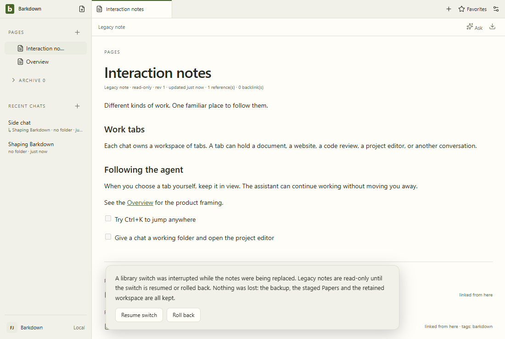

# retained

After the library switch the legacy notes are retained read-only: a badge in Pages and a read-only editor. Fixture journal; no Paper server.

[Full comparison](../runs/2026-10-07T04-48-18-581Z/README.md) · [Capture manifest](../runs/2026-10-07T04-48-18-581Z/manifest.json)

## Changelog

- 2026-10-07T04:50:21.144Z: C097 CI repair at c75024bc: inspected all 44 stills, 44 difference images and all 44 decoded frames across nine GIFs, including intermediate states, narrow layouts and dark/light contrast coverage. Forty-three stills are pixel-identical; the only pixel change is the disposable command-line path in Settings, inspected before/after full size. Geometry and environment are unchanged. Existing fixture GIF palette bands and narrow padding remain; this test-only change adds no UI regression. Native login six checks, ten stills and eighteen 2-fps video samples reviewed; desktop queue passes in retained resumed receipts ci-desktop-01/02/03, with original failures preserved. Existing live Paper capture remains applicable because production and status-capture inputs did not change; its labeled sample transcript is not real-provider proof. Native POSIX creation-time test collection remains unverified. Source c75024bc9; [review](../reviews/approval-b6233c57ef3b1e84cbb59b942595604ca8189965800f05d7be2aea121d66564f.json) - [comparison](../runs/2026-10-07T04-48-18-581Z/comparison.json).
- 2026-10-06T22:47:24.717Z: C097 Windows return: inspected all 44 stills, 36 difference images and 44 decoded frames across nine fixture GIFs, including narrow dialogs, menus and intermediate states. Intentional changes since C080 reflect the Mac-delivered read-only originals, retained-note coverage, profile export/import, provider controls and Electron 44.5.1. Existing fixture GIF palette bands and narrow-frame padding remain. Separately inspected five live Paper stills and 37 decoded frames; its corrected fallback visibly says sample transcript (Claude quota, Codex timeout), so no real-provider success is claimed. Native browser/terminal, switch/rollback/Resume, forced-exit recovery and two-installation Windows import pass; evidence and limits in docs/cycles/evidence/C097/README.md. Light frames retain theme/contrast regression coverage. No real-library, cross-machine, installer or complete Windows editor-matrix acceptance. Source 928f19336; [review](../reviews/approval-12df93fbccb8e16bed953880e8eda9c8e23b997696587701e4230ecc3698b6b5.json) - [comparison](../runs/2026-10-06T22-45-08-629Z/comparison.json).
