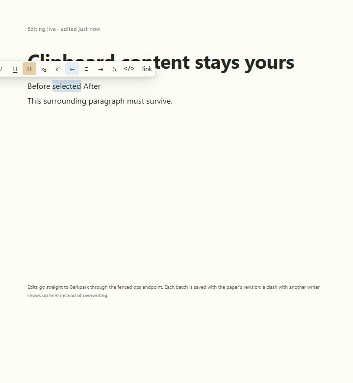
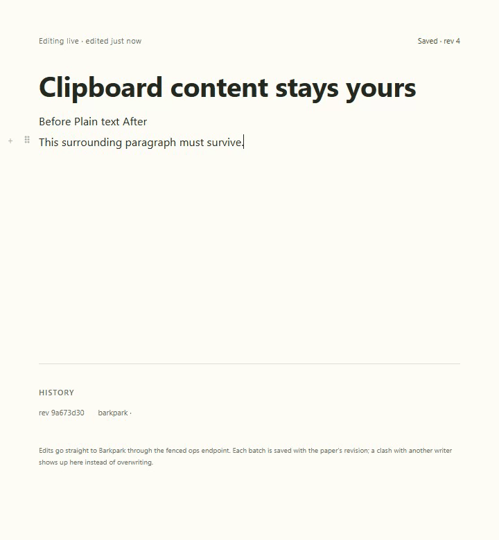
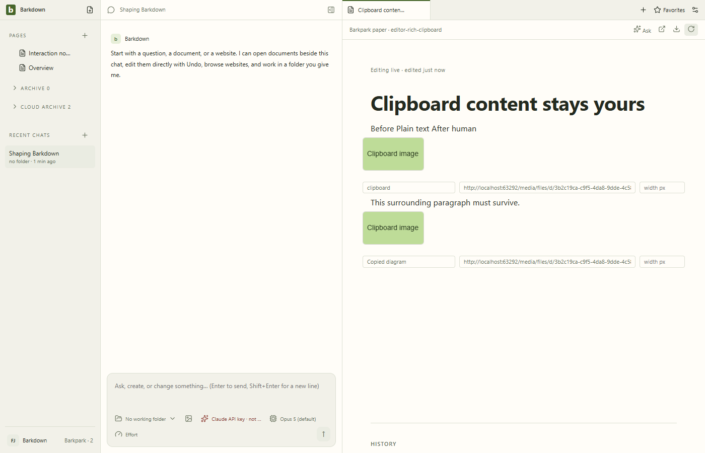

# Rich clipboard health

E009 is in progress. [Baseline failures](before-fix/d8-audit.json) reproduce selected-text deletion on unsupported HTML image paste, missing image siblings, and image-file precedence over rich/plain formats. The baseline script is retained as the executed historical source, not a command to overwrite this evidence.

[Trusted headless Chromium proof](native-headless/2026-09-22T03-30-10-747Z/result.json) verifies clean upstream3495f545c. One file plus image-only HTML uses the host uploader and retains alt text; explicit plain paste wins; ambiguous table/text plus images preserves the draft. No original external image URL is fetched. This is not every OS clipboard producer or arbitrary HTML media fidelity.

Actual Paper server uploads, history/reload, motion and narrow recovery evidence remain queued. [Cycle handoff](../../cycles/E009-rich-clipboard.md).

### Frozen headless comparison

[Six-case comparison and recorded image review](comparison/3495/comparison.json) uses the existing tolerance20/local32px tile comparator and retains exact before/after/difference hashes. Changes were visually inspected; the nested-details control is pixel-identical. [Exact3495 full upstream log](upstream-3495-full.txt) passed. Actual Paper upload and durability evidence remains pending.

## Actual Paper closeout

Clean25cb114/3495 native uploads, Undo/redo, later human save and reload passed. [Exact manifest](runs/2026-09-22T04-50-27-798Z/manifest.json), [review and hashes](runs/2026-09-22T04-50-27-798Z/review.json). Earlier pending statements above describe the retained checkpoints.

Nine stills,112 video samples and46 GIF frames reviewed. Mixed independent image/text remains explicit no-op recovery; this is not arbitrary HTML media support.
