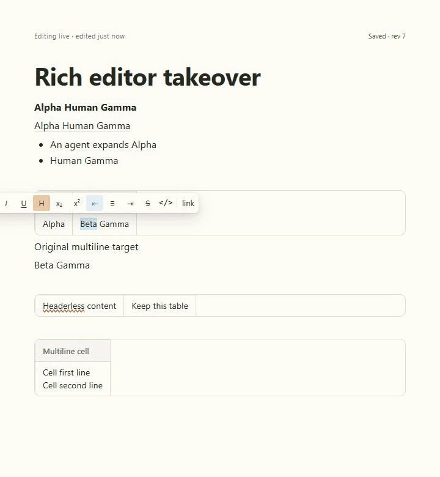

# Rich-content takeover

E003 closed: formatting/link changes and edits in neighboring list/table content retain the human selection. Actual keyboard replacement and acknowledged server content agree in all five live cases. [Handoff](../../cycles/E003-rich-content-takeover.md).

[Full video](runs/2026-09-22T00-15-10-579Z/rich-takeover.webm) · [Reviewed evidence](runs/2026-09-22T00-15-10-579Z/review.json) · [Structured read](runs/2026-09-22T00-15-10-579Z/structured-read.txt). Exact source9424b97/upstream8530a9e23. Ten stills, 115 decoded GIF frames and 112 video samples reviewed.

## Change record

- 2026-09-22: Real PM mark operations and mapped unchanged list/table structure preserve selection and native Undo. Basic rich Markdown tables no longer disappear during agent replacement. Unsupported mixed/nested or lossy conversion fails before mutation.
- Headless/multiline/aligned tables remain readable as structured blocks; full advanced table edit/export support is next. No broad roundtrip or upstream merge-readiness claim. Structural replacements remain conservative.
- Baseline failures and diagnostic captures remain alongside final evidence. Dedicated run uses production adapter, not a model turn; separate live status capture uses actual Codex.
