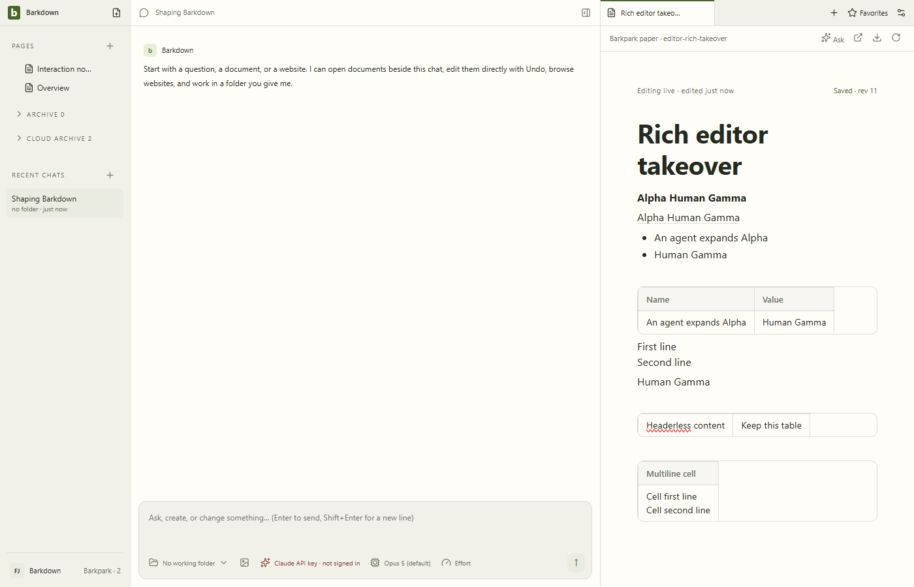
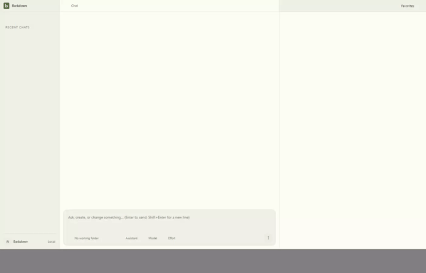

# Combined rich-content takeover review

Clean Barkdown `abbbcee` with Barkpark `8530a9e23`; actual server bundle SHA `6850a97eb9a7af6b9e0af9513c239ee4be19398d`. Private XP8A6P completed five real edit/save cases and MCP structured read, then stopped normally. Original manifest is unchanged.

[Original continuous video](rich-takeover.webm), [server revisions and hashes](manifest.json), [named review](review.json), [actual MCP read](structured-read.txt).

Root inspected all ten stills,26 whole-video samples at1fps and42 table-transition samples at10fps. The selected human text survived acknowledged agent changes and subsequent typing saved alongside the rich content. No new title/body displacement was observed in the sampled transition. GIF is a1fps summary; retain the video for original motion. These are actual production adapter operations without a model turn, not proof of all rich authoring or upstream release readiness.
