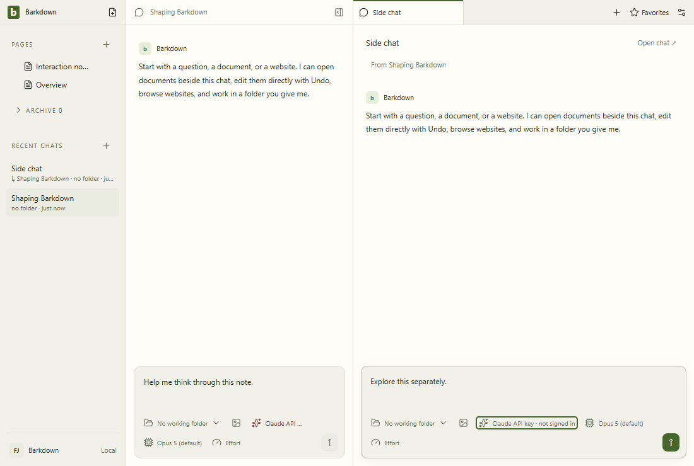
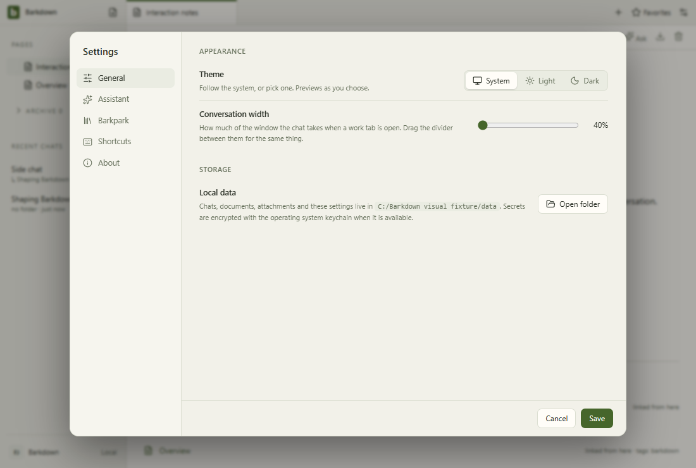

# Candidate visual review

Comparison report only. Approval is recorded separately in docs/visual/approved.json and reviews/. Inspect each before/after/diff, the GIFs and behavior checks. Pixel similarity is not proof of save, ownership or accessibility. Environment changes need recapture in the same environment before regression conclusions.

## workspace: default

new-coverage; geometry changed: true; changed pixels: new.

## workspace: quick-open

new-coverage; geometry changed: true; changed pixels: new.

## workspace: dismiss

new-coverage; geometry changed: true; changed pixels: new.

## workspace: narrow

new-coverage; geometry changed: true; changed pixels: new.

## workspace: restore

new-coverage; geometry changed: true; changed pixels: new.

## chat: draft

new-coverage; geometry changed: true; changed pixels: new.

## chat: provider

new-coverage; geometry changed: true; changed pixels: new.

## chat: dismiss

new-coverage; geometry changed: true; changed pixels: new.

## chat: model

new-coverage; geometry changed: true; changed pixels: new.

## chat: ready

new-coverage; geometry changed: true; changed pixels: new.

## side-chat: open

new-coverage; geometry changed: true; changed pixels: new.

## side-chat: draft

new-coverage; geometry changed: true; changed pixels: new.

## side-chat: provider

new-coverage; geometry changed: true; changed pixels: new.

## side-chat: ready

new-coverage; geometry changed: true; changed pixels: new.

## documents: open

new-coverage; geometry changed: true; changed pixels: new.

## documents: dark

new-coverage; geometry changed: true; changed pixels: new.

## documents: light

new-coverage; geometry changed: true; changed pixels: new.

## settings: general

new-coverage; geometry changed: true; changed pixels: new.

## settings: assistant

new-coverage; geometry changed: true; changed pixels: new.

## settings: barkpark

new-coverage; geometry changed: true; changed pixels: new.

## settings: shortcuts

new-coverage; geometry changed: true; changed pixels: new.

## workspace motion

## chat motion

## side-chat motion

## documents motion

## settings motion

