# Candidate visual review

Comparison report only. Approval is recorded separately in docs/visual/approved.json and reviews/. Inspect each before/after/diff, the GIFs and behavior checks. Pixel similarity is not proof of save, ownership or accessibility. Environment changes need recapture in the same environment before regression conclusions.

## workspace: default

within-tolerance; geometry changed: false; changed pixels: 0.

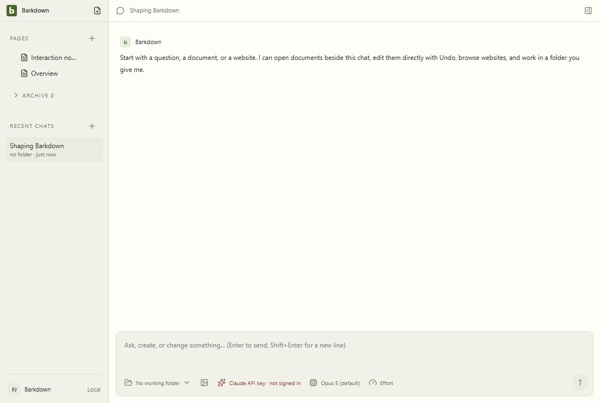

## workspace: quick-open

within-tolerance; geometry changed: false; changed pixels: 0.

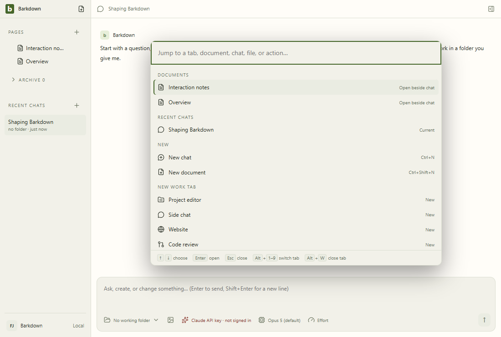

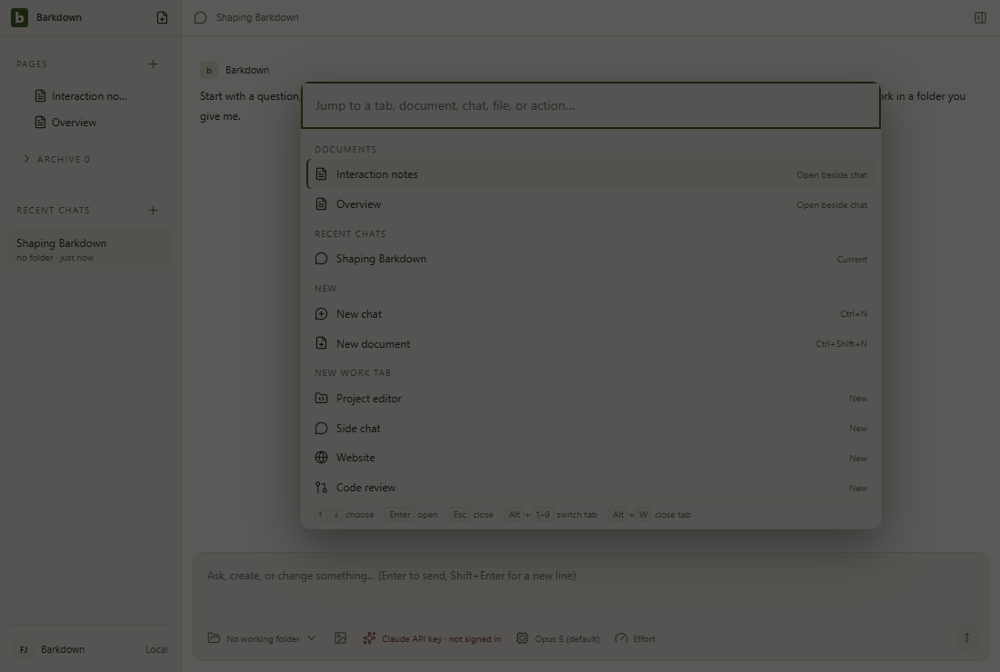

## workspace: dismiss

within-tolerance; geometry changed: false; changed pixels: 0.

## workspace: narrow

within-tolerance; geometry changed: false; changed pixels: 0.

## workspace: restore

within-tolerance; geometry changed: false; changed pixels: 0.

## chat: draft

within-tolerance; geometry changed: false; changed pixels: 0.

## chat: provider

within-tolerance; geometry changed: false; changed pixels: 0.

## chat: dismiss

within-tolerance; geometry changed: false; changed pixels: 0.

## chat: model

within-tolerance; geometry changed: false; changed pixels: 0.

## chat: ready

within-tolerance; geometry changed: false; changed pixels: 0.

## side-chat: open

within-tolerance; geometry changed: false; changed pixels: 0.

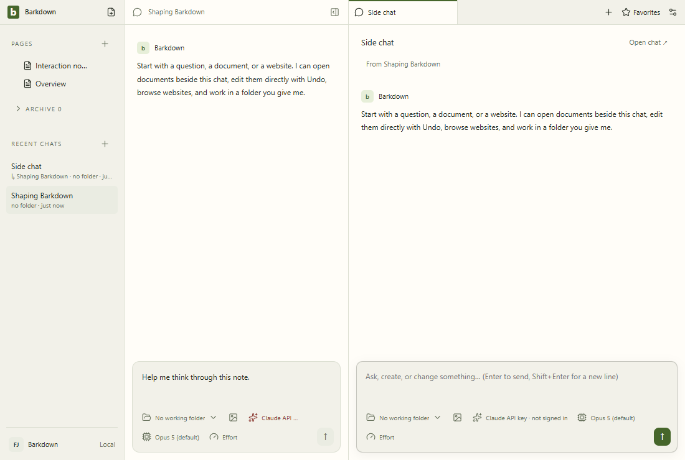

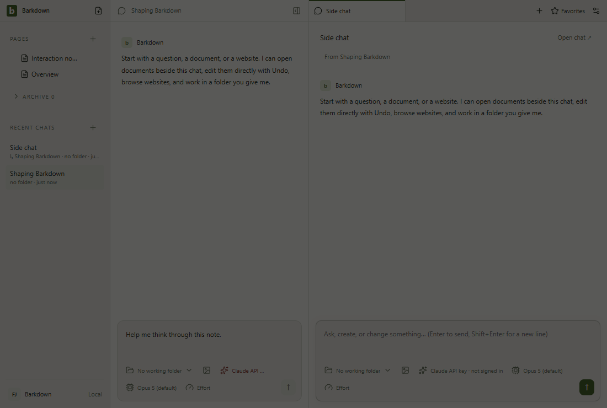

## side-chat: draft

within-tolerance; geometry changed: false; changed pixels: 0.

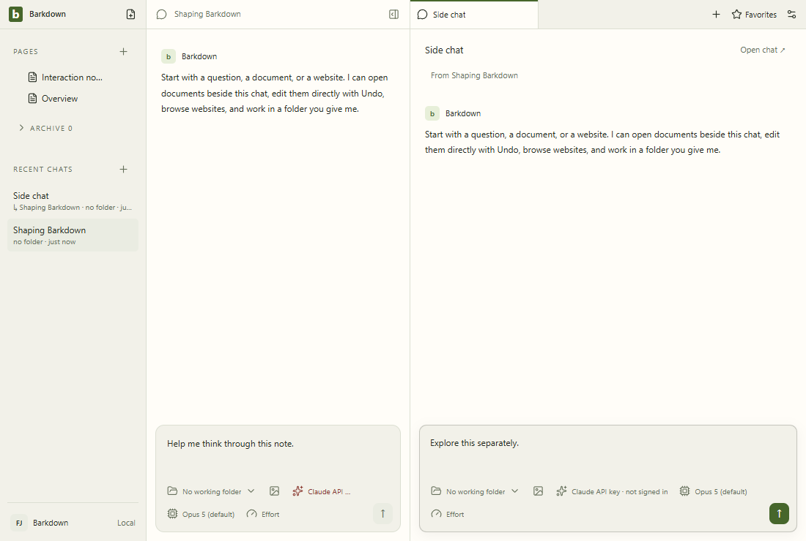

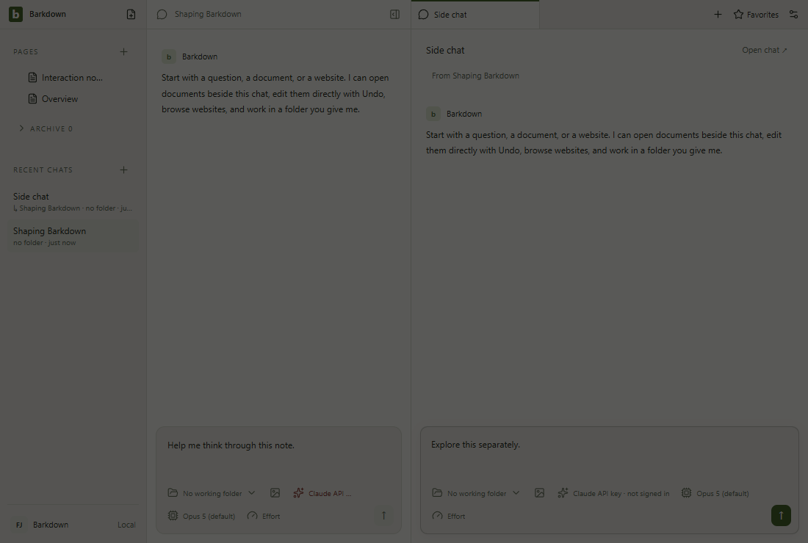

## side-chat: provider

within-tolerance; geometry changed: false; changed pixels: 0.

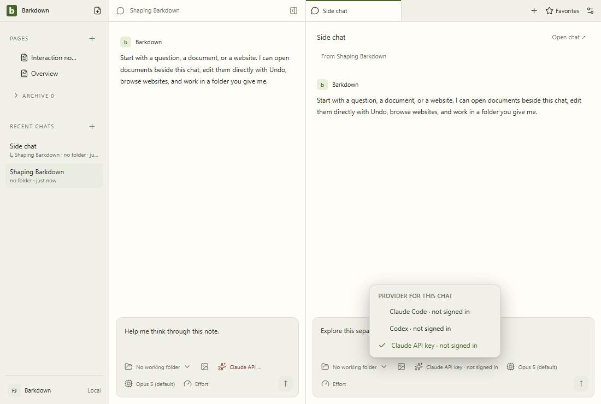

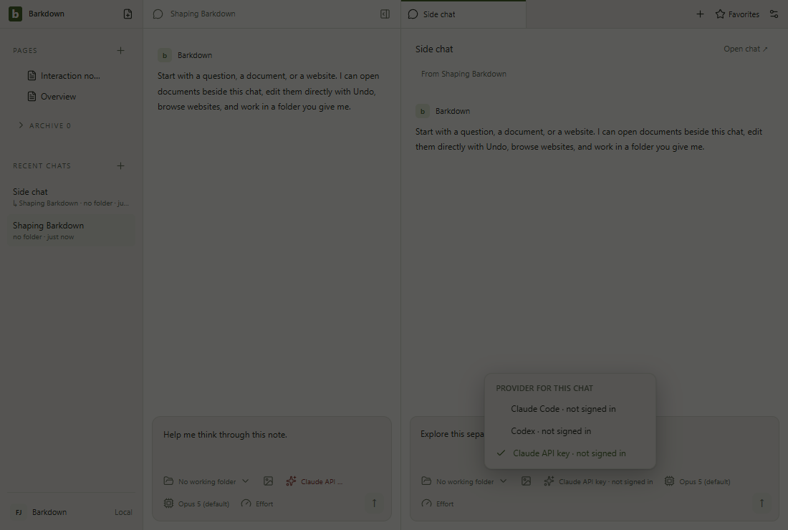

## side-chat: ready

within-tolerance; geometry changed: false; changed pixels: 0.

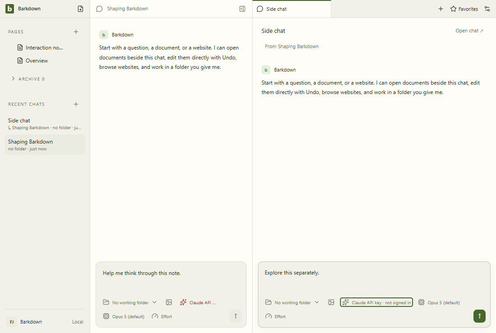

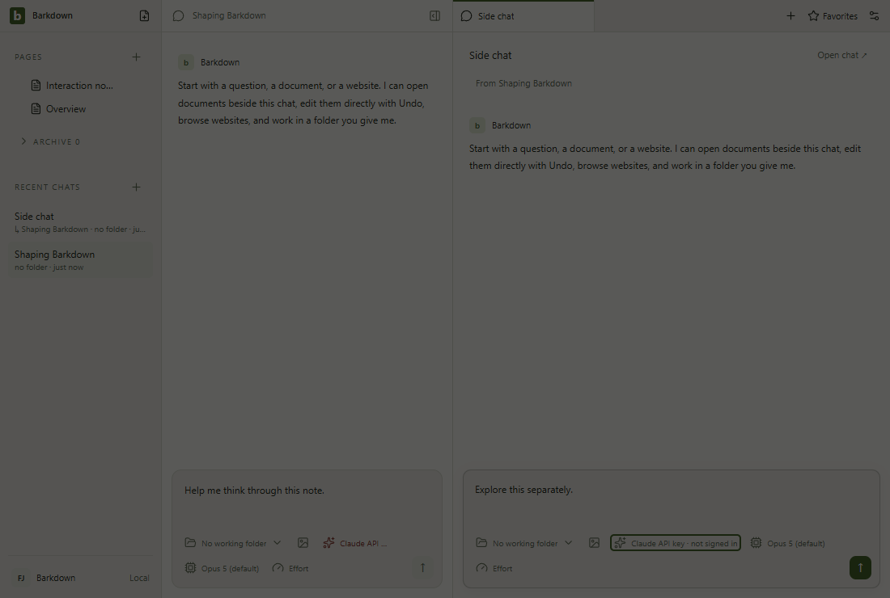

## documents: open

within-tolerance; geometry changed: false; changed pixels: 0.

## documents: dark

within-tolerance; geometry changed: false; changed pixels: 0.

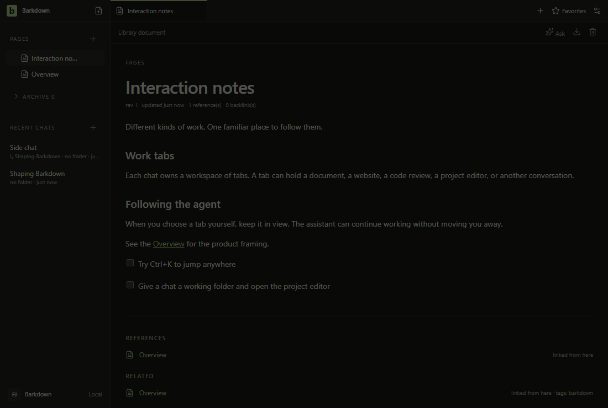

## documents: light

within-tolerance; geometry changed: false; changed pixels: 0.

## settings: general

within-tolerance; geometry changed: false; changed pixels: 0.

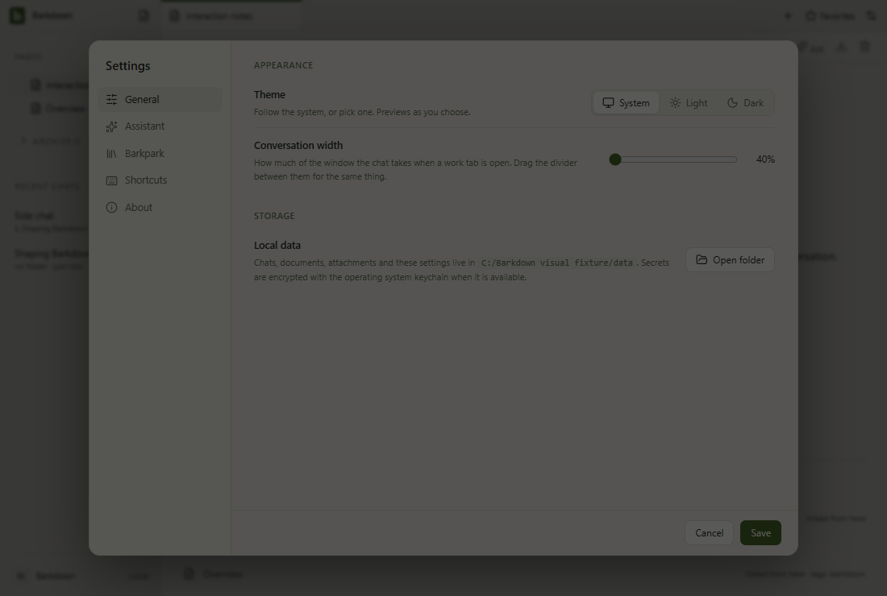

## settings: assistant

within-tolerance; geometry changed: false; changed pixels: 0.

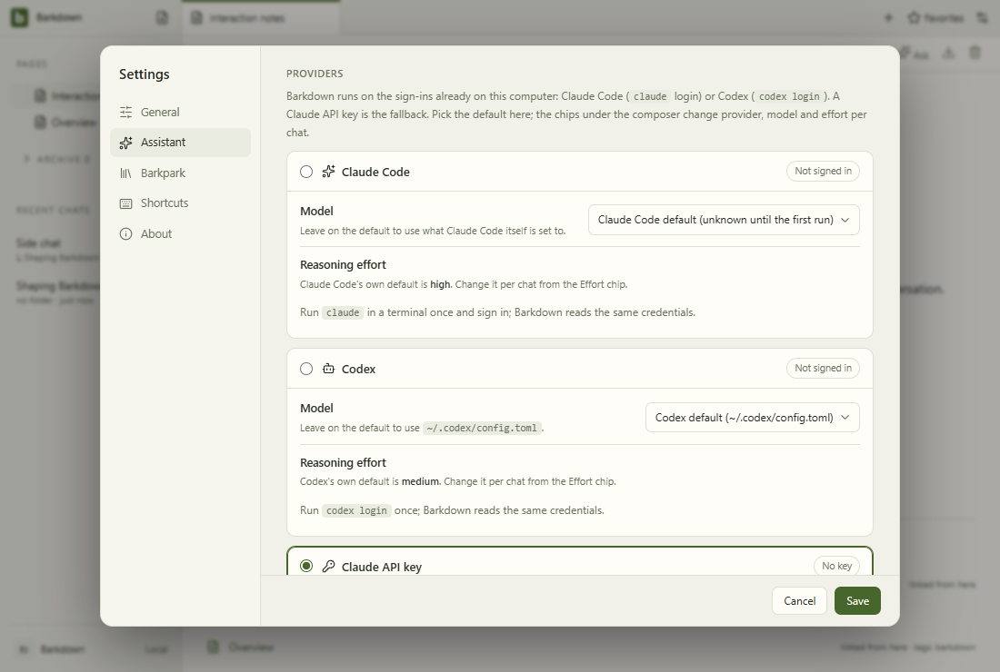

## settings: barkpark

within-tolerance; geometry changed: false; changed pixels: 0.

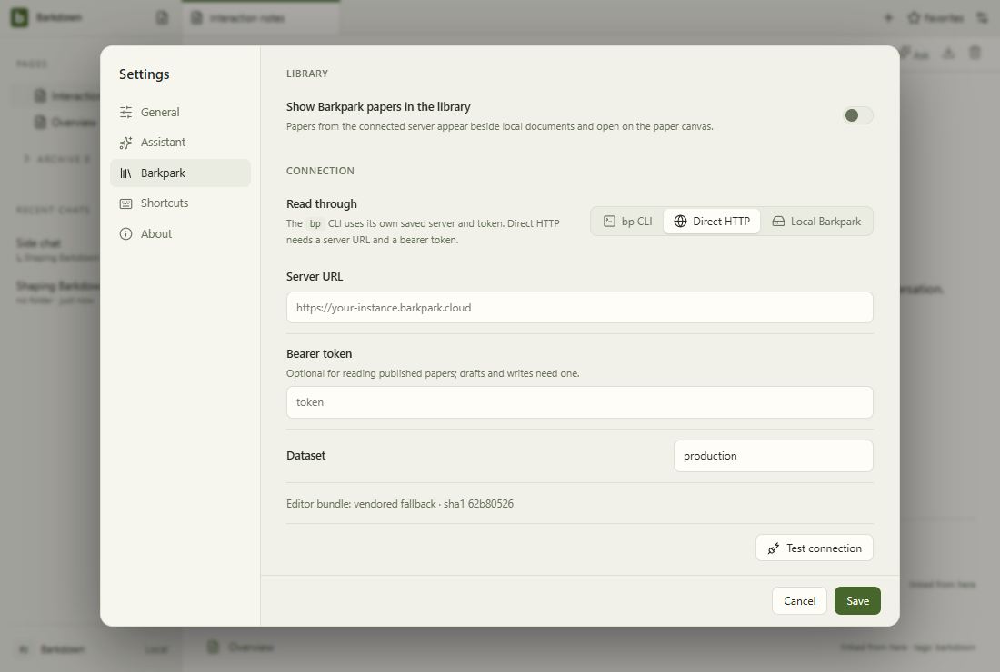

## settings: shortcuts

within-tolerance; geometry changed: false; changed pixels: 0.

## workspace motion

## chat motion

## side-chat motion

## documents motion

## settings motion

