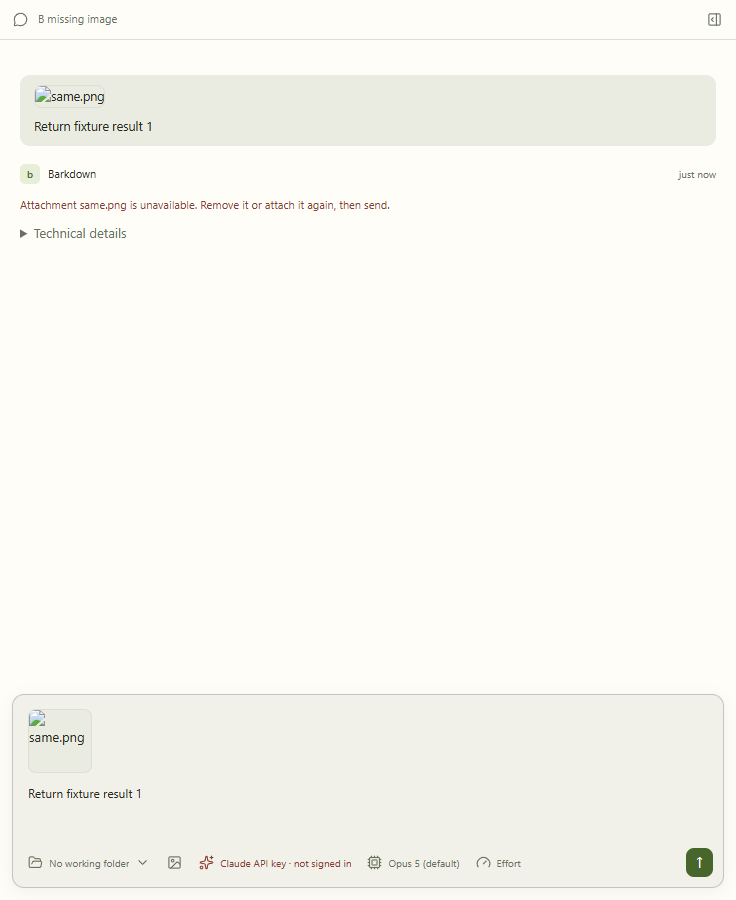
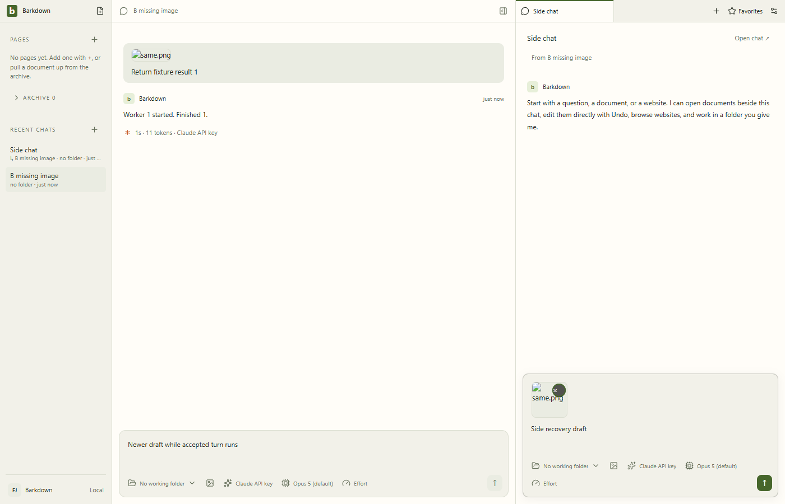
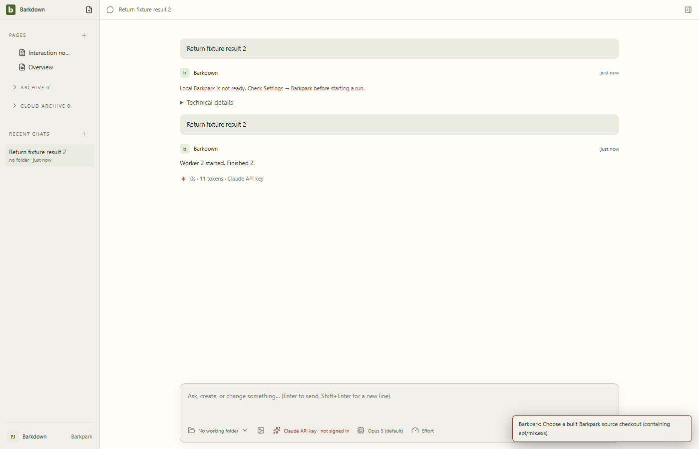
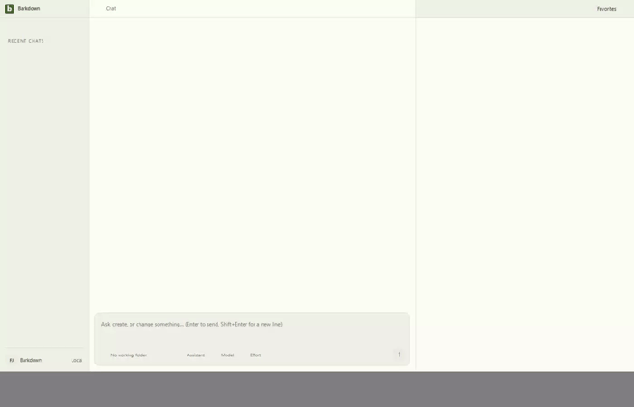

# Drafts survive rejected sends

C026 final source `1e138aa`. Actual Electron captures use disposable profiles and controlled HTTP. Fourteen full stills and 45 video samples were inspected; original videos and exact hashes are retained.

[Managed review](runs/1e138aa-managed/review.json) and [legacy review](runs/1e138aa-legacy/review.json) bind the final originals. Missing references remain until explicitly removed or restored. Both shared composers expose a 24px keyboard-reachable removal button; no-hover devices receive the visible control. Actual touch hardware was not tested.

Managed unaccepted optimistic rows do not become durable messages. Legacy definitely-not-dispatched rows remain visible but are excluded from retry history. Unknown dispatch outcomes remain history. Human-readable errors retain exact diagnostics under Technical details; wording never determines dispatch authority.

Earlier [managed raw-error review](runs/1434527-managed/review.json) and [legacy raw-error review](runs/9cc5f8a-legacy/review.json) remain unapproved UX evidence. [Failed legacy setup](runs/1434527-legacy-failed/README.md) and the [hover-fixture failure](runs/9ae22a6-hover-fixture-failed/original/manifest.json) are retained. Intermediate friendly-copy mouse captures remain in the 80ba196 folders, superseded by final keyboard proof.

Full desktop 44651 passed before the final CSS-only change; final actual 61539 passed. Deterministic final-source review passed. Live Paper and root closeout are recorded in the [cycle handoff](../../cycles/C026-send-preservation.md). No whole-P1 completion claim.
