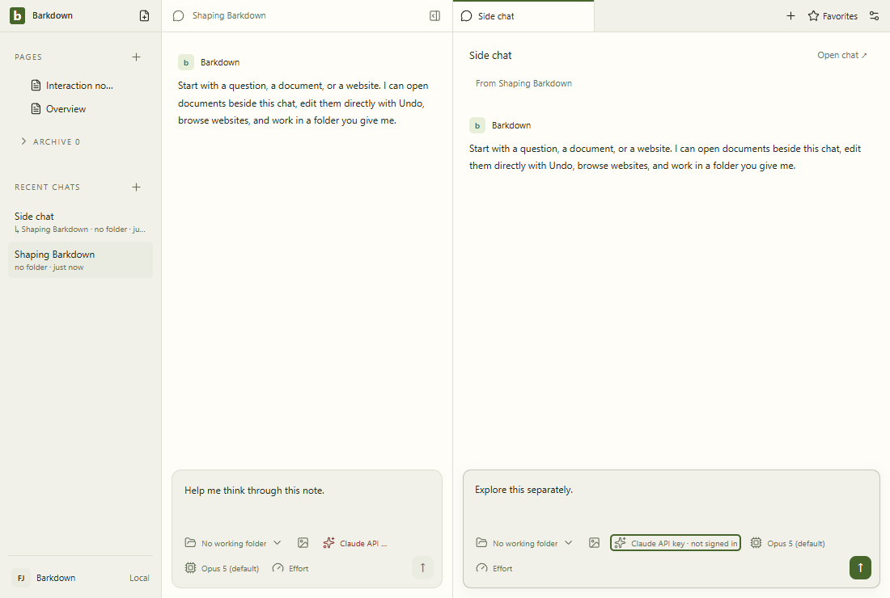

# side-chat

A real saved side conversation and its independent composer, using disposable fixture state.

[Full comparison](../runs/2026-09-22T00-00-37-127Z/README.md) · [Capture manifest](../runs/2026-09-22T00-00-37-127Z/manifest.json)

## Changelog

- 2026-09-22T00:02:29.029Z: Inspected all31 candidate action frames including narrow goals/settings. All pixels and geometry unchanged from reviewed baseline; seven GIFs use these same step frames. Separate actual Electron crash/reopen/reconcile/retry test passes with local deterministic SDK transport and synthetic environment credentials; its dedicated recovery views cover changed wording. No authenticated recovery or encrypted-key restart claim. Source e9be0194d; [review](../runs/2026-09-22T00-00-37-127Z/comparison.json).
- 2026-09-21T23:46:03.564Z: Inspected all31 raw action frames and seven step GIF frame sets, including full-size narrow profile Settings and prior goal narrow layout. Existing26 frames have zero changed pixels/geometry; Settings General reflow is the imported profile-settings structure, with legible local-data controls. Four new labelled fixture profile frames show selector, new-name input, narrow stacked controls and restore. Environment unchanged; no overlap or clipped controls observed, content scroll stays available.46 goal tests pass, including real owned process crash/recovery and large-image/history protocol; default-owned Electron SDK flow separately passed with local deterministic HTTP and inspected live-worker/result frames. Clean beefded authenticated3Codex proof is separate; this gallery does not claim actual profile switch or native crash execution. Full desktop and isolated Paper capture still running. Source 043e4727b; [review](../runs/2026-09-21T23-44-00-349Z/comparison.json).
- 2026-09-21T23:12:12.279Z: Inspected all 27 raw action frames via contact sheets and full-size390px goal view; six step-recorded GIFs map to those same27 frames. Existing21 frames have zero changed pixels or geometry changes; environment unchanged. Six new explicitly labelled fixture goal frames cover plan, three observed fixture workers, pause, narrow, restore and ordinary worker navigation. No clipping or unintended tracks; main content remains scrollable behind fixed footer. Goals/provider/service36 tests pass including real provider loops with deterministic transport, profile switch, stale saves and recovered termination guard. Full desktop suite and isolated live Paper capture are still running; these fixtures do not prove production IPC or authenticated goal execution. Source cde979434; [review](../runs/2026-09-21T23-10-09-960Z/comparison.json).
- 2026-09-21T22:38:14.738Z: Reviewed all 21 frames of combined C004 ownership and C005 scheduler/provider source f0568b5, including narrow and intermediate menu states, side-chat draft and local document themes. Zero pixel or geometry differences. 23 goal tests and 11 captured-ownership groups pass; no goal UI or authenticated model journey is claimed. Source f0568b508; [review](../runs/2026-09-21T22-36-51-168Z/comparison.json).
- 2026-09-21T22:29:05.986Z: Inspected all 21 fixture frames including narrow workspace, menus, side-chat independent draft, document light/dark and Settings. Comparison has zero changed pixels and no geometry/environment changes. Additive scheduler has 18 passing tests; no goal UI or live model integration is claimed. Source f9bc9e5fd; [review](../runs/2026-09-21T22-27-53-842Z/comparison.json).
- 2026-09-21T21:50:11.399Z: C002: reviewed all 21 action frames across five areas after folder-context and offline-fallback changes. No pixel differences above tolerance or control-geometry changes; environment unchanged. Request/dispatcher tests cover resumed and cleared folders, image-only turns and original-text offline navigation. Visual evidence does not measure live folder-answer latency. Source 3e2ed6fa0; [review](../runs/2026-09-21T21-48-36-561Z/comparison.json).
- 2026-09-21T21:34:25.844Z: Reviewed the CI startup-toast difference and corrected capture timing without hiding UI. New local capture matches all 21 prior frames and geometry; workspace dismissal image inspected again. Environment-change flag reflects newly recorded OS/architecture/font fields on the same local machine. Prior full visual and desktop regression evidence retained. Source 335b460f3; [review](../runs/2026-09-21T21-33-30-215Z/comparison.json).
- 2026-09-21T21:27:32.744Z: Repeatability review: all 21 action frames and control geometries match the inspected baseline within tolerance; environment unchanged. Initial full image review retained in prior approval. This records fixture UI only; live saves, provider behavior and recovery require their separate tests. Source e15d08c29; [review](../runs/2026-09-21T21-26-13-874Z/comparison.json).
- 2026-09-21T21:25:36.090Z: Initial baseline: inspected all 21 action frames across five areas, full-size settings and side-chat details, and GIF frame counts/dimensions. Navigation, menus, draft controls, themes and narrow layout remain visible. Fixture provider calls are blocked; no live save or recovery claim. Source e15d08c29; [review](../runs/2026-09-21T21-24-32-164Z/comparison.json).
