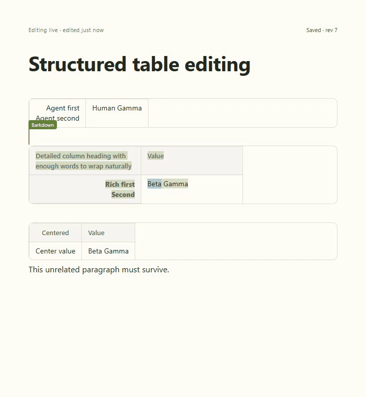
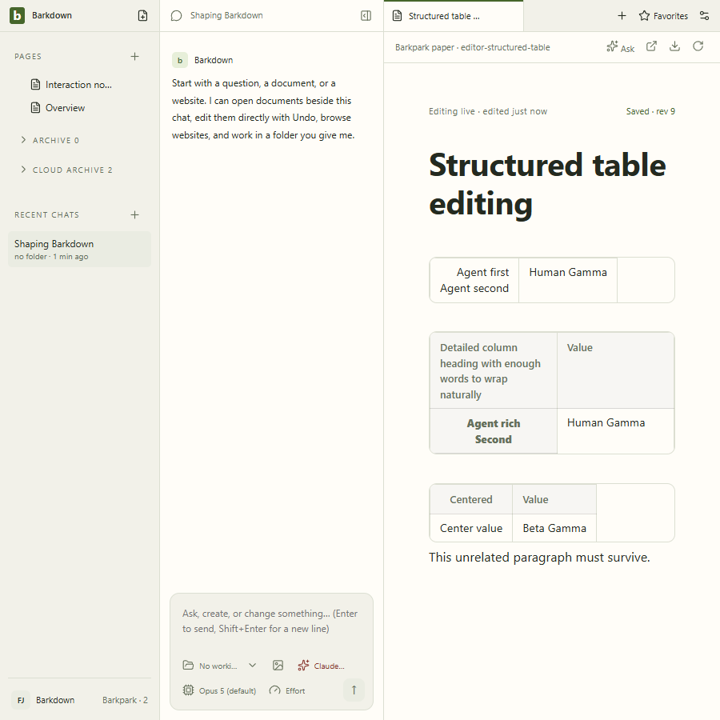

# E004 real structured table evidence

Source cd4b5c1; upstream01dfdd663. Private runtime DFG3Tq stopped normally. Three actual MCP cases pass: headerless, rich multiline, alignment-only. Each preserves backwards Beta selection, guarded Undo, repeated agent edit, full human input, acknowledged save, reload and exact structured export.

[Full continuous recording](structured-table.webm) · [Manifest](manifest.json) · [Actual visual review](review.json). GIF is seconds80–83 at10fps, cropped to the editor; full recording contains intentional viewport resize. No model turn in this dedicated test.
