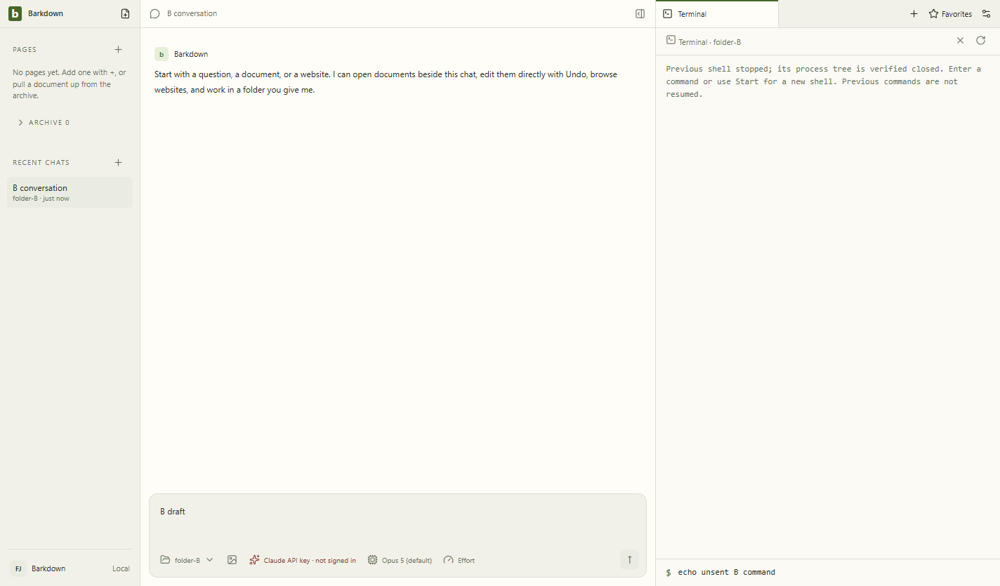
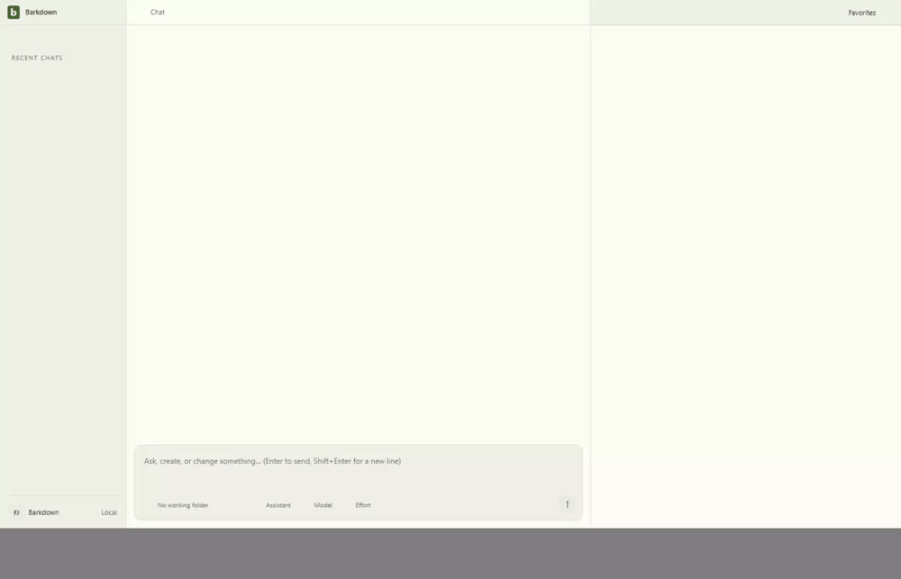

# Terminal ownership evidence

C018 source `db9b2ca` passed actual Electron A/B same-tab ownership, verified switch drain, abrupt main exit, restart without replay, draft retention, rapid Enter and legacy-shell checks. All four native jobs stopped; nine recorded descendants stopped. [Manifest](db9b2ca/manifest.json) · [Hash-bound review](db9b2ca/review.json) · [Cycle and limits](../../cycles/C018-terminal-ownership.md).

The GIF derives from the original [restart video](db9b2ca/page@645084400bcc50d9134138d436b19eea.webm). All seven stills, 17 one-second samples across three original videos and all 41 recovery frames were inspected; the GIF coalesces duplicate frames into 38 while retaining timing. Viewport resizing causes original-video letterboxing. [A/B switch video](db9b2ca/page@20a25ad2b659db690b9cf88d8045fda4.webm) · [Legacy terminal video](db9b2ca/page@67e6e5ebb697c1fd3beea0226689ff7b.webm).

The original `87b965e` baseline left three descendants alive after immediate-shell stop; those exact fixture PIDs were cleaned and verified stopped. This Windows pipe-terminal milestone does not claim a PTY, background terminals, non-Windows containment or persisted output/history. Live Paper status at db9b2ca is reviewed separately; final root verification passed (session33433).
