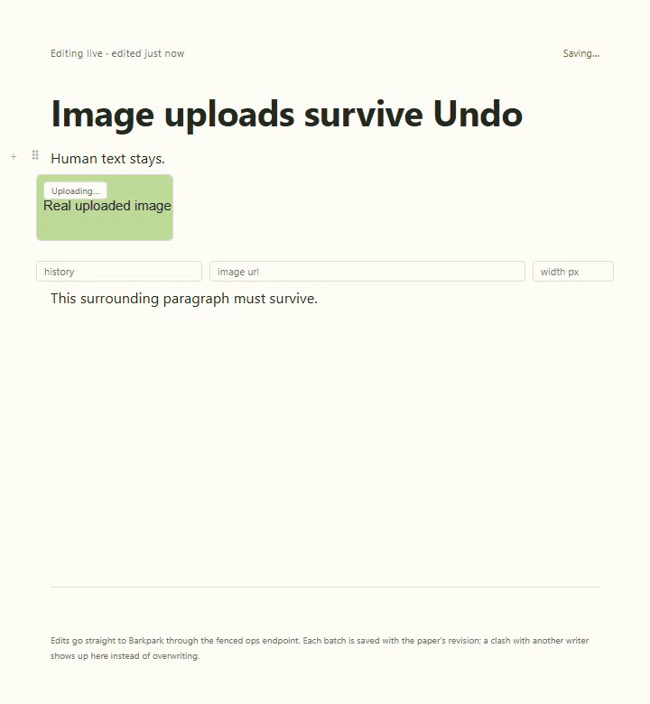
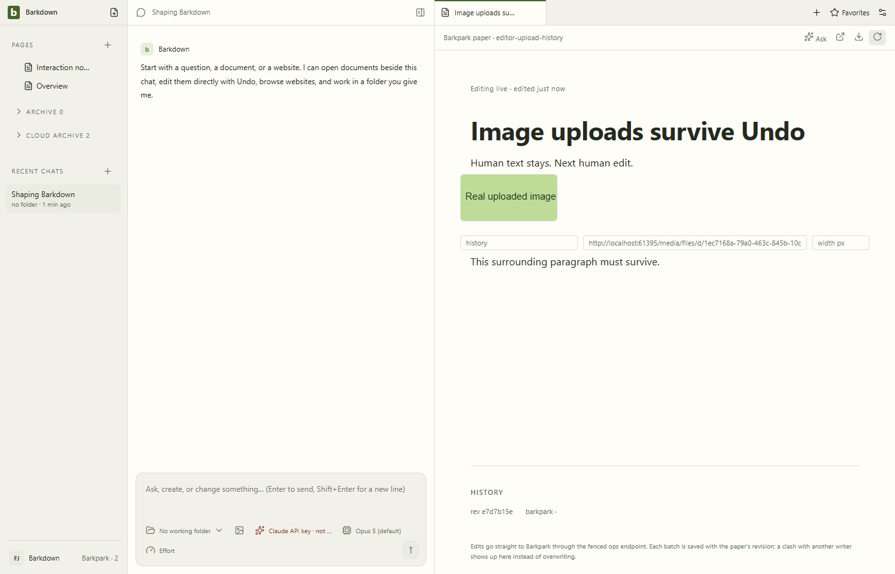

# Image upload history

E010 preserves a completed upload when native Undo temporarily removes its image. [Cycle handoff](../../cycles/E010-upload-history.md).

[Baseline](before-fix/chromium.json) uses trusted headless ClipboardItem and keyboard input, with a delayed injected uploader. Undo before completion followed by Redo restores a permanent pending placeholder. Completion after the normal history grouping interval also becomes a separate history action before the fix.

[Corrected headless review](runs/2026-09-22T04-16-50-774Z/review.json) binds exact artifacts/source. Both final images were inspected; the image renders after Redo and one Undo removes it. This is not actual server upload/reload evidence or the app visual baseline. Those checks remain pending.

Production source54579debe and nine mounted regressions are in isolated codex/canvas-upload-history. E009 remains independently frozen and has priority for its live window. No merge/deployment.

## Actual Paper history proof

[Clean0c73c7f/54579 manifest](runs/2026-09-22T05-11-00-573Z/manifest.json) records actual media upload, native history, human revision9 and server reload. [Review and hashes](runs/2026-09-22T05-11-00-573Z/review.json). Earlier pending statements above describe preserved checkpoints.

Sixstills,99video samples and30GIFframes reviewed. No duplicate upload; paragraphs persist. Document Saved can coexist with Uploading: restart recovery of an unfinished upload remains outside this proof. [Unbuilt-renderer failed attempt](runs/2026-09-22T05-08-54-282Z/manifest.json) remains separate.
