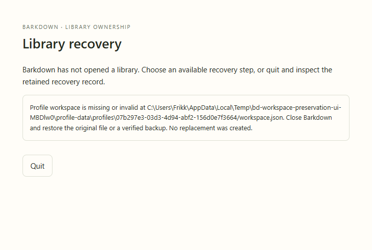
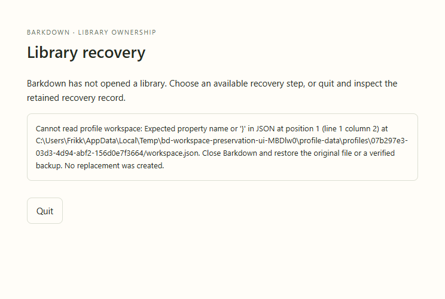
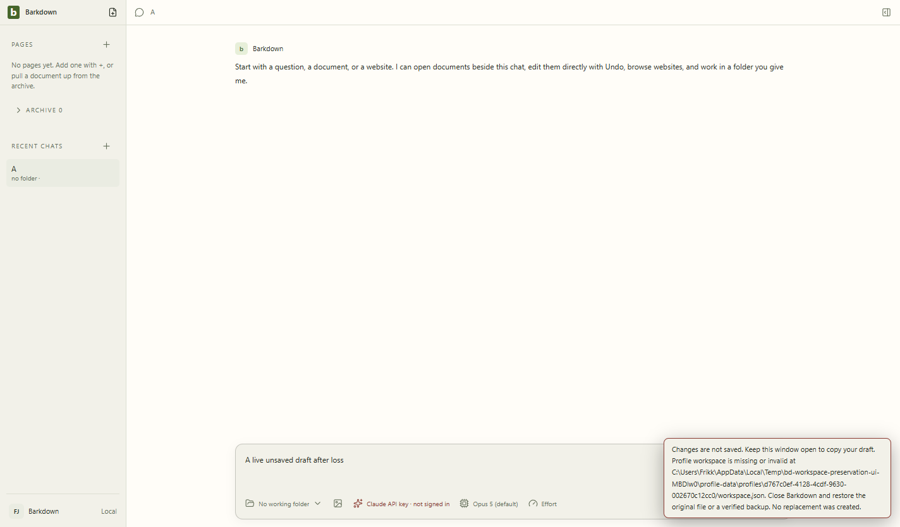

# Workspace recovery evidence

Source87ca623, branch codex/workspace-preservation-12h. Actual Electron process restart with disposable UUID profiles; no provider or Barkpark server. Fixture bd-workspace-preservation-ui-MBDlw0. Test: app/tests/workspace-preservation-ui.live.mjs.

Missing or corrupt selected B opens the existing isolated recovery window with a diagnostic path, restore guidance and Quit only. Invalid B selection preserves A and its draft. If the current file disappears while editing, saving refuses, an error is visible and the composer retains the unsaved text. No workspace file is synthesized; source bytes remain in retained fixture copies. The screenshots show actual outcomes, not injected visual states.

Reviewed all three actual images: readable wrapped paths, reachable Quit, draft retained, no observed clipping. The error toast is temporary and reappears on another failed save; it is not a durable replacement for a future recovery center. Copy the draft before closing. No automatic repair or whole-profile portability is claimed. There is no GIF for these separate process-restart outcomes yet; the generic recovery-window motion tour remains separately labeled as fixture evidence.

## Changelog

-2026-09-22 C012: registry initializes before publication; missing persisted workspace fails closed; startup recovery and failed-save warning proved in actual Electron. [Handoff](../../cycles/C012-workspace-preservation.md).
